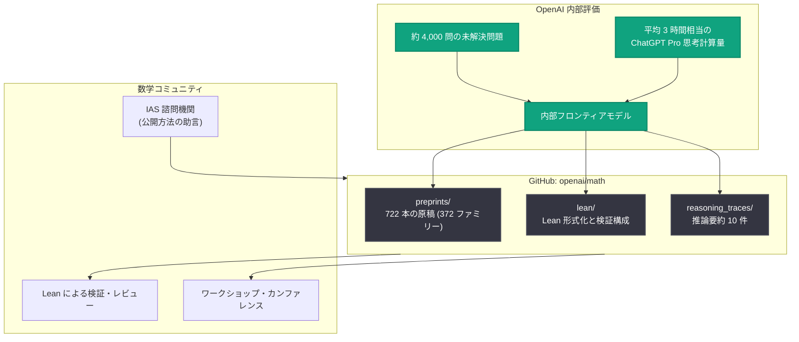

# 数学における AI の進展を共有: 内部フロンティアモデルによる新しい数学的成果の公開

## メタデータ

| 項目 | 内容 |
|------|------|
| 発表日 | 2026-10-06 |
| ソース | OpenAI Research |
| カテゴリ | 研究成果 (Publication) |
| 公式リンク | https://openai.com/index/sharing-ai-progress-in-mathematics |

## 概要

OpenAI は、未公開の内部フロンティアモデルが生成した広範な数学的成果を公開した。成果は GitHub リポジトリ ([openai/math](https://github.com/openai/math)) で公開され、722 本の原稿 (manuscript) が 372 のファミリーに整理されている。多くの証明については、コンピュータによる検証が可能な証明記述言語 Lean による形式化も併せて共有されており、今後も形式化が得られ次第リポジトリが更新される予定である。

今回のリリースにあたり、OpenAI はプリンストン高等研究所 (IAS) の独立諮問機関「Advisory Group on Mathematics and Artificial Intelligence」と協議し、その助言と公開勧告に基づいて成果の公開方法を設計した。科学的透明性を促進するため、モデルの推論過程の要約 10 件、ChatGPT Pro 利用換算での計算量の見積もり、挑戦した問題数の統計なども併せて公開されている。

## 主な内容

### 公開された成果の規模と構成

GitHub リポジトリには以下の内容が含まれる。

- **722 本の原稿を 372 のファミリーに整理**: ファミリーは関連する論文のグループで、主結果、補助的な議論、系 (結果の帰結)、別証明などを含む。各ファミリーは数学の分野ごとに分類されている
- **プレプリント**: `preprints/` ディレクトリに PDF、ソースファイル、原稿ごとの引用・ビルド手順を収録
- **Lean 形式化**: Lean ライブラリと形式化カタログ (`lean/formalization.yaml`) により、形式証明と対応する論文、検証構成を記述。多くの原稿が形式化済みだが、全てではない
- **概要資料**: `overview.pdf` で各ファミリーの説明を提供し、`CONTENTS.md` で個々の論文と補助資料を参照可能

成果には検証段階の異なるものが含まれており、Lean 形式化が付属しないものもある。形式化されていない結果には問題が含まれる可能性があり、OpenAI は問題が見つかった場合は迅速に修正するとしている。

### 成果の生成方法

結果の大部分は、未公開の内部 OpenAI モデルを用いた同一の手続きで得られた。

- **計算量**: 平均して 1 つの結果につき、ChatGPT Pro の思考 (thinking) 計算量換算で約 3 時間を使用
- **問題数**: 評価全体を通じて約 4,000 問が与えられた
- **背景**: 既存の数学ベンチマークで性能が飽和したため、未解決の研究問題による評価へと拡張された
- **例外**: リーマンゼータ関数の零点のない領域 (zero-free region) に関する研究と、CM アーベル多様体に対するホッジ予想の証明は固定手続きの例外である。また Re(s) > 11/12 の零点のない領域に関する論文は、読みやすさのために人間が編集している

### 推論過程の要約 (Reasoning Summaries)

モデルの推論の要約版が、以下の 10 件の結果について公開されている。

| ファミリー | 主題 |
|-----------|------|
| 007 | 乗法的関数の通常の 2 点相関 |
| 017 | 円周率 π の無理数度 (irrationality exponent) |
| 087 | 対称および一般の Mahler 予想 |
| 102 | 基本半正定値しきい値における NP 困難性 |
| 159 | 等差数列に対する準多項式的上界 |
| 197 | 標数 2 における Kaplansky の直有限性予想 |
| 221 | 希釈スピングラスに対する Mézard–Parisi 公式 |
| 271 | 量子ハイゼンベルク強磁性体における自発磁化 |
| 287 | 自由群因子環の同型問題 |
| 362 | 3 次元相対論的 Vlasov–Maxwell 系 |

### 数学コミュニティとの協調

OpenAI は、数学コミュニティとの成果共有方法を改善するため、IAS の独立諮問機関と協議し、ベストプラクティスの策定を進めている。今回のリリースでは、論文の改訂と引用のためのプロトコルを備えた GitHub リポジトリでの公開を選択した。公開履歴は保存され、訂正や改訂は新バージョンとして記録され、過去のバージョンも参照可能なまま維持される。委員会のガイドラインを満たすコミュニティホスト型の代替手段も引き続き検討されている。

さらに OpenAI は、AI が生み出した主要な成果の理解を深めるためのワークショップ、カンファレンス、特別プログラムの開催に資金を提供する予定である。

## 技術的な詳細

### Lean による形式検証

Lean は数学的証明をコンピュータで検証できるプログラミング言語である。形式化は単一の大規模ライブラリとして構成されており、一度に小さな部分のみをコンパイルすることが推奨されている。検証手順は Comparator README (`lean/ComparatorChallenges/README.md`) に記載されている。

なお、ライブラリ全体をコンパイルする場合、Linux の `vm.max_map_count` が低いと失敗する可能性があり、CMake オプション `-DMMAP=OFF` で Lean をビルドするなどの回避策が案内されている。

### 成果公開のワークフロー

## 開発者・研究者への影響

- **検証可能な AI 数学成果へのアクセス**: Lean 形式化により、研究者は AI が生成した証明を機械的に検証でき、信頼性の評価が容易になる
- **透明性の高い公開モデル**: 推論要約、計算量の見積もり、挑戦問題数の統計の公開は、AI による科学的成果の開示基準の先例となる
- **モデルの将来的な提供**: OpenAI はこれらの成果を生み出したモデルを責任ある形でリリースすべく取り組んでおり、科学者が最先端の能力を直接利用できるようになる可能性がある
- **コミュニティ参加の機会**: 資金提供されるワークショップや特別プログラムを通じて、AI が生成した主要な結果の理解と検証に数学コミュニティが参画できる
- **注意点**: 形式化されていない結果には誤りが含まれる可能性があるため、利用時には検証段階の確認が必要である

## 関連リンク

- [Sharing AI progress in mathematics (OpenAI 公式)](https://openai.com/index/sharing-ai-progress-in-mathematics)
- [openai/math リポジトリ (GitHub)](https://github.com/openai/math)
- [Institute for Advanced Study](https://www.ias.edu/)
- [Lean 公式サイト](https://lean-lang.org/)
- [OpenAI Research](https://openai.com/research)

## まとめ

OpenAI は、内部フロンティアモデルが生成した 722 本・372 ファミリーの数学的成果を GitHub で公開し、多くの証明に Lean 形式化を付与した。IAS の独立諮問機関の助言に基づく公開プロトコル、推論要約や計算量統計の開示など、AI による科学的成果の透明な共有方法を示した点が特徴である。平均 3 時間相当の ChatGPT Pro 思考計算量で 1 つの結果が得られており、円周率の無理数度や Kaplansky 予想など著名な問題に関する結果が含まれる。OpenAI はこのモデルの責任あるリリースにも取り組んでおり、AI と数学研究の協働が新たな段階に入ったことを示す発表である。
