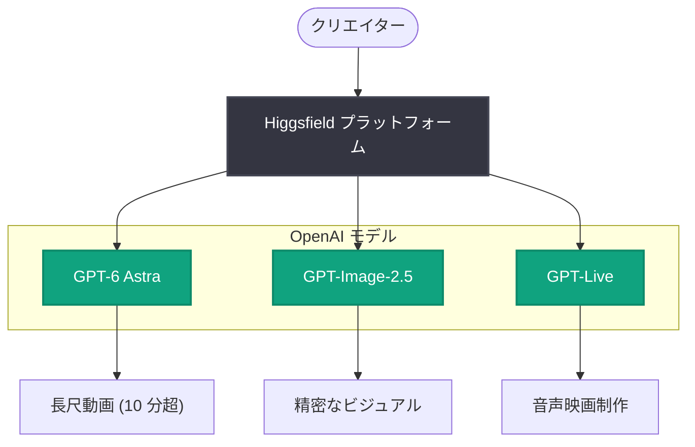

# Higgsfield、AI 動画を 1 分から 10 分超へ

## メタデータ

| 項目 | 内容 |
|------|------|
| 発表日 | 2026-10-13 |
| ソース | OpenAI News |
| カテゴリ | Startup (顧客事例) |
| 公式リンク | https://openai.com/index/higgsfield-longer-videos-voice |

> **注記 (情報の制約について)**: 本レポートは OpenAI News の公式 RSS フィードから取得したメタデータ (タイトルと説明文) のみを根拠に作成している。記事詳細ページは自動取得がブロックされており (HTTP 403)、本文中の具体的な統計値、引用、技術的詳細は確認できていない。確認できた範囲を超える記述は行わない。

## 概要

OpenAI は 2026 年 10 月 13 日、スタートアップの顧客事例として、AI 動画生成プラットフォームを手がける Higgsfield の記事を公開した。タイトルによれば、Higgsfield は AI 動画の生成時間を従来の 1 分から 10 分超へと拡大したという。

公式 RSS の説明文によると、Higgsfield はクリエイター向けに次の 3 点を実現している。

- **GPT-6 Astra** による、より長尺の動画生成
- **GPT-Image-2.5** による精密なビジュアル表現
- **GPT-Live** による音声映画制作 (voice filmmaking) への道筋

## 主な内容

### 長尺動画生成: GPT-6 Astra

記事タイトルおよび説明文によれば、Higgsfield は GPT-6 Astra を活用することで、AI 動画の長さを 1 分程度から 10 分を超える長尺コンテンツへと拡大した。短いクリップ生成が中心だった AI 動画の領域で、より長いストーリーテリングが可能になることを示す事例と位置づけられる。

### 精密なビジュアル: GPT-Image-2.5

説明文では、GPT-Image-2.5 により精密な (precise) ビジュアルをクリエイターに提供しているとされる。具体的な画質指標や機能の詳細は、本レポート作成時点では確認できていない。

### 音声映画制作への道: GPT-Live

説明文では、GPT-Live が音声映画制作 (voice filmmaking) への道を開くとされる。音声を軸とした映像制作ワークフローの構築を示唆するものだが、具体的な実装内容や提供時期は確認できていない。

## アーキテクチャ (推定される構成)

RSS 説明文で言及された 3 つのモデルと提供価値の対応関係を図示する (確認できた情報の範囲での整理であり、実際のシステム構成を示すものではない)。

## 開発者・クリエイターへの影響

確認できた情報の範囲で、次のような示唆が得られる。

- AI 動画生成の尺が 1 分から 10 分超へ拡大したことは、ショートクリップ中心だった AI 動画のユースケースを、より長いナラティブコンテンツへと広げる可能性を示す
- GPT-6 Astra、GPT-Image-2.5、GPT-Live という複数モデルの組み合わせにより、動画・画像・音声を統合した制作ワークフローを構築する事例が示された
- 音声映画制作 (voice filmmaking) という方向性は、音声インタラクションを起点とした新しい映像制作体験の登場を示唆する

詳細な API 仕様、料金、具体的なパフォーマンス数値などは本記事からは確認できていないため、公式記事および公式ドキュメントを参照されたい。

## 関連リンク

- [公式記事: Higgsfield takes AI video from 1 minute to over 10](https://openai.com/index/higgsfield-longer-videos-voice)
- [OpenAI News](https://openai.com/news)
- [OpenAI 公式ドキュメント](https://platform.openai.com/docs)

## まとめ

Higgsfield の顧客事例は、AI 動画生成が「1 分のクリップ」から「10 分超の長尺コンテンツ」へと進化していることを示す発表である。GPT-6 Astra (長尺動画)、GPT-Image-2.5 (精密なビジュアル)、GPT-Live (音声映画制作) という 3 つのモデルの活用が RSS 説明文で言及されている。なお、本レポートは公式 RSS メタデータのみを根拠としており、記事本文の詳細 (統計値、引用、技術仕様) は未確認である点に留意されたい。
