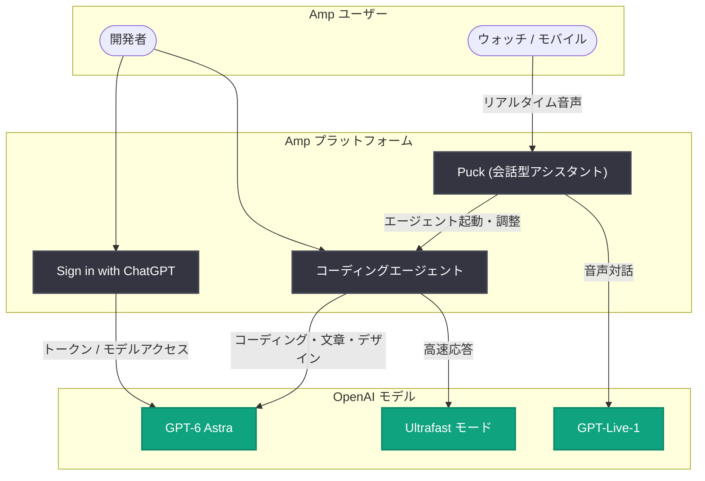

# Amp が OpenAI モデルでコーディングを超えた AI エージェント活用を推進

## メタデータ

| 項目 | 内容 |
|------|------|
| 発表日 | 2026-10-14 |
| ソース | OpenAI News |
| カテゴリ | スタートアップ (導入事例) |
| 公式リンク | https://openai.com/index/amp-beyond-coding |

## 概要

開発者向けのフロンティア AI エージェントを開発する [Amp](https://ampcode.com/) が、GPT-6 Astra、Ultrafast、GPT-Live-1、Sign in with ChatGPT といった OpenAI の最新モデル・機能を活用し、コーディングにとどまらない領域へエージェントの活躍の場を広げている事例が紹介された。Amp ではユーザーが消費するトークンの大半を OpenAI モデルが占めており、CEO の Quinn Slack 氏は「OpenAI モデルが一貫して向上し続けていることをユーザーは高く評価している」と述べている。

本事例では、トークンコストの制約を緩和する Sign in with ChatGPT 連携、文章作成・デザインにおける GPT-6 Astra の活用、GPT-Live-1 によるリアルタイム音声操作、Ultrafast モードによるエージェントワークフローの高速化という 4 つの取り組みが取り上げられている。

## 主な内容

### Sign in with ChatGPT による構築コストの低減

エージェントに任せる仕事が増えるにつれ、トークンコストが制約になり得る。Amp のユーザーの中には週に 100 億トークンを消費する人もいるという。Slack 氏は、利用量を逐一気にしているとエージェントの真の能力を引き出せなくなると考え、Sign in with ChatGPT 連携を導入した。

この連携により、Amp ユーザーはより多くのトークンと GPT-6 Astra を含む OpenAI モデルへアクセスでき、エージェントに大きなタスクを任せる心理的ハードルが下がった。「Sign in with ChatGPT によって、トークンを 1 つずつ数えなくてよい感覚が得られる。エージェントに長めの裁量を与えてみると、どれだけ多くのことができるかに気づく」と Slack 氏は語る。ユーザーは計画立案、何を作るかの意思決定、リリース後の作業継続にもエージェントを使い始めているという。

### GPT-6 Astra による文章作成・デザイン・創作

Amp はエージェントがプロダクトの構築と成長に関わるすべての仕事を支援することを目指しており、20 人のチーム自身がマーケティングを含めてその形で活用している。「マーケティング専任の担当者はいないが、専任のエージェントがいる」と Slack 氏は述べる。

GPT-6 Astra は、Amp の厳しい基準を満たすドキュメント作成とページデザインを支えている。「我々には非常に独特なデザインスタイルと文章スタイルがあり、こだわりが強いが、GPT-6 Astra の仕上がりには本当に満足している」(Slack 氏)。

Slack 氏は自宅でも GPT-6 Astra の実験を続けており、自宅の設計図を与えて Blender で 3D モデルを作成し、子供たちとそのモデルをゲーム化している (家の中にレイジーリバーを追加するなど)。「数カ月前には不可能だったことだ」という。

### GPT-Live-1 によるエージェントとの対話

Amp は最近、他のエージェントの起動・管理を支援する会話型 AI アシスタント「Puck」を発表した。ユーザーは Puck に対して、バグ調査のためのエージェント起動、複数エージェントの調整、過去の技術的な会話の検索などを依頼できる。

GPT-Live-1 を基盤とする「Calling Puck」により、ユーザーは腕時計からでもリアルタイムで Puck と会話できる。Slack 氏は、ランニング中などコンピューターから離れている間もエージェントを動かし続ける使い方を想定している。

### Ultrafast によるエージェントワークフローの高速化

Amp は GPT-6 Astra の Ultrafast モードをテストしており、速度の向上がエージェントの使い方自体を変えると Slack 氏は指摘する。現在、ユーザーは各タスクの完了を待つ間に複数のエージェントタスクを切り替えて作業することが多いが、応答が高速化すれば、扱うエージェント数を減らせたり、エージェントが結果を返す前に自己検証する時間を確保できたりする。

「これほど優秀で、これほど速いモデルを人々は見たことがない」と Slack 氏は評価している。

## アーキテクチャ

## 開発者への影響

- **トークンコストの心理的制約の緩和**: Sign in with ChatGPT 連携により、サードパーティ製エージェントツールでも ChatGPT のサブスクリプションを通じてトークンとモデルへアクセスできるパターンが広がりつつあり、エージェントに大きなタスクを任せやすくなる
- **コーディング以外へのエージェント適用**: GPT-6 Astra はドキュメント作成、ページデザイン、マーケティングなど、プロダクト開発の前後工程でも実用水準に達しており、小規模チームが専任担当者なしで業務をカバーする事例が示された
- **音声によるエージェント管理**: GPT-Live-1 のようなリアルタイム音声モデルを使えば、コンピューターから離れていてもエージェントの起動・調整・状況確認が可能になり、エージェント運用の新しい UI として音声が有力になる
- **高速モデルによるワークフロー変化**: Ultrafast モードのような高速応答は、複数エージェントの並行運用から少数エージェントへの集中、またはエージェント自身による自己検証時間の確保といった運用スタイルの変化をもたらす可能性がある

## 関連リンク

- [Amp puts AI agents to work beyond code with OpenAI models (OpenAI)](https://openai.com/index/amp-beyond-coding)
- [Amp 公式サイト](https://ampcode.com/)
- [OpenAI News](https://openai.com/news)
- [OpenAI 公式ドキュメント](https://platform.openai.com/docs)

## まとめ

Amp の事例は、AI エージェントの用途がコーディングから、計画立案、文章作成、デザイン、マーケティング、さらには 3D モデリングによる創作まで拡大していることを示している。Sign in with ChatGPT によるコスト制約の緩和、GPT-6 Astra の品質、GPT-Live-1 の音声対話、Ultrafast の速度という 4 つの要素が組み合わさることで、「エージェントに長い裁量を与える」働き方が現実になりつつある。
