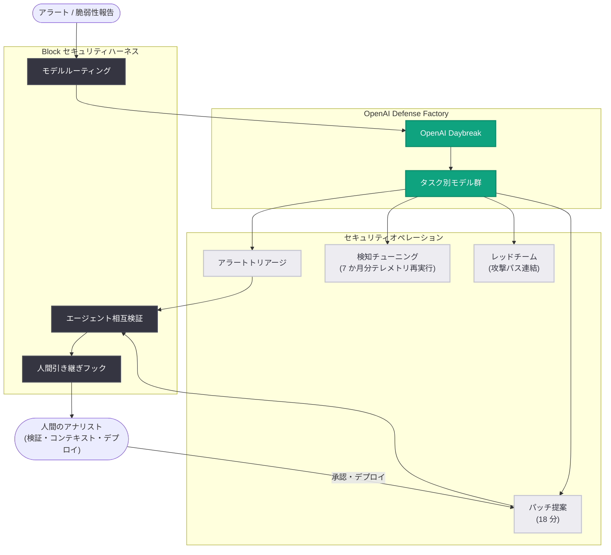

# Block が OpenAI 技術で構築する AI セキュリティ: 脅威調査の高速化とパッチ提案の分単位化

## メタデータ

| 項目 | 内容 |
|------|------|
| 発表日 | 2026-10-14 |
| ソース | OpenAI News |
| カテゴリ | 顧客事例 (カスタマーストーリー) |
| 公式リンク | https://openai.com/index/block-ai-powered-security |

## 概要

Square、Cash App、Afterpay を運営する Block のセキュリティチームが、OpenAI の「Defense Factory」と AI システム「Daybreak」を活用し、脆弱性の発見・検知・対応を人間のチームでは不可能な規模で実行している事例が公開された。従来は数週間かかっていた作業が数時間で完了するようになり、レッドチーム演習では脆弱性報告から自動パッチ提案までわずか 18 分を達成している。

Block の CISO である James Nettesheim 氏は、「AI は人間の意図から行動までの時間を圧縮している。これまでは攻撃者が優位とされてきたが、Daybreak や OpenAI のツールの進化により、防御側も同じ速さで対抗できるようになった (defenders are able to fight fire with fire)」と述べている。

## 主な内容

### 新しいチームメイトとしての AI

Block のセキュリティチームは、コード生成からセキュリティオペレーションまで、ワークフロー全体に AI を責任を持って導入することに注力してきた。Nettesheim 氏は AI を「スケールできる新しいチームメイト」と位置づけ、ステップごとに定義が必要な従来型の自動化とは異なり、「かなり曖昧な問題をそのまま提示して、一緒に解決を進められる」点が本質だと説明している。

ソフトウェアバグのレビューやログの解析といった、従来は数日から数週間かかっていたプロジェクトを、現在は大幅に短い時間で完了できる。ただし、すべての結果は人間が検証している。

### 検知チューニングの高速化

各調査では生のクエリ証拠が保存されており、提案された検知ルールの変更を 7 か月分の本番テレメトリに対して 1 時間以内で再実行 (リプレイ) できるようになった。従来は数百件の過去ケースを手作業で再クエリする必要があり、時間がかかりすぎるため実際にはほとんど行われていなかった作業である。

### タスクに応じたモデル選択とセキュリティハーネス

チームはタスクごとに使用するモデルを使い分けるようになった。Nettesheim 氏は「以前は常に最新モデルを使っていたが、もうその必要はない。タスクごとに異なるモデルを選ぶことは学びの経験だった」と述べている。

Block のセキュリティハーネスは Daybreak 上に構築されており、以下の機能を持つ。

- タスクを適切なモデルへルーティング
- 人間がタスクを引き継ぐためのフック
- エージェント同士が相互に作業を検証する仕組み
- 内部ベンチマークと実運用パフォーマンスによる継続的な評価と、必要に応じた人間レビューへのルーティング

### キャンペーンの発見: 1 件のアラートから大規模対処へ

1 台のラップトップで発生したアラートは、単体では軽微なポリシー違反に見えた。しかしピアレビュー中にモデルが、証拠内に偶発的にしか現れていなかった指標を追跡し、Block のアイデンティティログと突合することで、はるかに大きな問題群を発見した。Nettesheim 氏は「日常的なエンドポイントアラート 1 件がキャンペーンの摘発につながった。この結合を行える単一のツールは存在しない。シグナルは 2 つの製品のログを横断して初めて存在する」と述べている。

### レッドチーム演習: 2 時間での攻撃パス連結

最近のレッドチーム演習では、内部システムに関するわずかなヒントを与えられたモデルが、SQL インジェクション、権限昇格、足がかりの確保、認証情報の列挙、他システムへのピボットという完全な攻撃パスを約 2 時間で連結した。人間のレッドチーム担当者であれば通常数日かかる作業である。また、高レベルの脆弱性報告から自動パッチ提案までの時間は 18 分だった。

### 修復プロセスと人間の役割

すべての発見事項に対して、チームは次のプロセスを実行する。

1. 問題がコードのどこにあるかを特定し、所有者を明らかにする
2. パッチを提案する
3. 悪用可能性 (エクスプロイタビリティ) を確認する
4. 修正されたことを検証する (人間がループに入り、コード変更をガイド・デプロイ)

エージェントは技術的には有能だが、組織のコンテキストや過去の意思決定の背景を持たない。それを補うのが人間のレビュー層であり、AI の判断力が実運用で実証されるにつれ、「より機密性の高いシステムへ段階的にリスクレベルを引き上げていく」方針だという。

## アーキテクチャ

## 成果の概要

| 項目 | 数値 |
|------|------|
| 検知変更の 7 か月分テレメトリ再実行 | 1 時間未満 |
| 脆弱性報告から自動パッチ提案まで (レッドチーム演習) | 18 分 |
| 誤検知トリアージから取り戻した時間 | 四半期あたり約 600 アナリスト時間 |
| 完了した調査作業量 | 四半期あたり約 1,100 アナリスト時間 |
| トリアージのスループット向上 | 50% |
| 情報収集・調査の増加 | 50% |
| 新機能 | 完全自律型ハンティング能力 |

Nettesheim 氏は調査能力について、「すべてのアラートが、関係するすべての要素にわたって完全かつ深い調査を受けるようになった。我々のシステムは、すべてのアラートをその日唯一のアラートであるかのように扱う」と述べている。

## 開発者への影響

- **セキュリティへの AI 適用パターンの参考例**: 単一モデルの利用ではなく、タスク別モデルルーティング、エージェント相互検証、人間への引き継ぎフックを備えたハーネスを構築するアーキテクチャは、エージェントシステムを設計する開発者にとって実践的な参考になる
- **Human-in-the-loop の段階的拡大**: すべての結果を人間が検証しつつ、AI の判断力が実証されるにつれて機密性の高いシステムへ適用範囲を広げるという、リスクを管理した導入モデルを示している
- **証拠の保存によるリプレイ可能性**: 調査ごとに生のクエリ証拠を保存することで、検知ルール変更を過去テレメトリに対して再実行できる設計は、セキュリティ基盤に限らず評価・回帰テストの考え方として応用できる
- **防御技術の民主化**: Nettesheim 氏は「OpenAI は優位性を防御側にシフトさせている。これまで高度な防御能力は著名テック企業や政府の手にしかなかったが、重要インフラ、学校、中小企業も自らのネットワーク防御にこの技術を使い始められる」と述べており、小規模組織でも高度なセキュリティ自動化が現実的になりつつある

## 関連リンク

- [How Block is building AI-powered security with OpenAI technology (原文)](https://openai.com/index/block-ai-powered-security)
- [OpenAI News](https://openai.com/news)
- [OpenAI 公式ドキュメント](https://platform.openai.com/docs)

## まとめ

Block は OpenAI の Defense Factory と Daybreak を中核に、独自のセキュリティハーネスを構築し、検知チューニング、脅威ハンティング、レッドチーム演習、パッチ提案までを AI で高速化した。7 か月分のテレメトリ再実行が 1 時間未満、パッチ提案まで 18 分、四半期あたり約 1,100 アナリスト時間相当の調査を実現しつつ、すべての結果を人間が検証する Human-in-the-loop 体制を維持している。攻撃者優位とされてきたセキュリティ領域で、AI によって防御側へ優位性がシフトしつつあることを示す事例である。
