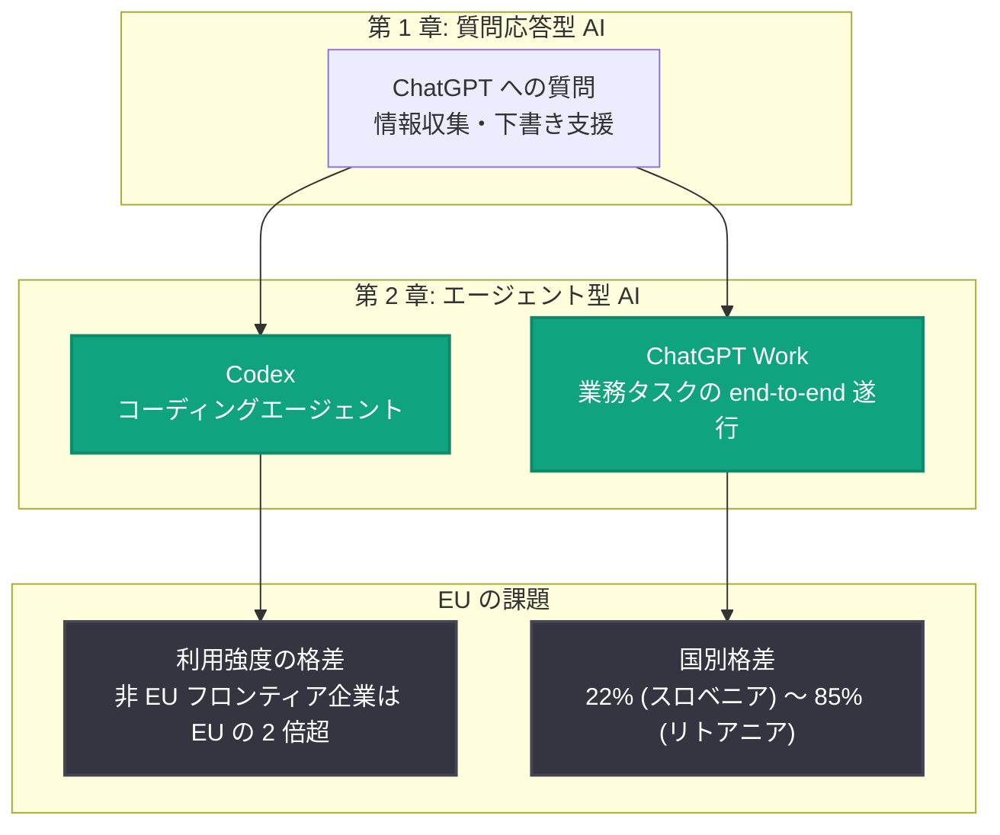

# EU における AI の次章はエージェント型へ: EU 企業のエージェント型 AI 導入分析

## メタデータ

| 項目 | 内容 |
|------|------|
| 発表日 | 2026-10-14 |
| ソース | OpenAI News (Global Affairs) |
| カテゴリ | 経済分析 / エージェント型 AI |
| 公式リンク | https://openai.com/index/the-eus-next-chapter-in-ai-is-agentic |

## 概要

OpenAI の経済調査チーム (Economic Research) は、EU 全域の企業や中小企業において、AI に質問をする段階から、タスクを最初から最後まで完了させるエージェント型ツールを活用する段階へと移行が進んでいることを示す新たな分析を発表した。ChatGPT の利用強度と業務内容の分析に基づき、EU のエンタープライズ利用では Codex と ChatGPT の業務利用が出力トークン全体の半分以上を占めるなど、エージェント型 AI の普及が急速に進んでいることが明らかになった。

一方で、EU 域内の国ごとの導入状況には大きなばらつきがあり、利用強度の面では EU 企業と非 EU 企業の間に依然として差が存在する。レポートは、幅広い導入をより深い活用へと転換することが、EU の生産性向上と労働者への恩恵につながると結論づけている。

## 主な内容

### エンタープライズにおけるエージェント型利用の拡大

EU のサンプルにおいて、エージェント型の利用はすでに ChatGPT Enterprise のアクティビティの大きな割合を占めている。具体的には、Codex と ChatGPT の業務利用 (ChatGPT Work) が全出力トークンの半分以上を生成している。これは、AI が単なる質問応答ツールから、実際の業務を遂行するエージェントへと役割を変えつつあることを示している。

### 中小企業 (SMB) での 8 倍超の成長

従業員 200 名以下のユーザーが紐づく企業を中小企業 (SMB) と定義した分析では、2026 年 5 月以降、EU の SMB における Codex と ChatGPT Work の週間アクティブユーザー数が 8 倍以上に増加した。この成長は EU の全加盟国で確認されており、エージェント型 AI の普及が大企業にとどまらず、中小企業にも広がっていることを示している。

### 国ごとの導入格差

エージェント型 AI の導入状況は EU 域内でも均一ではない。サンプルとなったエンタープライズアカウントにおける Codex と ChatGPT Work の出力トークン比率は、最低のスロベニアで 22%、最高のリトアニアで 85% と大きな開きがある。また、ChatGPT に持ち込まれる業務の種類も国によって異なる。

### フロンティア企業と利用強度の差

アクティブユーザーあたりの出力トークン数で上位 10% に入る企業を「フロンティア企業」と定義した分析 (Enterprise および Business アカウントが対象) では、以下の差が明らかになった。

- 2026 年 9 月時点で、EU のフロンティア企業は EU の一般的な企業と比較して 4 倍超の出力トークンをアクティブユーザーあたりで生成
- 非 EU のフロンティア企業は、EU のフロンティア企業の 2 倍超の出力トークンをアクティブユーザーあたりで生成
- 世界のフロンティア企業に占める EU 企業の割合はわずか 10% であり、世界の登録企業数に占める EU のシェアと比較して低い水準

### 格差を埋めるための提言

レポートは、EU の機会は幅広い導入をより深い活用、より強い企業、より高い生産性、そして労働者への恩恵に転換することにあると指摘し、格差を埋めるために以下を提言している。

- 企業が実験段階を脱して本格活用に移行できるよう支援する
- 労働者が AI を使いこなすスキルと自信を身につけられるようにする
- 高度な AI 機能をより利用しやすく、手頃な価格で提供する

OpenAI の CFO である Sarah Friar 氏は、欧州は「人々のためにタスクを遂行できるツールを備えた、AI の新時代」に入ったと述べ、EU のエンタープライズおよびビジネス顧客の利用の半分以上がこれらのツールに関わるものになったこと、SMB ユーザーが域内で 8 倍に成長したこと、そして依然として大きな成長余地があることを強調した。

## エージェント型 AI 導入の構図

## 開発者への影響

- **エージェント型ツールへの需要拡大**: EU 市場では Codex や ChatGPT Work のようなタスク遂行型ツールの利用が急増しており、エージェント型のワークフローを前提としたアプリケーションやインテグレーションの需要が今後さらに高まると見込まれる
- **SMB 向けソリューションの機会**: 中小企業での週間アクティブユーザーが 8 倍超に成長しており、SMB 向けのエージェント型 AI 導入支援やツール開発に大きな市場機会がある
- **国別の成熟度を考慮した展開**: EU 域内でも導入状況の差が大きいため、EU 向けプロダクトを展開する際は国ごとの AI 活用成熟度を考慮した戦略が有効
- **利用強度を高める設計**: 単発の質問応答にとどまらず、業務プロセスに深く組み込まれたエージェント型の体験を設計することが、フロンティア企業との格差を埋める鍵となる

## 関連リンク

- [The EU's next chapter in AI is agentic (OpenAI 公式)](https://openai.com/index/the-eus-next-chapter-in-ai-is-agentic)
- [OpenAI News](https://openai.com/news)
- [OpenAI Codex](https://openai.com/codex/)
- [ChatGPT Enterprise](https://openai.com/chatgpt/enterprise/)

## まとめ

OpenAI の分析により、EU の企業は質問応答型の AI 利用からエージェント型の AI 活用へと移行しつつあり、エンタープライズでは出力トークンの半分以上を Codex と ChatGPT Work が占め、SMB では 2026 年 5 月以降に週間アクティブユーザーが 8 倍以上に成長したことが示された。一方で、国別の導入格差 (22%〜85%) や、非 EU フロンティア企業との利用強度の差 (2 倍超) も明らかになっており、EU がこの格差を埋めるには、企業の本格活用への移行支援、労働者のスキル向上、高度な AI 機能へのアクセス改善が重要となる。
