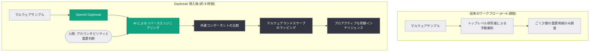

# SentinelOne が OpenAI Daybreak でマルウェア解析を数週間から数時間に短縮

## メタデータ

| 項目 | 内容 |
|------|------|
| 発表日 | 2026-10-14 |
| ソース | OpenAI News |
| カテゴリ | 導入事例 (カスタマーストーリー) |
| 公式リンク | https://openai.com/index/sentinelone |

## 概要

サイバーセキュリティ企業の SentinelOne は、OpenAI のサイバーセキュリティ向けプラットフォーム「Daybreak」を活用し、マルウェアのリバースエンジニアリング作業を劇的に高速化した。従来はトップレベルのセキュリティ研究者でも高度なマルウェアの解析に 4〜6 週間を要していたが、Daybreak の導入により人間レベルの解析成果を約 8 時間で生成できるようになった。

解析の高速化により調査可能な脅威の数が大幅に増加し、マルウェア間の関係性をマッピングすることで、従来は手が届かなかったプロアクティブな防御インテリジェンスの獲得が可能になったとしている。

## 主な内容

### リバースエンジニアリングの劇的な高速化

SentinelOne は、ソフトウェアを分解してその挙動を理解するリバースエンジニアリングに Daybreak を使用している。同社のチーフ AI オフィサーである Gregor Stewart 氏は、「AI は人間レベルのアウトプットを約 8 時間で実現している」と述べており、従来 4〜6 週間かかっていた高度なマルウェア解析が数時間に短縮された。

### マルウェアランドスケープのマッピング

従来は、リソースの制約から深い調査を重要な脅威のみに限定せざるを得ず、解析できるのは「ごく少数のソフトウェア」のみだった。Daybreak により次のことが可能になった。

- より多くのマルウェアサンプルを調査する余力の創出
- 複数サンプル間で共通コンポーネントを比較し、一見無関係なマルウェア同士のつながりを発見 (顧客調査の手がかりになる)
- 脅威間の関係性の把握による、より先回りしたプロアクティブな防御

Stewart 氏は「より高速なリバースエンジニアリングによって、マルウェアランドスケープのはるかに大きな部分をマッピングできる」と述べ、これを「以前は決して手が届かなかった種類のインテリジェンス」と表現している。

### 人間の役割とアカウンタビリティ

Stewart 氏は自動化の限界について、「自動化できない唯一のものはアカウンタビリティ (説明責任) である」と明言している。

- **アーキテクチャ変更**: ソフトウェアの根本に関わる重要な判断には人間の確認が必要
- **ポイント修正**: ソフトウェアの根本を変えない作業は自動化に適している

### セキュリティ業務の民主化

以前は少数の専門家に依存していた専門知識に、社内のほぼ全員がアクセスできるようになり、より多くのメンバーが自ら問題を調査できるようになった。今後はコード作成段階にもサイバー機能を組み込み、開発者がビルド時にセキュリティ問題へ対処できるようにする計画である。

Stewart 氏は「OpenAI はエキスパートレベルのサイバー能力を提供することで、優位性を防御側にシフトさせている」と締めくくっている。

## アーキテクチャ

## 開発者への影響

- **セキュリティ解析の AI 活用モデル**: 専門家が数週間かけていた高度な解析タスクを AI で数時間に短縮できることが実証され、セキュリティ分野での AI 導入の具体的なベンチマークとなる
- **人間と AI の役割分担の指針**: アカウンタビリティと重要判断は人間が担い、定型的な解析や修正は AI に任せるという実践的な分担モデルが示された
- **シフトレフトの加速**: コード作成段階にサイバー機能を組み込む計画は、開発者がビルド時にセキュリティ問題へ対処する流れを後押しする
- **専門知識の民主化**: 少数の専門家に依存していた高度なスキルを組織全体で活用できるようになり、セキュリティチームの体制設計に影響を与える

## 関連リンク

- [SentinelOne 導入事例 (OpenAI 公式)](https://openai.com/index/sentinelone)
- [OpenAI News](https://openai.com/news)
- [SentinelOne 公式サイト](https://www.sentinelone.com/)

## まとめ

SentinelOne は OpenAI Daybreak の活用により、マルウェア解析を 4〜6 週間から約 8 時間へ短縮し、より多くの脅威を調査する能力を獲得した。解析の高速化はマルウェアランドスケープの広範なマッピングを可能にし、防御側に優位性をもたらすプロアクティブなインテリジェンスを実現している。一方で、アカウンタビリティなど自動化できない領域は人間が担うという明確な役割分担が示されており、AI 時代のセキュリティ運用のモデルケースとなる事例である。
