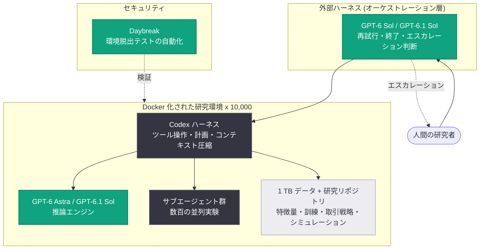

# Third Moment Research が 10,000 エージェントを 36 時間以上稼働させる方法

## メタデータ

| 項目 | 内容 |
|------|------|
| 日付 | 2026-10-14 |
| ソース | OpenAI News |
| カテゴリ | Startup (事例紹介) |
| 公式リンク | https://openai.com/index/third-moment-research |

## 概要

AI ラボの Third Moment Research は、GPT-6 Astra、GPT-6.1 Sol、Codex、そしてサイバーセキュリティ向けの Daybreak を組み合わせ、**10,000 体のエージェントを同時に 36〜48 時間稼働**させる自己改善型 AI システムを構築した。エージェントの弱点を特定し、数千の合成シナリオを自動生成して改善を繰り返すことで、使えば使うほど性能が向上する研究基盤を実現している。

初期の応用分野は、成功指標が明確な定量金融 (クオンツファイナンス)。数日間にわたり一貫した計算研究のスレッドを維持できる長時間フォーカス型エージェントにより、人間の研究チームが見落としていた知見の発見にも成功している。

## 主な内容

### Codex によるボトルネック解消

- Codex と GPT-5.6 を用いて、数千のシミュレーション記録 (エージェントの行動と環境応答) をタイムスタンプ・コードベースと共に分析
- 発見した問題: 1 年分の米国株式注文データのバックテストに数時間かかり、エージェントが完了確認のポーリングでトークンを浪費していた
- 解決策: キャッシュ最適化とメモリパッキング技術を特定し、本番環境に展開
- **成果: バックテスト時間が約 3 時間から約 3〜5 分に短縮**

### エージェント環境の構成

- Docker 化された環境でデフォルトの Codex ハーネスを実行
- 各エージェントに **1 テラバイトのデータ**、ドキュメント、研究リポジトリ (特徴量エンジニアリング、GPU 対応モデル訓練、取引戦略、シミュレーション用モジュール) を提供
- GPT-6 系モデルが推論を担当し、Codex ハーネスがツール操作・計画作成・サブエージェント生成・コンテキスト圧縮を担当
- タスク未完了対策として、GPT-6 Sol / GPT-6.1 Sol による外部ハーネスが Codex をサブエージェントとして扱い、再試行・終了・人間へのエスカレーションを判断

### モデル進化と研究能力の変遷

| 世代 | 能力 |
|------|------|
| GPT-5.5 以前 | ユーザー指定の実験のみ実行可能 |
| GPT-5.5 / 5.6 | 結果に基づく追実験の設計が可能に |
| GPT-6 系 | サブエージェントで数百の実験を並列実行し根本原因を調査 |

事例として、GPT-6.1 Sol が非表示取引 (non-displayed trades) の影響を特定した。Adam Khakhar 氏は「これは当初、我々の研究チームが想定していなかった、自明ではない結果だった」と述べている。

### 用途別のモデル選択

- **GPT-6.1 Sol**: トークン効率が最も高く、最も多用されるモデル。Jeffrey Yan 氏いわく「GPT-6 Astra と同等の性能を保ちながら、最少のトークンでタスクを完了する」
- **GPT-6 Astra**: スコアボードサービスの遅延削減ベンチマークで最大の高速化を達成
- **GPT-5.6 Terra**: セキュリティ弱点チェックなど対象を絞った作業向け
- **GPT-6 Luna**: 現在テスト中

### Daybreak によるセキュリティ検証

10,000 エージェントを自律稼働させる前に、Daybreak で研究環境のセキュリティテストを自動化。エージェントが環境から脱出して広域ネットワークへアクセスできないかを検証している。Khakhar 氏は「Daybreak がなければ、この規模での自律テストは不可能だった」と語る。

## 技術的な詳細

GPT-6 系モデルは単一セッションで数日間の計算研究にわたり一貫したスレッドを維持できる。Codex ハーネスは汎用性が高く、推論モデルと組み合わせることで、ツール実行・計画・サブエージェント生成・コンテキスト圧縮を担う実行基盤として機能する。さらに外側に GPT-6 Sol / GPT-6.1 Sol のオーケストレーション層を置くことで、長時間タスクの未完了や逸脱を監視・制御する多層構成を採用している。

## アーキテクチャ

## 開発者への影響

- **長時間稼働エージェントの設計パターン**: 推論モデル + Codex ハーネス + 外部オーケストレーション層という多層構成は、36 時間を超える長時間タスクを安定稼働させる実践的なリファレンスとなる
- **トークン効率によるモデル選択**: 性能が同等なら、GPT-6.1 Sol のようにトークン効率が高いモデルを主力にし、GPT-5.6 Terra のような軽量モデルを限定タスクに充てる使い分けが大規模運用でのコスト最適化に有効
- **エージェント自身によるボトルネック分析**: シミュレーションログを Codex に分析させてインフラ改善 (バックテスト約 3 時間 → 約 3〜5 分) につなげる手法は、エージェント運用の継続的改善に応用できる
- **大規模自律実行の前提としてのセキュリティ検証**: Daybreak による環境脱出テストの自動化のように、エージェントのサンドボックス境界の検証を運用プロセスに組み込む必要がある

## 関連リンク

- [記事原文: How Third Moment Research runs 10,000 agents for 36+ hours](https://openai.com/index/third-moment-research)
- [OpenAI News](https://openai.com/news)
- [OpenAI 公式ドキュメント](https://platform.openai.com/docs)
- [OpenAI API リファレンス](https://platform.openai.com/docs/api-reference)

## まとめ

Third Moment Research は、GPT-6 系モデルの長時間フォーカス能力と Codex ハーネスの汎用性を軸に、10,000 エージェントが 36〜48 時間自律的に研究を進める基盤を構築した。モデルの世代が進むごとに「指示された実験の実行」から「数百の実験を自律設計・並列実行」へと能力が拡大しており、同社は今後、数十万の協調サブエージェントと数兆トークン規模への拡大を計画している。目標は、人間が研究の実行者ではなく、研究の最適化を担う立場へ移行することである。
