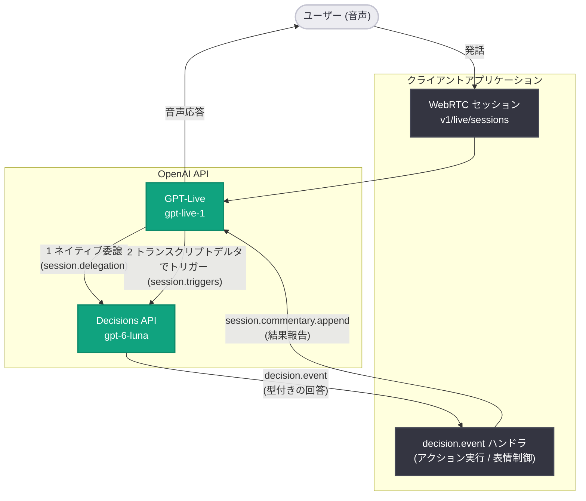

# OpenAI API アップデート (2026-10-15): GPT-Live に Decisions のネイティブ統合を追加

## メタデータ

| 項目 | 内容 |
|------|------|
| 発表日 | 2026-10-15 |
| ソース | OpenAI API Changelog |
| カテゴリ | 新機能 / API 更新 |
| 公式リンク | https://developers.openai.com/api/docs/changelog |

## 概要

OpenAI は 2026 年 10 月 15 日、API Changelog で GPT-Live への **Decisions API のネイティブ統合**を発表した。対象は `gpt-live-1` と `gpt-6-luna`、エンドポイントは `v1/live/sessions` である。Changelog 原文は "Added native Decisions integration in GPT-Live. Your app can act while your user is speaking or react to what Live says." と述べており、ユーザーが話している最中にアプリが行動したり、Live の発話に反応したりできるようになる。

Decisions API は 2026 年 10 月 6 日に `gpt-6-luna` でベータ公開された、テキストと画像を Responses API 比 10 倍高速に型付きの回答へ変換する API である ([2026-10-06 のレポート](./2026-10-06-api-update-decisions-api-usage-tiers.md) 参照)。今回の統合により、音声会話というリアルタイム性が重要な場面で、この低レイテンシな「判断」機能を Live セッションから直接利用できるようになった。

## 主な内容

今回の統合では、2 つの利用方式が提供される。Changelog 原文: "Let Live call Decisions directly through native delegation, or trigger decisions as input or output transcript deltas arrive."

### 1. ネイティブ委譲 (native delegation)

Live が Decisions を直接呼び出す方式。従来のカスタム委譲では「Live がアプリに通知 → アプリが Decisions を呼び出す」という往復が必要だったが、ネイティブ委譲ではこのアプリ経由の往復が省略され、レイテンシが削減される。

- セッション設定の `session.delegation` に `type: "decisions"` と質問 (choice タイプ) を定義する
- Live への指示 (instructions) で「いつ委譲するか」を指定する
- 委譲タイプはセッション作成時に固定され、セッション中は変更不可。ただし質問自体は `session.update` → `session.updated` の確認後に変更できる
- 結果は `session.delegation.created` と `decision.event` (`event.type` が `decision.completed`) で受信し、`session.commentary.append` で実行結果を Live に報告する

公式ガイドでは、車載アシスタントが「車内を暖めて」「フロントガラスの曇りを取って」といった運転者の発話を判断し、アプリが車両操作を実行する例が示されている。

### 2. トランスクリプトデルタによるトリガー

入力 (ユーザー発話) または出力 (Live の発話) のトランスクリプトのデルタが届いた時点で Decisions を自動的にトリガーする方式。委譲とは独立して動作する。

- `session.triggers` に `event_type` として `session.input_transcript.delta` または `session.output_transcript.delta` を指定する
- トリガー時のモデルとトリガー ID は Live 側が提供する (委譲時のようにアプリ側でモデルを指定しない)
- 結果の `decision.event` には `trigger_id`、`source_event_type`、`source_event_id` が含まれ、`delegation_id` は null になる

公式ガイドでは、デジタルヒューマンがユーザーの発話を聞きながら表情 (happy / sad / concerned など)、強度、ジェスチャーをリアルタイムに判断する例が示されている。

### コンテキスト管理

Decisions に判断材料となるアプリの状態を渡すために、専用のイベントが用意されている。

- `decision.item.create` でコンテキストアイテムを追加し、`decision.item.created` で返される `item.id` を保持する
- 状態が変わったら `decision.item.delete` → `decision.item.deleted` を待ってから新しい状態を追加する

## 技術的な詳細

### 対象モデルとエンドポイント

| 項目 | 内容 |
|------|------|
| Live セッション | `gpt-live-1` |
| Decisions (委譲時に指定) | `gpt-6-luna` |
| エンドポイント | `v1/live/sessions` |
| 必要な権限 | `api.decisions.write` (Live 接続側)。サーバー側で Responses API を併用する場合は `api.responses.write` |
| 追加ヘッダー | 不要。公式ガイド原文: "You don't need a Decisions-specific alpha header." (通常の Live 接続ヘッダーを使用) |

### コードサンプル

#### 例 1: ネイティブ委譲の設定 (車載アシスタント)

WebRTC セッションリクエストの `session` 配下に、既存の `transport` と並べて `delegation` オブジェクトを設定する。

```json
{
  "model": "gpt-live-1",
  "instructions": "Delegate requests to warm the cabin or clear windshield fog, and questions about windshield fogging. Wait for the app to report the result before describing it.",
  "delegation": {
    "type": "decisions",
    "decisions": {
      "model": "gpt-6-luna",
      "questions": [
        {
          "type": "choice",
          "name": "cabin_temperature",
          "instructions": "Choose increase if the driver asks to make the cabin warmer. Otherwise choose none.",
          "choices": [{ "value": "increase" }, { "value": "none" }]
        },
        {
          "type": "choice",
          "name": "windshield_defogger",
          "instructions": "Choose on if the driver asks to clear windshield fog or asks why the windshield is fogging up. Otherwise choose none.",
          "choices": [{ "value": "on" }, { "value": "none" }]
        }
      ]
    }
  }
}
```

#### 例 2: コンテキストの追加と結果報告

```json
{
  "type": "decision.item.create",
  "event_id": "evt_cabin_70",
  "item": {
    "type": "message",
    "role": "user",
    "content": [
      {
        "type": "input_text",
        "text": "Cabin set to 70°F. Windshield defogger off."
      }
    ]
  }
}
```

アプリが操作を実行した後、`session.commentary.append` で結果を Live に伝える。

```json
{
  "type": "session.commentary.append",
  "delegation_id": "del_cabin_1",
  "content": "The dashboard now shows the cabin is set to 71°F."
}
```

#### 例 3: トランスクリプトトリガーの設定 (デジタルヒューマン)

```json
{
  "type": "decisions",
  "event_type": "session.input_transcript.delta",
  "decisions": {
    "questions": [
      {
        "type": "choice",
        "name": "expression",
        "instructions": "Choose your expression as you listen to the person's latest words.",
        "choices": [
          { "value": "neutral" },
          { "value": "happy" },
          { "value": "sad" },
          { "value": "concerned" }
        ]
      },
      {
        "type": "choice",
        "name": "gesture",
        "instructions": "Choose a gesture that fits what you just heard.",
        "choices": [
          { "value": "none" },
          { "value": "nod" },
          { "value": "shake" },
          { "value": "lean" }
        ]
      }
    ]
  }
}
```

トリガー結果は以下の形式で届く。

```json
{
  "type": "decision.event",
  "delegation_id": null,
  "trigger_id": "trg_listening_1",
  "source_event_type": "session.input_transcript.delta",
  "source_event_id": "evt_input_42",
  "event": {
    "type": "decision.completed",
    "decision": {
      "answers": [
        { "type": "choice", "name": "expression", "choice": "happy" },
        { "type": "choice", "name": "gesture", "choice": "nod" }
      ]
    }
  }
}
```

### 実装上の注意点

- **委譲タイプは固定**: `delegation.type` はセッション作成時に設定し、そのセッション中は変更できない
- **質問の更新手順**: アクティブセッション中の質問変更は、`session.update` を送信し、対応する `session.updated` を待ってから decision item を追加する
- **イベントフィルタ**: WebRTC イベントをフィルタする場合、`session.delegation.created` と `decision.event` の両方を許可する必要がある。またトリガー結果は、ソースとなるトランスクリプトイベントも許可されている場合にのみ配信される
- **デルタの結合と順序**: Live は保留中のデルタを結合することがあり、結果は順不同で届く可能性がある。各方向で最新の関連結果のみを適用し、口の動き (リップシンク) は音声側から駆動することが推奨されている
- **質問の独立性**: 1 回のネイティブ決定リクエストで、すべての質問に独立して回答される
- **料金**: 今回参照した Changelog および Decisions voice ガイドには、この統合に固有の料金に関する記述はない (不明)

## アーキテクチャ



## 開発者への影響

- **音声アプリの応答性が向上**: ユーザーの発話が完了するのを待たずに、トランスクリプトのデルタ単位で判断を実行できる。発話中のリアルタイムな UI 更新 (表情、ジェスチャー、画面操作) や、発話と並行したアクション実行が可能になる
- **アプリ経由の往復が不要に**: 従来のカスタム委譲では Live → アプリ → Decisions という往復が必要だったが、ネイティブ委譲では Live が Decisions を直接呼び出すため、レイテンシとアプリ側の実装負荷が削減される
- **型付きの回答による確実な分岐処理**: Decisions API の choice タイプによる回答が返るため、音声からの意図判定を自由形式テキストのパースなしで実装できる。「該当なし」を表す `none` 選択肢を用意し、no-op として扱う設計が公式ガイドで示されている
- **イベント駆動の実装が必要**: `decision.item.create` / `decision.item.delete` によるコンテキスト管理、`session.commentary.append` による結果報告、順不同で届く結果への対応など、イベントのライフサイクルを意識した実装が求められる
- **権限設定の確認**: Live 接続に `api.decisions.write` 権限が必要。既存の GPT-Live アプリに統合する際は API キーの権限を確認したい

## 関連リンク

- [OpenAI API Changelog](https://developers.openai.com/api/docs/changelog)
- [Decisions voice ガイド (GPT-Live 統合)](https://developers.openai.com/api/docs/guides/decisions-voice)
- [Decisions API ガイド](https://developers.openai.com/api/docs/guides/decisions)
- [関連レポート: Decisions API ベータリリース (2026-10-06)](./2026-10-06-api-update-decisions-api-usage-tiers.md)

## まとめ

2026 年 10 月 15 日のアップデートにより、10 月 6 日にベータ公開された Decisions API が GPT-Live (`gpt-live-1`) にネイティブ統合された。ネイティブ委譲 (`session.delegation`) により Live が `gpt-6-luna` の Decisions を直接呼び出せるほか、入出力トランスクリプトのデルタをトリガー (`session.triggers`) として発話中の判断を実行できる。これにより、車載アシスタントのような「発話を聞きながら操作する」アプリや、デジタルヒューマンのような「聞きながら表情を変える」アプリを、低レイテンシかつ型付きの回答に基づいて実装できるようになる。本統合に固有の料金については、現時点で参照したドキュメントに記述がなく不明である。
