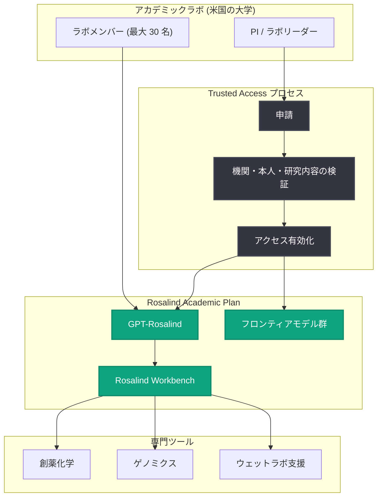

# GPT-Rosalind をアカデミック研究ラボへ: Rosalind Academic Plan の発表

## メタデータ

| 項目 | 内容 |
|------|------|
| 発表日 | 2026-10-15 |
| ソース | OpenAI News (Research) |
| カテゴリ | 研究成果 / 新プログラム |
| 公式リンク | https://openai.com/index/introducing-the-rosalind-academic-plan |

## 概要

OpenAI は、ライフサイエンス研究専用モデル GPT-Rosalind をより多くのアカデミック研究者が利用できるようにする「Rosalind Academic Plan」を発表した。本プランでは、資格を満たす研究ラボに対し、最大 30 シートの Business Standard プランを最長 12 か月間無償で提供する。GPT-Rosalind へのアクセスは「trusted access (信頼アクセス)」の承認を条件とし、創薬化学、ゲノミクス、ウェットラボ支援などの専門ツールをオーケストレーションする Rosalind Workbench と組み合わせて利用できる。

OpenAI は「科学的発見の加速」を AGI がすべての人類に利益をもたらすというミッションの中核に位置づけており、本プランはヒトゲノム計画、CRISPR-Cas9、mRNA ワクチンのような将来のブレークスルーの土台となる基礎研究を行う科学者への投資と位置づけられている。

## 主な内容

### プランの提供内容

資格を満たすラボは以下を受け取ることができる。

- **最大 30 シートの Business Standard プラン**: 1 ユーザーあたり月額 0 ドルで、最長 12 か月間利用可能
- **商用提供中のすべてのフロンティア OpenAI モデルへのアクセス**: プランの利用上限の範囲内で利用可能
- **GPT-Rosalind へのアクセス**: trusted access の承認後に利用可能

また、Rosalind Academic Plan を通じて共有された研究データは、デフォルトではモデルの学習に使用されない。

### 対象と申請方法

- 現時点では**米国の大学に所属するアカデミックラボ**が対象
- OpenAI Enterprise 契約のない大学の PI (研究代表者) およびラボリーダーは、trusted access プロセスを通じてラボを代表して申請できる
- 既存の Enterprise 契約がある大学のラボは、大学の Enterprise アクセスプロセス経由で申請する
- 承認後、PI / ラボリーダーは最大 30 名の指名メンバーに対して GPT-Rosalind と他のフロンティアモデルへの無償アクセスを有効化できる
- **API アクセスは現時点では含まれない**
- 検証済みの PI / ラボリーダーがメンバー権限を管理し、ラボの承認済み利用に責任を負う

申請フローは「プランの確認 → サインインと申請 → 検証の完了 → アクセス有効化後に研究開始」の 4 ステップで構成される。

### 対象となる研究領域

GPT-Rosalind は、複雑な生物学的課題に対する深い推論を支援する専門モデルであり、承認された研究者は正当な研究のためのセーフガードの範囲内で機微な科学的課題を調査できる。研究領域の例として以下が挙げられている (全 7 領域のうちの 1 つ)。

- **創薬・タンパク質設計**: 候補薬、治療用タンパク質、ペプチド、酵素の設計と、分子間相互作用・選択性・安定性・開発適合性の最適化

既に著名なアカデミックラボが、タンパク質設計から神経変性の理解まで、幅広い研究ワークフローで GPT-Rosalind の活用を進めている。

### 責任あるアクセス管理

アクセス有効化の前に、OpenAI は以下を実施する。

- 機関の正当性と PI / ラボリーダーの本人確認
- リーダーの職歴、機関での任用状況、ラボアクセスを監督する権限のレビュー
- ラボの機関所属、研究活動、利用目的の評価
- ラボリーダーの明確な責任と、機関指定の安全担当窓口の設置

有効化後もモニタリングとエンフォースメントによるセーフガードが継続する。登録された高機微ユースケースについては、承認済みの研究コンテキストを考慮した安全チェックが行われ、疑義がある場合は研究者に作業内容と承認状況の確認が行われる。これにより、正当な研究を不必要に中断させずに潜在的な誤用を検出する設計となっている。

## 技術的な詳細

### GPT-Rosalind と Rosalind Workbench

GPT-Rosalind はフロンティア級の推論能力を持つライフサイエンス専用モデルで、Rosalind Workbench と組み合わせることで、以下のような専門ツールのオーケストレーションが可能になる。

- 創薬化学 (medicinal chemistry)
- ゲノミクス解析
- ウェットラボ (実験室作業) 支援
- その他の科学アプリケーション

### 一般モデルとの比較例

記事では「抗ウイルス治療薬の設計改善」を題材に、GPT-Rosalind と汎用モデル (Mainline Astra) の応答が比較されている。

| モデル | 応答の特徴 |
|--------|-----------|
| GPT-Rosalind | 候補比較マトリクス、モデリング計画、対照群と解釈ガイダンスを含むペアの実験計画を提示し、リード化合物の不均一な性能に対応 |
| Mainline Astra | 具体的な候補設計や実装レベルの実験計画など、実行可能な部分の回答を保留し、高レベルのモデリング文脈と定性的なチェックのみを提示 |

trusted access の枠組みにより、承認された研究者に対しては、通常は安全上の理由で制限される実行可能な科学的詳細を、承認済みの研究コンテキストの範囲内で提供できる点が本プランの技術的な特徴である。

## アーキテクチャ

## 開発者・研究者への影響

- **コスト障壁の大幅な低減**: 最大 30 シートを最長 12 か月間無償で利用できるため、資金が限られる基礎研究ラボでもフロンティアモデルを研究ワークフローに組み込める
- **機微な研究課題への対応**: trusted access により、汎用モデルでは安全上制限される実行可能な科学的詳細 (候補設計、実験計画など) を正当な研究コンテキスト内で取得できる
- **データ保護**: 共有された研究データはデフォルトでモデル学習に使用されないため、未発表研究の機密性を保ちやすい
- **API アクセスは対象外**: 現時点では ChatGPT (Business Standard) 経由の利用に限られ、プログラムによる自動化パイプラインへの組み込みはできない点に注意が必要
- **対象地域の制限**: 現時点では米国の大学のみが対象であり、日本を含む他国の研究機関は今後の展開を待つ必要がある

## 関連リンク

- [発表記事 (公式)](https://openai.com/index/introducing-the-rosalind-academic-plan)
- [GPT-Rosalind 公式ページ](https://openai.com/rosalind/)
- [Rosalind Workbench (開発者ブログ)](https://developers.openai.com/blog/rosalind-workbench)
- [ヘルプセンター: 資格要件と申請ガイド](https://help.openai.com/articles/20001602)
- [OpenAI News](https://openai.com/news)

## まとめ

Rosalind Academic Plan は、ライフサイエンス専用モデル GPT-Rosalind を米国のアカデミック研究ラボに無償提供する新プログラムである。最大 30 シート・最長 12 か月の Business Standard プラン、全フロンティアモデルへのアクセス、trusted access 承認後の GPT-Rosalind 利用が柱となる。機関検証・継続的モニタリングを組み合わせた責任あるアクセス管理のもと、創薬・タンパク質設計からゲノミクスまで、将来のブレークスルーにつながる基礎研究を支援する取り組みであり、科学分野における AI 活用のアクセス格差を縮める一歩と言える。
