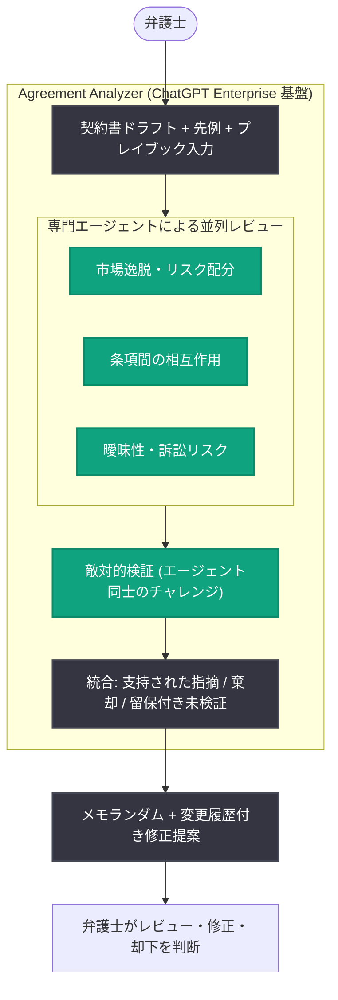

# Sullivan & Cromwell、法務の専門知識を契約書レビューに組み込む「Agreement Analyzer」を開発

## メタデータ

| 項目 | 内容 |
|------|------|
| 発表日 | 2026-10-15 |
| ソース | OpenAI News |
| カテゴリ | 導入事例 (リーガル) |
| 公式リンク | https://openai.com/index/sullivan-cromwell |

## 概要

米大手法律事務所 Sullivan & Cromwell は、OpenAI との協業により、契約書ドラフトの問題点を特定する AI ツール「Agreement Analyzer」を開発した。同ツールは、関連する先例 (プレシデント) との比較、事務所の経験に基づくアプローチ、クライアントの優先事項といった弁護士の契約書レビューに必要な要素を単一のワークフローに統合し、分析結果と修正提案を生成する。弁護士はその内容を検証・修正したうえで最終判断を下す。

パートナーの John Savva 氏が Codex を用いてシングルユーザー向けの概念実証 (PoC) として開発したものを起点に、OpenAI との協業を通じて出力品質の向上、並列処理による効率化、複数の弁護士が同時利用できるツールへの発展を実現した。「弁護士を置き換えるのではなく、より深い分析を可能にし、クライアントにより高品質な成果物を提供するためのツール」と Savva 氏は位置づけている。

## 主な内容

### 事務所の専門知識を契約書レビューに統合

AI は当初、メール返信の下書きやカレンダー確認といった反復的・管理的なタスクに使われることが多かったが、Savva 氏によれば、AI モデルの分析能力の向上により状況は変化した。「現在では、複雑な契約の深い分析のような難易度の高い法務タスクでの活用機会が大幅に増えている」という。

Agreement Analyzer は、先例間で対応する条項を比較し、それらの条項がどのように相互作用するかを追跡する作業を支援する。

ツールの構成要素は以下の通り。

- **Sullivan & Cromwell のワークフロー**: 事務所の実務プロセスに沿ったレビュー手順
- **厳選された事務所の先例**: 弁護士が自ら選択した先例を追加可能
- **交渉プレイブック**: 事務所およびクライアントのポジション、市場慣行の情報
- **ChatGPT Enterprise**: 基盤となる AI プラットフォーム

弁護士が契約書ドラフトを入力すると、ツールは複数の視点から複数回のレビューサイクルを実行し、出力を統合して潜在的な問題の特定を支援する。最終的に、メモランダム (分析メモ) と変更履歴付きの修正提案が返され、弁護士がレビュー・修正・却下を判断する。

### 情報源と不確実性の可視化

Savva 氏は、AI ツールの出力を信頼できるものにするのは「完全な透明性」だと強調する。「AI ツールが市場慣行について主張をするなら、その情報の出典を確認できる必要がある」という。

同氏が説明する応用例では、エージェントが結論を導き、別のエージェントがそれに敵対的プロセスで異議を申し立てる仕組みが採られている。想定されるユースケースでは、専門化されたエージェントが以下の観点で契約書を並列にレビューする。

- 市場慣行からの逸脱とリスク配分
- 条項間の相互作用
- 訴訟に影響しうる曖昧な記述

結果は、他のエージェントによる検証 (チャレンジ) を経て支持された指摘、棄却された指摘、留保付きで保持された未検証の論点に区別して提示される。弁護士は各論点、その根拠となる説明、関連する先例を確認したうえで、最終的なマークアップに反映すべき指摘を判断できる。

### 今後の展望

Sullivan & Cromwell は、特定の法務タスクに合わせたツールの開発を継続している。Savva 氏は、分析能力の向上がリサーチや文書作成プロセスのより広い範囲を支援する機会につながるとみている。

同氏は GPT‑6 Astra の推論能力の進歩に言及し、「Astra は利用可能な推論の品質を大きく前進させた。それこそが従来のボトルネックだった」と述べている。

## 技術的な詳細

Agreement Analyzer の特徴的な設計は、マルチエージェントによる敵対的レビューである。

1. **並列レビュー**: 専門化された複数のエージェントが、市場逸脱・リスク配分、条項間の相互作用、曖昧性などの異なる観点から契約書を同時に分析
2. **敵対的検証**: あるエージェントの結論に対し、別のエージェントが異議を申し立てて妥当性を検証
3. **結果の分類**: 検証を通過した指摘 / 棄却された指摘 / 留保付きの未検証論点を明示的に区別
4. **出典の提示**: 各指摘の根拠となる説明と関連先例を弁護士が確認可能

また、開発プロセスでは Codex による PoC 構築から始まり、OpenAI との協業で並列処理による効率化とマルチユーザー対応を実現している。

## アーキテクチャ

## ビジネス/開発者への影響

- **高度な法務タスクへの AI 適用**: AI の活用領域が、メール下書きなどの定型業務から複雑な契約分析のような専門性の高いタスクへ拡大していることを示す事例
- **「人間の判断を支援する」設計**: AI が最終判断を下すのではなく、分析結果・根拠・先例を提示し、弁護士が採否を決める人間中心のワークフローは、規制産業での AI 導入の参考モデルとなる
- **敵対的マルチエージェントの実用例**: エージェント同士が結論を検証し合い、指摘を信頼度別に分類する設計は、ハルシネーション対策として他ドメインにも応用可能
- **現場主導の開発**: ドメイン専門家 (パートナー弁護士) が Codex で PoC を構築し、OpenAI と協業して本格的なツールへ発展させた開発プロセスは、エンタープライズでの AI 内製化の好例
- **透明性の重視**: 出典の明示と不確実性の可視化が、専門職による AI 出力の信頼・採用の前提条件であることを示唆

## 関連リンク

- [Sullivan & Cromwell brings legal expertise into agreement review (OpenAI 公式)](https://openai.com/index/sullivan-cromwell)
- [ChatGPT Enterprise](https://openai.com/chatgpt/enterprise/)
- [Codex](https://openai.com/codex/)
- [OpenAI News](https://openai.com/news)

## まとめ

Sullivan & Cromwell の Agreement Analyzer は、事務所の先例・プレイブック・ワークフローと ChatGPT Enterprise を統合し、契約書レビューを支援する AI ツールである。専門化されたエージェントによる並列レビューと敵対的検証により、指摘を信頼度別に分類し、出典と根拠を可視化することで、弁護士が最終判断を下せる透明性の高い設計を実現した。パートナー弁護士自身が Codex で構築した PoC を OpenAI との協業で発展させた経緯も含め、「弁護士の置き換えではなく、より深い分析と高品質な成果物のためのツール」という思想が貫かれた、専門職向け AI 導入の代表的な事例といえる。
