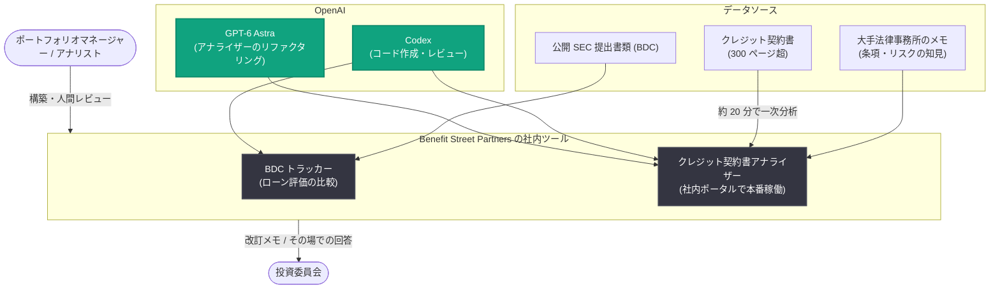

# Benefit Street Partners が Codex で投資委員会への回答を高速化 — ポートフォリオマネージャーが自ら開発者に

## メタデータ

| 項目 | 内容 |
|------|------|
| 発表日 | 2026-10-16 |
| ソース | OpenAI News |
| カテゴリ | 導入事例 |
| 公式リンク | https://openai.com/index/benefit-street-partners |

## 概要

OpenAI は、クレジット (債権) 投資に特化した運用会社 Benefit Street Partners (BSP) の Codex 活用事例を公開した。従来、投資委員会からのフォローアップ質問への回答には数日から数週間を要していたが、ポートフォリオマネージャーの Anant Kumar 氏によれば、現在はアナリストが Codex を使って 1 日で一巡のコメント対応を完了でき、会議中にその場で質問に回答できることも多いという。BSP はこれらのツールを「より多くの案件をこなす」ためではなく、同じ期間内でアンダーライティング (投資審査) のレビュー能力と厳密さを高めるために活用している点が特徴である。

Kumar 氏は「私は単なるアナリスト兼ポートフォリオマネージャーから、今では開発者にもなった。自分でものを作れる」と語っており、金融実務の専門家が AI を使って自らツールを開発する「市民開発者」化の具体例となっている。

## 主な内容

### ローン評価比較ダッシュボードの自作

かつて Kumar 氏が同僚と共有できるダッシュボードを作るには、ソフトウェアの専門家に Web サイトの構築とデータ取り込みを依頼する必要があった。現在は AI でコードのドラフトを作成し、エラーをレビューさせることで、自らツールを構築している。

このトラッカーは、事業開発会社 (BDC) の公開 SEC 提出書類を使い、各社が同一のローンをどう評価しているかを比較するもの。チームは自社の評価 (マーク) が他の保有者の評価とどう異なるかを確認できる。

- **開発プロセス**: Kumar 氏がトラッカーを構築し、Codex をコードレビューに使用
- **初版の構築期間**: 1 日
- **総開発時間**: その後数週間かけた機能追加とインターフェース改善を含め、合計 10〜12 時間と見積もられる

### クレジット契約書アナライザーの構築

もう一つのツールは、300 ページ以上に及ぶことも多いクレジット契約書 (credit agreement) を分析する。投資家は、貸し手から価値を移転させ得る条項を見つける必要があり、従来は外部の法律顧問に契約書を 1 ページずつ精査してもらう作業だった。Kumar 氏は、注視すべき条項とリスクに関する大手法律事務所のメモを集約してこのツールを構築し、「組織内のセカンドブレイン」と表現している。

- **処理時間**: アップロードされた契約書は約 20 分で一次分析 (first-pass analysis) が完成し、その後 1 時間以上の人間によるレビューを実施
- **技術基盤**: BSP はこのツールを GPT-6 Astra でリファクタリングし、現在は自社ホスティングのポータルで本番稼働中

Kumar 氏は「AI はデータの収集・取り込み・分析の統合に非常に役立つが、最終的な投資判断は人間が下す必要がある」と述べ、人間が意思決定の主体であることを強調している。

### アンダーライティングプロセスの強化

アンダーライティングは通常、複数ラウンドのプロセスである。1 ラウンドは追加のデューデリジェンスと、投資委員会の質問に応える改訂版メモで構成される。案件のタイムラインは数日から数週間と幅があり、ラウンド数も案件により異なる。Kumar 氏は「より多くの情報が手元にあるため、意思決定への自信が高まった」と語り、「分析の質は格段に良く、格段に速くなった」と評価している。

## 成果サマリー

| 項目 | 成果 |
|------|------|
| BDC トラッカー初版の構築 | 1 日 (Codex をコードレビューに使用、追加開発込みで合計約 10〜12 時間) |
| クレジット契約書の一次分析 | 約 20 分 (その後 1 時間以上の人間レビュー) |
| 投資委員会のフォローアップ質問への回答 | 従来の数日〜数週間から短縮し、会議中にその場で回答できることも多い |

## アーキテクチャ

取得した記事内容に基づく全体像を以下に示す。

## 開発者・企業への影響

- **ドメイン専門家の開発者化**: ソフトウェア専門家に頼らず、金融実務の専門家自身が Codex を使ってツールを構築・レビューするモデルは、専門職の生産性向上の新しいパターンを示している
- **「量より質」の AI 活用**: 案件数を増やすのではなく、同じ期間内でレビューの能力と厳密さを高めるという活用方針は、品質重視のエンタープライズ AI 導入の参考になる
- **Human-in-the-loop の徹底**: AI の一次分析 (約 20 分) の後に 1 時間以上の人間レビューを置き、最終的な投資判断は人間が下すという設計は、金融分野での責任ある AI 活用の実例である
- **継続的アンダーライティングへの展望**: イベント発生後にのみ再審査するのではなく、ニュースの発生に応じてローンを監視しポートフォリオ全体への影響を検証する「継続的アンダーライティング」が長期的な目標として示されている

## 関連リンク

- [Benefit Street Partners answers questions faster with Codex (OpenAI 公式)](https://openai.com/index/benefit-street-partners)
- [Codex (OpenAI 公式)](https://openai.com/codex/)
- [OpenAI News](https://openai.com/news)
- [OpenAI 公式ドキュメント](https://platform.openai.com/docs)

## まとめ

Benefit Street Partners では、ポートフォリオマネージャーの Anant Kumar 氏が Codex をコードレビューに活用し、BDC のローン評価比較トラッカー (初版 1 日、合計約 10〜12 時間) と、300 ページ超のクレジット契約書を約 20 分で一次分析するアナライザー (GPT-6 Astra でリファクタリングし本番稼働) を自ら構築した。投資委員会のフォローアップ質問への回答は数日〜数週間から 1 日以内、しばしば会議中のその場回答にまで短縮された。「最終的な投資判断は人間が下す」という原則を維持しながら、同じ期間内でアンダーライティングの厳密さを高める活用方針は、金融業界における AI 導入の実践的な先行事例である。
