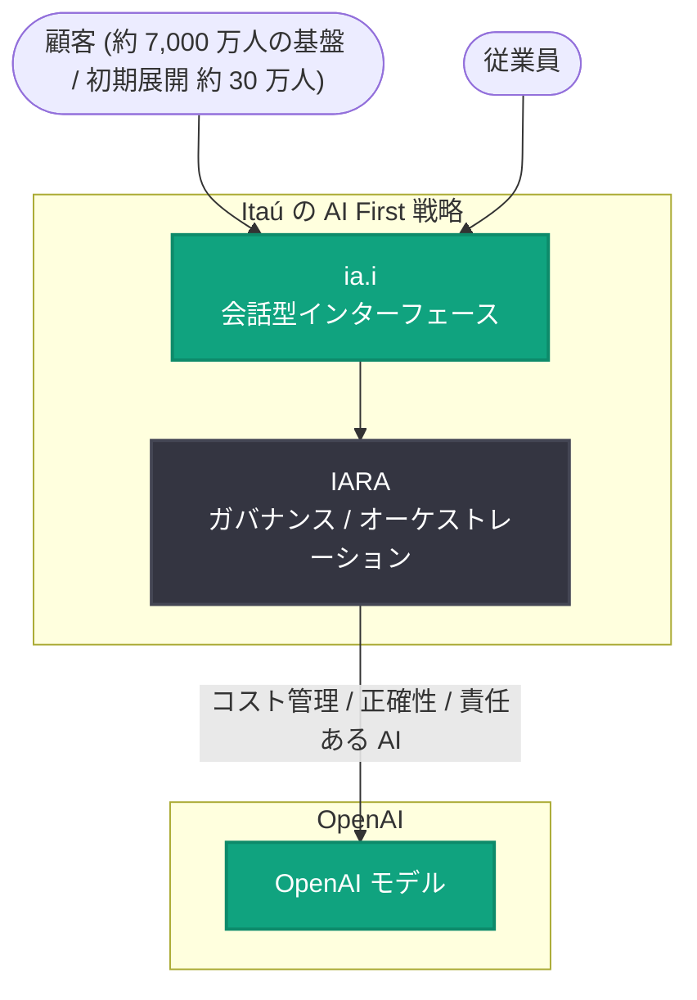

# Itaú が全顧客基盤に向けて生成 AI を構築 — ia.i と IARA による AI First 戦略

## メタデータ

| 項目 | 内容 |
|------|------|
| 発表日 | 2026-10-16 |
| ソース | OpenAI News |
| カテゴリ | 導入事例 |
| 公式リンク | https://openai.com/index/itau-generative-ai |

## 概要

OpenAI は、ブラジル最大の銀行 Itaú (イタウ・ウニバンコ) の生成 AI 導入事例を公開した。Itaú は会話型インターフェース「ia.i」とガバナンスプラットフォーム「IARA」を軸に、「AI First」戦略を顧客と従業員の両方に適用している。ブラジルの銀行業はブラジルで最も規制の厳しい業界の一つであり、その環境下で約 7,000 万人という顧客基盤全体を見据えた生成 AI 展開を進めている点が特徴である。

記事の核心は「モデルの性能」ではなく「シンプルさ」にある。Itaú の CTO である Carlos Eduardo Mazzei 氏は「重要なのは、シンプルで直接的かつ有用なものを作り、顧客に直接的な利益を届け、テクノロジーをほとんど意識させないようにすることだ」と述べており、技術はあくまで手段であり、体験の中心に置かないという設計思想が貫かれている。

## 主な内容

### AI First 戦略とシンプルさの基準

Itaú が掲げる基準は厳格である。ソリューションは次の条件を満たさなければならない。

- 実際の日常的な問題を解決すること
- 直接的 (direct) であること
- シンプル (simple) であること
- 記憶に残る (memorable) 体験であること

ブラジルのような国で数百万人の顧客に親密でパーソナライズされた体験を提供することは、何よりもまずモデルの問題ではなくシンプルさの問題である、と記事は位置づけている。

### 市場調査が示す需要

Itaú が Grupo Consumoteca と共同で実施した調査では、生成 AI による金融支援への強い需要が示された。

| 調査結果 | 割合 |
|---------|------|
| 家計をより良く整理したい、意思決定へのより効果的なサポートを求めるブラジル人 | 80% |
| 継続的なガイダンスを提供する「金融コパイロット」のような技術を望むブラジル人 | 65% |

### ia.i: OpenAI モデルを活用した会話型インターフェース

ia.i は OpenAI のモデルを活用した会話型インターフェースで、各種銀行サービスを横断してパーソナライズされた金融ガイダンスと取引処理を提供する。Itaú の顧客基盤は約 7,000 万人であり、初期展開フェーズでは約 30 万人の顧客を対象に提供されている。

### IARA: ガバナンス・オーケストレーションプラットフォーム

IARA は AI モデルへのアクセスを管理するガバナンス・オーケストレーションプラットフォームで、以下を担保する。

- **コスト管理**: モデル利用コストの制御
- **応答の正確性**: 回答品質の担保
- **責任ある AI**: 責任ある AI ポリシーの遵守

厳格なコンプライアンスと監督要件のもとで運営される銀行業では、顧客対応・データ処理・従業員ワークフローがリスク管理と交差するため、ガバナンスプラットフォームがモデル層そのものと同等に重要になり得る。IARA はその役割を担う基盤である。

## アーキテクチャ

取得した記事内容に基づく全体像を以下に示す。

## 開発者・企業への影響

- **規制業界での展開モデル**: 厳しく規制された金融セクターでも、ガバナンス層 (IARA) をモデル層と分離して整備することで、大規模な生成 AI 展開が可能であることを示した
- **ガバナンスの重要性**: コスト管理・応答品質・責任ある AI ポリシーをオーケストレーション基盤で一元管理するアプローチは、エンタープライズ AI 導入の参考パターンとなる
- **UX ファーストの設計思想**: モデル性能の誇示ではなく「シンプルで直接的、テクノロジーを意識させない」体験設計を優先する方針は、コンシューマー向け AI プロダクト設計の指針となる
- **段階的ロールアウト**: 約 7,000 万人の顧客基盤に対し約 30 万人から段階的に展開する手法は、大規模サービスへの AI 導入のリスク管理手法として参考になる

## 関連リンク

- [How Itaú is building generative AI for its entire customer base (OpenAI 公式)](https://openai.com/index/itau-generative-ai)
- [OpenAI News](https://openai.com/news)
- [OpenAI 公式ドキュメント](https://platform.openai.com/docs)

## まとめ

Itaú は、会話型インターフェース ia.i と ガバナンスプラットフォーム IARA を組み合わせ、ブラジルで最も規制の厳しい業界の一つである銀行業において AI First 戦略を顧客と従業員の双方に展開している。「シンプルで直接的、テクノロジーをほとんど意識させない」という体験基準と、コスト・正確性・責任ある AI を管理するガバナンス基盤の両輪は、規制業界における大規模な生成 AI 導入の先行事例として注目される。

---

**注記**: OpenAI 公式ページ (https://openai.com/index/itau-generative-ai) への直接アクセスは 403 Forbidden (Bot 対策) により取得できなかったため、本レポートは記事の提供概要、記事冒頭部分の転載を含むミラーサイト (Subvolts) および二次報道 (Blockchain.News) から取得した内容に基づいて作成している。記事後半の詳細 (使用モデルの具体名、従業員向けユースケースの詳細、今後の計画など) は取得できていない。顧客基盤約 7,000 万人・初期展開約 30 万人という数値はミラーサイトの要約情報に基づく。
