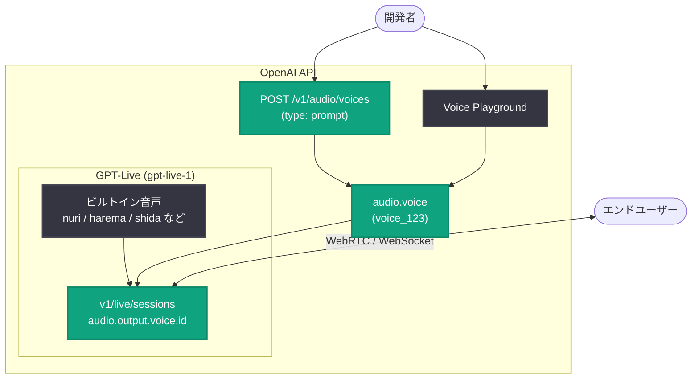

# Prompt-to-voice 機能リリースと GPT-Live 新音声 9 種の追加

## メタデータ

| 項目 | 内容 |
|------|------|
| 発表日 | 2026-10-16 |
| ソース | OpenAI API Changelog |
| カテゴリ | API 更新 |
| 公式リンク | https://developers.openai.com/api/docs/changelog |

## 概要

OpenAI は 2026 年 10 月 16 日、全 API ユーザー向けに prompt-to-voice 機能をリリースした。テキストによる説明文 (アクセント、年齢、ピッチ、音色、話速など) からカスタム音声を作成し、GPT-Live セッションで再利用できる。音声の作成自体は無料で、音声生成には通常の GPT-Live セッション課金が適用される。

あわせて、GPT-Live に 5 言語 9 種の自然音声 (Natural voice) が追加された。ドイツ語 3 種、フランス語 2 種、ヒンディー語 1 種、日本語 2 種、韓国語 1 種で、英語以外の言語での音声アプリケーション構築の選択肢が大きく広がった。

## 主な内容

### Prompt-to-voice 機能

テキスト記述からカスタム音声を作成できる機能で、API (`/v1/audio/voices` エンドポイント) または voice Playground から利用できる。主な特徴は以下の通り。

- **作成方法**: 音声の特徴を記述したプロンプトを `/v1/audio/voices` に POST する
- **再利用**: 作成した音声の ID を GPT-Live セッション設定で指定して利用する
- **料金**: 音声の作成は無料。GPT-Live での音声生成は通常のセッション課金
- **上限**: 組織あたり最大 100 個のプロンプト生成音声を作成可能
- **対応範囲**: プロンプト生成音声は GPT-Live 専用。Text to Speech、Realtime、Chat Completions API では利用不可
- **制約**: `/v1/audio/voices` での音声作成は Zero Data Retention と互換性がない

### GPT-Live 新音声 9 種

GPT-Live (`gpt-live-1`) に以下の自然音声が追加された。すべて Source が「Natural」の音声として提供される。

| 音声名 | API 名 | 言語 | 話者タイプ |
|--------|--------|------|-----------|
| Nuri | `nuri` | ドイツ語 | Feminine |
| Juni | `juni` | ドイツ語 | Feminine |
| Flitz | `flitz` | ドイツ語 | Masculine |
| Brise | `brise` | フランス語 | Feminine |
| Sillage | `sillage` | フランス語 | Masculine |
| Nira | `nira` | ヒンディー語 | Feminine |
| Harema | `harema` | 日本語 | Feminine |
| Shida | `shida` | 日本語 | Masculine |
| Noeul | `noeul` | 韓国語 | Feminine |

音声はセッション作成時に `audio.output.voice` に API 名を指定して選択する (デフォルトは `marin`)。セッション中の音声変更はできず、別の音声を使うには新しいセッションの開始が必要。

## 技術的な詳細

### カスタム音声の作成 (`POST /v1/audio/voices`)

リクエストパラメータは以下の通り。

| パラメータ | 必須 | 説明 |
|-----------|------|------|
| `type` | 必須 | `"prompt"` を指定 |
| `name` | 必須 | 音声の名前 |
| `prompt` | 必須 | 音声の特徴の説明文 (アクセント、年齢、ピッチ、音色、話速など) |
| `model` | 必須 | 公式例では `"auto"` を指定 |
| `script_hint` | 任意 | 音声生成のガイドとなるサンプルスクリプト (最大 2,000 文字)。省略時はサービス側が説明文から生成。短すぎる、または空のスクリプトは拒否される |

### コードサンプル

音声の作成 (公式ドキュメントの例):

```bash
curl --fail-with-body https://api.openai.com/v1/audio/voices \
  -H "Authorization: Bearer $OPENAI_API_KEY" \
  -H "Content-Type: application/json" \
  -d '{
    "type": "prompt",
    "name": "Support assistant",
    "prompt": "A calm, reassuring adult voice for a customer support assistant. Speak with an American English accent, a mid-range pitch, a smooth, warm tone, and a steady, conversational pace.",
    "model": "auto"
  }' \
  -o voice.json
```

レスポンスには音声データやプレビューは含まれず、メタデータ (ID、作成時刻、元のプロンプト) が返される。

```json
{
  "object": "audio.voice",
  "id": "voice_123",
  "name": "Support assistant",
  "created_at": 0,
  "type": "prompt",
  "prompt": "A calm, reassuring adult voice for a customer support assistant. Speak with an American English accent, a mid-range pitch, a smooth, warm tone, and a steady, conversational pace."
}
```

### GPT-Live セッションでのカスタム音声の利用

返された音声 ID を `session.audio.output.voice.id` に設定する。音声の表現力を保つため、元の説明文を `session.instructions` に含めることが公式に推奨されている。

```json
{
  "model": "gpt-live-1",
  "instructions": "You are a helpful voice assistant. A calm, reassuring adult voice for a customer support assistant. Speak with an American English accent, a mid-range pitch, a smooth, warm tone, and a steady, conversational pace.",
  "audio": { "output": { "voice": { "id": "voice_123" } } }
}
```

- **WebRTC**: `transport` と並べて JSON の `session` フィールドに設定する
- **WebSocket**: 最初の `session.start` イベントに設定する
- 音声はセッション開始時に選択する。別の音声を試すには新しいセッションが必要

## アーキテクチャ



## 開発者への影響

- **ブランド独自の音声体験**: テキスト記述だけでアプリケーション固有の音声を無料で作成でき、音声アシスタントやカスタマーサポートのブランド統一が容易になる
- **多言語対応の強化**: ドイツ語、フランス語、ヒンディー語、日本語、韓国語のネイティブ向け自然音声が追加され、英語圏以外のユーザー向け音声アプリの品質向上が期待できる
- **日本語開発者への恩恵**: 日本語音声として Harema (Feminine) と Shida (Masculine) の 2 種が追加され、日本語音声アプリケーションで話者タイプを選択できるようになった
- **設計上の注意点**: プロンプト生成音声は GPT-Live 専用で、TTS や Realtime API では利用できない。また組織あたり 100 個の作成上限、Zero Data Retention 非互換、セッション途中での音声変更不可といった制約を考慮した設計が必要

## 関連リンク

- [OpenAI API Changelog](https://developers.openai.com/api/docs/changelog)
- [Custom voices ガイド (Create a voice from a description)](https://developers.openai.com/api/docs/guides/custom-voices#create-a-voice-from-a-description)
- [Live conversations ガイド (Voice options)](https://developers.openai.com/api/docs/guides/live-conversations#voice-options)

## まとめ

2026 年 10 月 16 日のアップデートで、GPT-Live の音声カスタマイズ性と多言語対応が大きく前進した。prompt-to-voice により開発者はテキスト記述だけで独自音声を無料作成でき (`POST /v1/audio/voices`、`type: "prompt"`)、GPT-Live セッションで `audio.output.voice.id` を指定して利用できる。さらに 5 言語 9 種の自然音声 (日本語の Harema、Shida を含む) が追加され、グローバルな音声アプリケーション開発の選択肢が広がった。プロンプト生成音声は GPT-Live 専用である点と、組織あたり 100 個の作成上限には注意が必要である。
