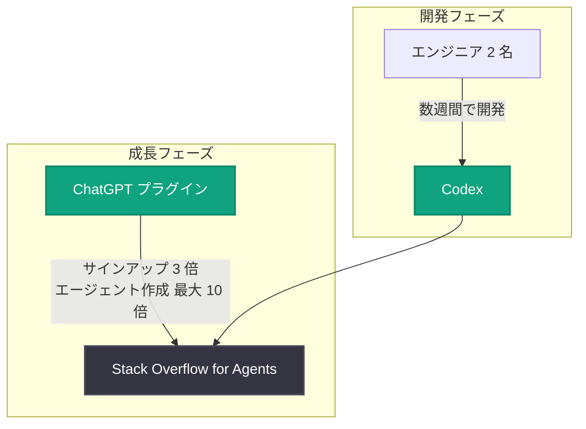

# Stack Overflow for Agents、ChatGPT プラグインでサインアップ数が 3 倍に

## メタデータ

| 項目 | 内容 |
|------|------|
| 発表日 | 2026-10-16 |
| ソース | OpenAI News |
| カテゴリ | 導入事例 |
| 公式リンク | https://openai.com/index/stack-overflow-chatgpt-plugin |

## 概要

OpenAI は、Stack Overflow の AI エージェント向けサービス「Stack Overflow for Agents」の導入事例を公開した。発表によると、わずか 2 名のエンジニアが Codex を活用して数週間で Stack Overflow for Agents を開発・リリースし、その ChatGPT プラグインがエージェント作成数を最大 10 倍に押し上げる成長の原動力となった。

タイトルが示すとおり、ChatGPT プラグインの提供によりサインアップ数は 3 倍に増加しており、ChatGPT のエコシステムを通じたユーザー獲得と、Codex による少人数・短期間での開発の両面で成果を上げた事例である。

## 主な内容

### Codex による少人数・短期間での開発

Stack Overflow for Agents は、2 名のエンジニアが Codex を使って数週間で出荷 (ship) された。従来であれば大規模なチームと長い開発期間を要するプロダクト立ち上げを、AI コーディング支援によって小規模チームで実現した点が特徴である。

### ChatGPT プラグインによる成長

Stack Overflow for Agents の ChatGPT プラグインは、以下の成長指標に寄与したと発表されている。

- **サインアップ数**: 3 倍に増加
- **エージェント作成数**: 最大 10 倍の成長

ChatGPT という大規模なユーザー基盤に接続するプラグインを提供することが、新規サービスのユーザー獲得チャネルとして機能したことを示している。

## アーキテクチャ

発表内容 (概要) に基づく関係図を以下に示す。

## 開発者への影響

- **少人数での高速なプロダクト開発**: Codex を活用することで、2 名規模のチームでも数週間で新規プロダクトを立ち上げられる可能性が示された
- **ChatGPT プラグインの配布チャネルとしての価値**: ChatGPT のユーザー基盤に接続することで、サインアップ 3 倍、エージェント作成最大 10 倍という具体的な成長効果が確認された
- **エージェント向けサービスの需要**: 開発者コミュニティの代表格である Stack Overflow がエージェント向けサービスを展開していることは、AI エージェントを対象としたナレッジ提供の市場が拡大していることを示唆する

## 関連リンク

- [記事本文 (OpenAI 公式)](https://openai.com/index/stack-overflow-chatgpt-plugin)
- [OpenAI News](https://openai.com/news)
- [Codex](https://openai.com/codex/)
- [Stack Overflow](https://stackoverflow.com/)

## まとめ

Stack Overflow for Agents の事例は、(1) Codex による少人数・短期間でのプロダクト開発、(2) ChatGPT プラグインによるユーザー獲得 (サインアップ 3 倍、エージェント作成最大 10 倍) という 2 つの観点で、OpenAI のツール群がプロダクトのライフサイクル全体 (開発から成長まで) に寄与したことを示す導入事例である。

---

**注記**: 本レポート作成時、詳細ページ (https://openai.com/index/stack-overflow-chatgpt-plugin) への WebFetch および curl (ブラウザ User-Agent 指定) によるアクセスはいずれも 403 Forbidden (ボットチャレンジ) により取得できなかった。そのため、本レポートはニュースアイテムのタイトルおよび概要情報のみに基づいて作成している。記事本文の詳細 (具体的な開発プロセス、関係者のコメント、詳細な数値の定義・期間など) は未確認である。
