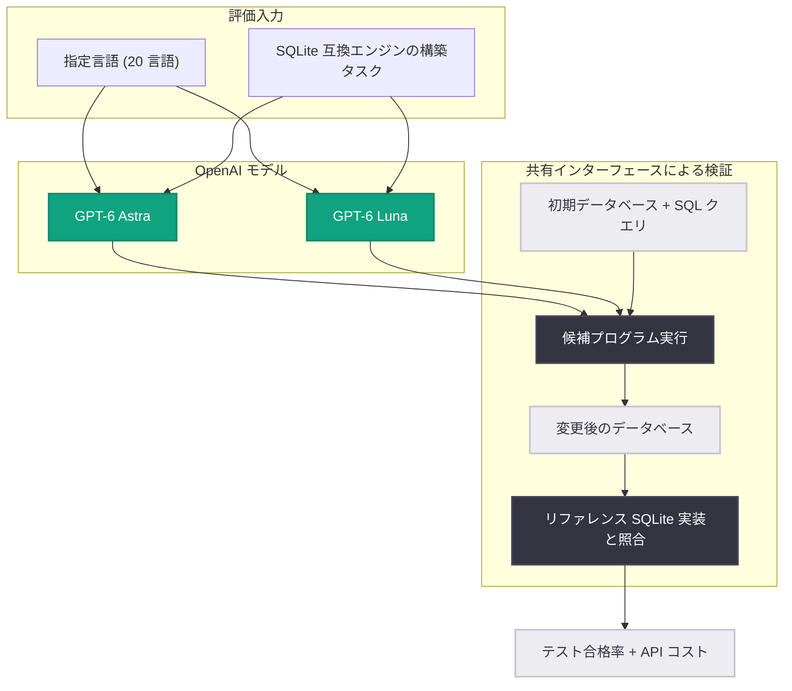

# 低リソースプログラミング言語におけるコーディング能力の進化

## メタデータ

| 項目 | 内容 |
|------|------|
| 発表日 | 2026-10-19 |
| ソース | OpenAI Research |
| カテゴリ | 研究成果 / Publication |
| 公式リンク | https://openai.com/index/low-resource-programming-languages |

## 概要

OpenAI は、COBOL、Fortran、Visual Basic、OCaml などの低リソースプログラミング言語におけるコーディング能力の大幅な向上を発表した。これらの言語は Python や JavaScript と比較して学習に利用できるコードやドキュメントが少ないが、世界中の重要インフラや基幹サービスを支えている。COBOL はオンラインバンキングシステムの 40% 超、対面クレジットカード取引の 80%、ATM 取引の 95% を支え、Fortran は気象予報や核記録の安全性分析に使用されている。

進捗を測定するため、OpenAI は 2 つの新しい評価を開発した。**MultiLangBench**: 20 の異なるプログラミング言語で SQLite 互換のデータベースエンジンをゼロから構築できるかをテストする評価。**COBOL 移行評価**: 既存のプログラムの動作を保持したまま別の言語へ移行できるかをテストする評価。最新モデルは両評価で大幅な改善を示し、より低いコストで大幅に高い精度を達成した。

## 主な内容

### 背景 - なぜ低リソース言語が重要か

この取り組みは、コーディングモデルがこれらの言語で苦戦することが多いという開発者やエンタープライズ顧客からのフィードバックに基づいている。レガシーソフトウェアの保守と近代化には以下の困難が伴う。

- **不完全なドキュメント**: 仕様書が存在しない、または古い
- **開発者の退職**: オリジナルの開発者がすでに会社を去っている
- **コードにのみ存在するビジネスルール**: 重要な業務ロジックがコード内にしか記録されていない

バグ修正であれ他言語への移行であれ、チームはシステムが依存する動作を正確に保持する必要がある。

### 評価 1: SQLite をゼロから構築する (MultiLangBench)

MultiLangBench は、指定されたプログラミング言語で SQLite 互換のデータベースエンジンを構築するようモデルに求める評価である。モデルはコードベースの整理、状態管理、エラー処理を行い、既存機能を保持しながら新機能を追加しなければならない。

**言語間の比較方法**: データベースファイルを共有インターフェースとして使用する。候補プログラムは初期データベースと SQL クエリを受け取り、変更後のデータベースを出力する。リファレンスの SQLite 実装を使って結果のデータベースが期待される内容を持つかを検証するため、エンジンの構築に使用した言語に関係なく同じテストを適用できる。テストは SQLite の既存テストスイートをこの形式に適応させたもので、長時間のコーディングセッションでどれだけ動作する機能を構築できるかを、テスト合格率と API コストの両面で測定する。

**対象 20 言語**: C、C#、C++、COBOL、Common Lisp、Fortran、Go、Java、JavaScript、Lean、OCaml、PHP、PowerShell、Python、Ruby、Rust、Scala、Swift、Visual Basic、Zig

#### GPT-6 Astra の結果 (最大 reasoning effort)

| 言語 | GPT-5.6 Sol | GPT-6 Astra |
|------|------------|-------------|
| 20 言語平均 | 26.8% | **87.4%** |
| COBOL | 10.9% | 72.1% |
| OCaml | 25.6% | 85.8% |
| Fortran | 21.4% | 83.5% |
| Visual Basic | 27.5% | 89.4% |

テストした全言語で改善が見られ、20 言語中 19 言語で 83% 超を達成した。COBOL は 72% で依然として最難関の言語である。

#### GPT-6 Luna の結果 (低コストオプション)

GPT-6 Luna もテストした全言語で GPT-5.6 Sol を上回り、最大 reasoning effort で平均テスト合格率 40.3% を達成した。

| 言語 | GPT-5.6 Sol | GPT-6 Luna |
|------|------------|------------|
| 20 言語平均 | 26.8% | 40.3% |
| COBOL | 10.9% | 17.1% |
| OCaml | 25.6% | 34.1% |
| Fortran | 21.4% | 31.4% |
| Visual Basic | 27.5% | 41.6% |

**コスト効率**: 推定平均 API コストはサンプルあたり $0.77 で、GPT-5.6 Sol の $3.48 と比較して約 78% 低い。

MultiLangBench の評価セットアップとテストスイートは各言語の結果とともに GitHub で公開されており、開発者は評価内容を確認し、使用する言語でのパフォーマンスをレビューし、自身の作業に関わるギャップを特定できる。

### 評価 2: COBOL コードベースの移行

2 つ目の評価は、COBOL プログラムの動作を保持したまま C++、Java、Kotlin、Python、Rust のいずれかへ移行するようモデルに求める。

移行の成功には、プログラムのビジネスロジックと COBOL 固有の言語動作の両方を理解する必要がある。COBOL プログラムは金融取引や業務記録を処理することが多く、丸めルールや欠損レコードの処理といった詳細がビジネス要件を反映している。例えば、COBOL の固定小数点演算は、明示的に丸めが要求されない限り余分な小数桁を切り捨てる。代わりに値を丸めてしまう書き換えは、エラーなく実行されながら異なる金融計算結果を生む可能性がある。

**評価方法**: 観測可能な出力のバイト単位の完全一致 (byte-for-byte parity) を要求する hidden tests で評価し、全テストに合格した場合のみ移行成功とみなす。

| 指標 | GPT-5.6 Sol | GPT-6.1 Sol |
|------|------------|-------------|
| 精度 (low reasoning effort) | 5.4% | **86.6%** |
| 精度 (高 reasoning effort) | - | **97.9% (ほぼ飽和)** |
| API コスト (low 設定時) | 100% | 61% |

なお、こうした動作保持能力はレガシーシステムの保守・近代化を行うチームに有用だが、本番ソフトウェアへの適用には、システムのビジネスルールや依存関係に対する専門家によるレビューとテストが引き続き必要である。

## 技術的な詳細

### MultiLangBench の評価パイプライン

### COBOL 移行評価のフロー

## 開発者への影響

- **レガシーシステムの近代化が現実的に**: COBOL 移行で 97.9% の精度 (高 reasoning effort) を達成したことで、金融機関などの基幹システムの移行支援ツールとしての実用性が大きく向上した
- **コスト効率の改善**: GPT-6 Luna はサンプルあたり $0.77 と GPT-5.6 Sol 比で約 78% 低いコストを実現し、GPT-6.1 Sol の COBOL 移行も 61% のコストで大幅な精度向上を達成した
- **評価の透明性**: MultiLangBench が GitHub で公開されたことで、開発者は自分の使用言語でのモデル性能を自ら検証し、ギャップを特定できる
- **動作保持の重要性への注目**: 丸めルールや欠損レコード処理など、ビジネス要件を反映した細部の動作保持が評価基準として明示された。ただし本番適用には専門家によるレビューとテストが引き続き必要
- **幅広い言語でのソフトウェアエンジニアリング**: OpenAI の目標は、未知のリポジトリの理解、変更の計画、ビルドツールの使用、テスト実行、デバッグといったスキルをより多くの言語に適用できるようにすることである

## 関連リンク

- [Advancing Coding in Low-Resource Programming Languages (OpenAI)](https://openai.com/index/low-resource-programming-languages)
- [OpenAI Research](https://openai.com/research)
- [OpenAI 公式ドキュメント](https://platform.openai.com/docs)
- MultiLangBench 評価セットアップとテストスイート (GitHub で公開)

## まとめ

OpenAI は低リソースプログラミング言語でのコーディング能力を測定する 2 つの新評価、MultiLangBench と COBOL 移行評価を公開した。GPT-6 Astra は 20 言語での SQLite 構築タスクで平均テスト合格率 87.4% (GPT-5.6 Sol は 26.8%) を達成し、COBOL (10.9% → 72.1%)、OCaml (25.6% → 85.8%)、Fortran (21.4% → 83.5%)、Visual Basic (27.5% → 89.4%) を含む全言語で改善した。COBOL 移行では GPT-6.1 Sol が低 reasoning effort で 86.6%、高 reasoning effort で 97.9% と評価をほぼ飽和させた。精度向上とコスト低減の両立により、世界の基幹サービスを支えるレガシーソフトウェアの保守・近代化に AI を活用する道が大きく開かれた。
