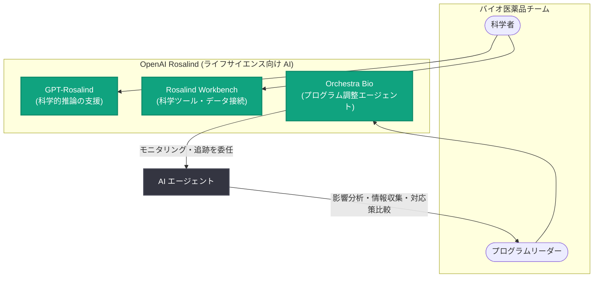

# OpenAI が Orchestra Bio の買収を発表 - ライフサイエンス R&D に AI オペレーションを導入

## メタデータ

| 項目 | 内容 |
|------|------|
| 発表日 | 2026-10-20 |
| ソース | OpenAI News |
| カテゴリ | 企業ニュース (買収) |
| 公式リンク | https://openai.com/index/openai-to-acquire-orchestra-bio |

## 概要

OpenAI は 2026 年 10 月 20 日、Orchestra Bio の買収を発表した。Orchestra Bio は、バイオ医薬品チームが創薬開発の複雑なプロセスを調整 (オーケストレーション) するのを支援するプラットフォームを開発している企業である。Orchestra Bio のチームと技術は、OpenAI のライフサイエンス研究向け AI モデル・ツール群である「Rosalind」に統合される。

この買収の目標は、科学者の発見を支援するだけでなく、新しい治療法をより早く患者に届けるために必要な業務管理 (オペレーション) まで AI で支援することにある。

## 主な内容

### 買収の背景

- 新薬開発は、米国においてターゲット発見から規制承認まで平均で約 10〜15 年かかる極めて複雑なプロセスである
- 創薬には科学面の課題だけでなく、社内の複数部門や外部パートナーをまたぐプログラム調整が必要であり、現状では分断されたシステムに依存しがちである
- OpenAI は、AI がこうした専門的タスクや複雑なワークフローを担える転換点に差し掛かっていると述べている

### Orchestra Bio について

- バイオテック、ソフトウェア、AI にまたがる経験を持つチームが、創薬開発を調整するためのプラットフォームを開発
- 人間と AI エージェントが協働して医薬品プログラムを前進させる仕組みを提供
- 科学者やプログラムリーダーは、研究やキャンペーンのモニタリング・追跡をエージェントに委任し、自身は意思決定や問題対処に時間を使える
- 例として、製造バッチの失敗が臨床試験の開始を遅らせるなど、プログラムの一部で発生した問題が他に波及するケースに対応する。エージェントは影響を受ける活動やタイムラインの特定、関連情報の収集、対応策の比較を支援し、最終的な次の行動は人間が決定する

### Rosalind との統合

Orchestra Bio は、OpenAI のライフサイエンス向け AI 群「Rosalind」に統合される。Rosalind は以下で構成される。

| コンポーネント | 役割 |
|---------------|------|
| GPT-Rosalind | 生物学・化学の問いに関する科学者の推論を支援 |
| Rosalind Workbench | AI の能力を科学ツールやデータと接続し、結果分析や実験計画を支援 |

### パートナーシップ事例

- **Novo Nordisk**: 同社の規模と科学的専門性を、強固なガバナンスを維持しながら R&D と商業実行の高速化につなげることを目指す
- **Moderna**: AI が複雑なデータからの洞察を実験ワークフローに変換するのを支援し、R&D 加速の可能性を追求

## アーキテクチャ

## 影響

### ライフサイエンス業界への影響

- 創薬の科学面 (推論・実験設計) に加えて、業務面 (プログラム調整・進捗管理) でも AI 活用が進む
- 分断されたシステムに依存していたプログラム調整が、人間と AI エージェントの協働モデルに移行する可能性がある
- 平均 10〜15 年かかる新薬開発プロセスの短縮が期待される

### AI と人間の役割分担

- エージェントがモニタリング・追跡・情報収集・選択肢の比較を担い、人間は意思決定に集中するという分担が明確化されている
- 最終判断は人間が行う設計であり、医薬品開発におけるガバナンスを重視した統合が示されている

## 関連リンク

- [公式発表: OpenAI to acquire Orchestra Bio](https://openai.com/index/openai-to-acquire-orchestra-bio)
- [OpenAI News](https://openai.com/news)

## まとめ

OpenAI は Orchestra Bio の買収により、ライフサイエンス向け AI 群「Rosalind」に創薬開発のオペレーション調整機能を加える。GPT-Rosalind による科学的推論の支援、Rosalind Workbench による実験計画・結果分析に加え、Orchestra Bio の人間と AI エージェントの協働プラットフォームが統合されることで、アイデア探索から実験設計、結果の解釈、治療法を前進させるための業務調整まで、創薬・開発プロセス全体を AI が支援するというビジョンに向けた一歩となる。なお、買収金額や契約条件、Orchestra Bio の創業者名は公式発表には記載されていない。
