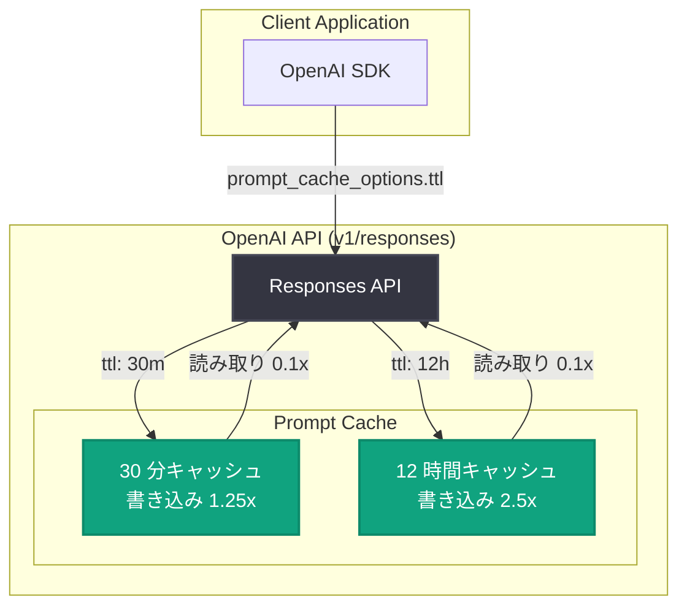

# Responses API で 12 時間プロンプトキャッシュが選択可能に

## メタデータ

| 項目 | 内容 |
|------|------|
| 発表日 | 2026-10-20 |
| ソース | OpenAI API Changelog |
| カテゴリ | API アップデート (Feature · API: v1/responses) |
| 公式リンク | https://developers.openai.com/api/docs/changelog |

## 概要

OpenAI は 2026 年 10 月 20 日、Responses API で 12 時間のプロンプトキャッシュ保持期間を選択可能にしたと発表した。Changelog では「12-hour prompt caching keeps shared instructions, tools, and context cached longer」と説明されており、共有インストラクション、ツール定義、コンテキストをより長くキャッシュに保持できる。リクエストの間隔が数時間空くワークロードでも、低価格のキャッシュ入力料金の恩恵を受けられるようになる。

12 時間キャッシュの書き込みコストは、未キャッシュ入力トークン価格の 2.5 倍。従来のデフォルトである 30 分保持 (書き込み 1.25 倍) と使い分けることで、ワークロードの再利用パターンに応じたコスト最適化が可能になる。

## 主な内容

### 12 時間保持の位置づけ

公式のプロンプトキャッシュガイドによると、12 時間保持は「長い間隔を挟んで再利用される安定したプレフィックス」向け、30 分保持は「頻繁に再利用される会話・エージェントの文脈」向けとされている。12 時間は「最低保持期間」であり、削除期限ではない。

なお、30 分キャッシュへの読み取りは有効期限を少なくとも読み取り後 30 分に更新するが、12 時間キャッシュのタイマーは読み取りで再始動せず、追加の書き込み課金も発生しない。

### 指定方法

GPT-5.6 以降のモデルでは、Responses API のリクエストに `prompt_cache_options.ttl` を指定する。

- 指定できる値は `"30m"` (デフォルト) または `"12h"`
- リクエスト単位で設定し、コンテンツ内の個別のブレークポイント `prompt_cache_breakpoint.ttl` で上書き可能
- 非対応の値を指定すると `400 invalid_request_error` が返る
- 明示ブレークポイントは 1 リクエストあたり最大 4 つの書き込みスロット (暗黙モード併用時は暗黙が 1 枠を消費)

旧モデルで使用されていた `prompt_cache_retention` (値は `in_memory` または `24h`) には 12 時間設定はなく、ドキュメントでは `prompt_cache_options.ttl` への置き換えが移行時の指針として示されている。

### 対象モデルと前提条件

- `ttl` オプションは GPT-5.6 以降のモデルで対応 (12 時間保持は Responses API のみ)
- 最小キャッシュ可能トークン数は、GPT-5.6 以降で可視入力トークン 1,024 (非表示システムトークンは含まない)
- キャッシュは KV テンソルを保存する方式で、組織間やリージョン境界を越えた共有は不可

## 技術的な詳細

### 料金 (GPT-5.6 以降)

| 項目 | 料率 (未キャッシュ入力単価比) |
|------|------------------------------|
| キャッシュ書き込み (30 分) | 1.25 倍 |
| キャッシュ書き込み (12 時間) | 2.5 倍 |
| キャッシュ読み取り | 0.1 倍 (GPT-6.1 Sol は 0.05 倍)。保持期間に関係なく同一 |

料金に関する注意点。

- 書き込み料金は通常入力への加算サーチャージではなく、総額レート ("These are total write rates, not surcharges on top of ordinary input")
- 30 分カバレッジを 12 時間に格上げすると、該当トークン分の 12 時間書き込みが新たに課金される (旧書き込み分のクレジットはなし)
- 1 リクエスト内で各トークンは、それをカバーする書き込みのうち最長の保持期間で一度だけ課金される

### コードサンプル

公式ドキュメントに掲載されているリクエスト例。リクエスト全体のデフォルト TTL を `30m` とし、共有インストラクション部分のみブレークポイントで `12h` に上書きしている。

```json
{
  "model": "gpt-6.1-sol",
  "prompt_cache_options": { "mode": "explicit", "ttl": "30m" },
  "input": [
    {
      "role": "developer",
      "content": [{
        "type": "input_text",
        "text": "Shared instructions and reference material reused throughout the day...",
        "prompt_cache_breakpoint": { "mode": "explicit", "ttl": "12h" }
      }]
    },
    {
      "role": "user",
      "content": [
        {
          "type": "input_text",
          "text": "Session context reused over the next few minutes...",
          "prompt_cache_breakpoint": { "mode": "explicit" }
        },
        { "type": "input_text", "text": "The current question, which does not need a cache write..." }
      ]
    }
  ]
}
```

### 使用量レポート

レスポンスの `input_tokens_details.cache_write_tokens_details` で、書き込みトークンが `ttl_30m_tokens` と `ttl_12h_tokens` に分解される。両者は重複せず、合計が `cache_write_tokens` と一致する。コスト計算では、30 分書き込みに入力単価 × 1.25、12 時間書き込みに × 2.5、`cached_tokens` にはキャッシュ入力単価を適用する。

## アーキテクチャ



## 開発者への影響

- **間欠的なワークロードのコスト削減**: 数時間おきに実行されるバッチ処理、カスタマーサポート、日中に断続的に利用される社内ツールなどで、リクエスト間隔が 30 分を超えてもキャッシュヒット (読み取り 0.1 倍) を維持できる
- **コスト設計の見直しが必要**: 12 時間書き込みは入力単価の 2.5 倍のため、再利用頻度が低いプレフィックスに適用すると逆にコスト増になり得る。安定した共有プレフィックスにのみ `12h` を適用し、セッション文脈は `30m` に留める設計が有効
- **ブレークポイントによる細かな制御**: `prompt_cache_breakpoint.ttl` により、同一リクエスト内で保持期間を部分ごとに使い分けられる
- **移行の指針**: 旧モデルの `prompt_cache_retention` から `prompt_cache_options.ttl` への置き換えがドキュメントで案内されている。GPT-5.6 以降への移行時はパラメータの変更が必要
- **使用量の可視化**: `cache_write_tokens_details` の `ttl_30m_tokens` / `ttl_12h_tokens` により、保持期間別の書き込みコストをモニタリングできる

## 関連リンク

- [OpenAI API Changelog](https://developers.openai.com/api/docs/changelog)
- [プロンプトキャッシュガイド (公式ドキュメント)](https://developers.openai.com/api/docs/guides/prompt-caching)
- [OpenAI API リファレンス](https://platform.openai.com/docs/api-reference)

## まとめ

Responses API に 12 時間のプロンプトキャッシュ保持期間が追加され、`prompt_cache_options.ttl` (または `prompt_cache_breakpoint.ttl`) に `"12h"` を指定することで利用できるようになった。書き込みコストは入力単価の 2.5 倍 (30 分保持は 1.25 倍)、読み取りは保持期間に関係なく 0.1 倍。対象は GPT-5.6 以降のモデルで、12 時間保持は Responses API のみの提供となる。長い間隔を挟んで再利用される安定プレフィックスに適用することで、間欠的なワークロードのコストを効果的に削減できる。
