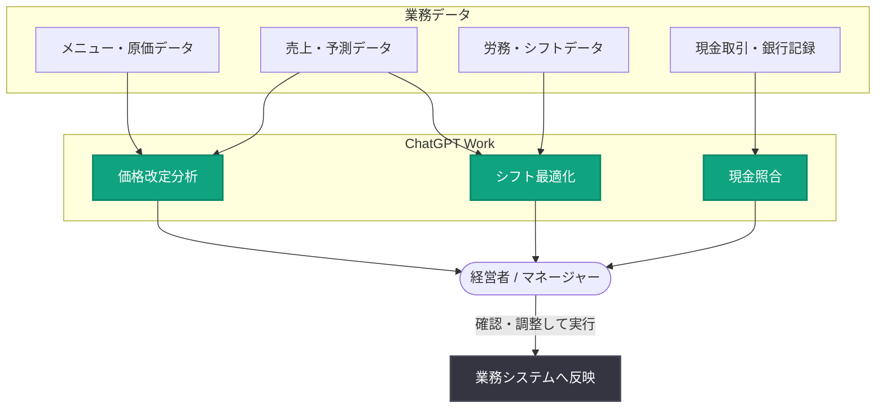

# フランチャイズ経営者が ChatGPT Work で現金照合時間を 94% 削減

## メタデータ

| 項目 | 内容 |
|------|------|
| 発表日 | 2026-10-20 |
| ソース | OpenAI News |
| カテゴリ | 導入事例 (ChatGPT Work) |
| 公式リンク | https://openai.com/index/ted-taylor-restaurant |

## 概要

半導体業界で 25 年のキャリアを積んだ後にレストラン業界へ転身した Ted Taylor 氏は、ニューメキシコ州で Schlotzsky's と Cinnabon を併設した 3 店舗を運営する独立系フランチャイズ経営者である。同氏は ChatGPT および ChatGPT Work を活用し、メニュー価格改定、人員配置、現金照合、設備メンテナンスといった顧客の目に見えないバックオフィス業務を大幅に効率化している。

主な成果として、メニュー価格改定にかかる時間を 95% 削減 (5 日間から 1~2 時間へ)、月次の現金照合を 3 時間から 5~10 分へ短縮 (約 94% 削減)、給与計算サイクルごとに 4 時間の手作業を削減した。さらに、シフト最適化により年間 50,000~100,000 ドルのフリーキャッシュフロー創出の可能性を見込んでいる。

## 主な内容

### 3 市場のメニュー価格改定を数分で完了

メニューの価格改定は年次の大がかりな作業であり、レシピ原価、商品の人気度、地元競合の価格、ポーションサイズ、店内注文とデリバリー注文の経済性の違いなど、複雑な分析を必要とする。Taylor 氏は ChatGPT Work でこれらの要素を統合し、従来 5 日かかっていた価格推奨の取得を 1~2 時間で完了している。

ワークフローは以下の通り。

1. **価格戦略の策定**: 地元競合の価格動向、ポーションサイズ、相対的な品質に基づき、ChatGPT Work で価格目標と戦略を調査・設定する
2. **データの投入**: カテゴリ分けされたメニュー一覧と現行の店内価格・デリバリー価格を渡し、全体の値上げ幅や商品ごとの増減方針を指定する
3. **分析の深化**: 商品レベルの販売履歴やサプライヤー価格を追加すると、価格変更による売上への影響推定や、原価目標に沿った商品単位の価格最適化が可能になる
4. **推奨価格の出力**: ChatGPT Work は店内価格とデリバリー価格の推奨値をスプレッドシートで返し、顧客維持や価格ショックの最小化、アドオン商品の最適配置といったビジネス成果に沿った全体戦略との関連付けも行う

初回利用時、Taylor 氏は手作業での分析も並行して実施した。その結果「ChatGPT Work はより深いローカル比較を行い、一部商品が競争力を失うような値上げを回避するのに役立った」と述べ、以降は ChatGPT で最初の推奨案を作成する方式に切り替えている。

> 「ChatGPT Work の推奨はとても優れているので、そこから始めて調整を加える方がはるかに速い」
>
> — Ted Taylor 氏 (Schlotzsky's / Cinnabon 独立系フランチャイズ経営者)

### 労働力の最適化とキャッシュフローの創出

Taylor 氏は 2 つの方法で人件費管理に ChatGPT Work を活用している。

**労働状況の分析**: 売上・労務データへの読み取り専用アクセスを ChatGPT Work に付与し、予定工数・予算工数・実工数を売上予測および実売上と比較する分析を実行している。過去 12 週間のデータも参照し、売上予測を恒常的に上回る、あるいは下回る店舗の傾向を考慮する。生成されるレポートは、残業、予定より長引いたシフト、人員配置の空白を検出し、マネージャーが確認すべき点をハイライトする。

**週次シフト作成のテスト**: 従業員の役割、研修状況、勤務可能時間、給与を記載した名簿と、売上水準ごとの必要人員数を ChatGPT Work に渡した。マネージャーが作成したシフトと ChatGPT Work の提案を比較し、繁忙期の増員ルールなど不足していた指示を特定して改善した。現在は ChatGPT Work が当該店舗の完全なシフトを作成し、マネージャーが確認・調整の上でシフト管理システムに入力している。

Taylor 氏は、シフト最適化により 3 店舗全体で時給労働コストを売上比 1~2 ポイント削減でき、年間 50,000~100,000 ドルのフリーキャッシュフローを創出できる可能性があると試算している。この資金は昇給、ボーナス、事業投資、利益分配の拡大に充てられる。

### バックオフィス業務の高速化

日常業務でも幅広く活用されている。

- **HR ポリシーの作成**: ニューメキシコ州が体液インシデント対応手順の文書化を義務付けた際、約 30 秒でドラフトを作成。従業員ハンドブック用のソーシャルメディアポリシーも ChatGPT で迅速に起草し、外部の HR 会社が修正なしでレビューを通過した
- **現金照合**: 3 店舗の現金取引データと銀行記録をアップロードし、取引と入金を照合する。従来 3 時間かかっていた月次照合が 5~10 分で完了する
- **給与計算**: 給与計算のインプットを ChatGPT Work で要約することで、サイクルごとに 4 時間の手作業を削減
- **備品・修理依頼ポータル**: 従業員が備品や修理を依頼できる Web ポータルを ChatGPT Work で構築。専用メールアドレスへの通知と依頼ステータスの追跡が可能

## ワークフロー概要

## 主な成果まとめ

| 業務 | 導入前 | 導入後 | 削減率 |
|------|--------|--------|--------|
| メニュー価格改定 | 5 日 | 1~2 時間 | 95% |
| 月次現金照合 | 3 時間 | 5~10 分 | 約 94% |
| 給与計算 | - | サイクルごとに 4 時間削減 | - |
| シフト最適化 | - | 年間 5 万~10 万ドルのキャッシュフロー創出見込み | - |

## ビジネスへの影響

本事例は、大企業だけでなく小規模事業者にとっても ChatGPT Work が実用的であることを示している。

- **スモールビジネスへの適用性**: 意思決定に使うのと同じデータとガイドラインを ChatGPT に与え、自分で行った場合の結果と比較検証するという Taylor 氏のアプローチは、あらゆる小規模事業者が再現可能
- **段階的な信頼構築**: 結果への信頼が高まるにつれて適用業務を拡大し、実行前には必ず結果をレビューするという運用が、安全な AI 活用のモデルケースとなる
- **時間削減を超えた価値**: 従来はスキップしていたかもしれない分析を実施できるようになり、顧客対応、従業員、事業成長により多くの時間を割けるようになった

## 関連リンク

- [公式記事: Franchisee reconciles cash in 94% less time with ChatGPT Work](https://openai.com/index/ted-taylor-restaurant)
- [ChatGPT Business/Work](https://openai.com/chatgpt/business/)
- [OpenAI News](https://openai.com/news)

## まとめ

ニューメキシコ州で Schlotzsky's / Cinnabon の 3 店舗を運営する独立系フランチャイズ経営者 Ted Taylor 氏は、ChatGPT Work を活用してメニュー価格改定時間を 95% 削減、月次現金照合を 3 時間から 5~10 分に短縮し、給与計算サイクルごとに 4 時間を削減した。さらにシフト最適化により年間最大 100,000 ドルのフリーキャッシュフロー創出を見込む。同じデータを AI に与えて自身の判断と比較検証しながら適用範囲を広げるアプローチは、小規模事業者における実践的な AI 導入モデルとして注目される。
