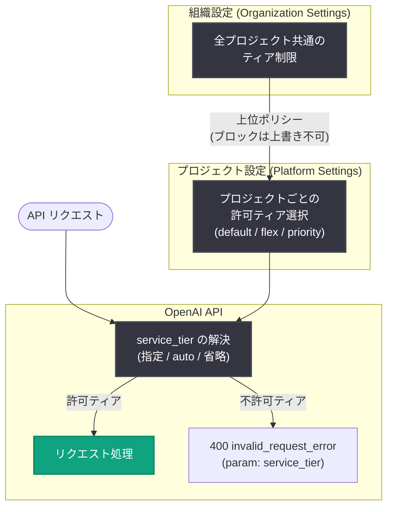

# プラットフォーム設定でプロジェクトごとのサービスティア選択が可能に

## メタデータ

| 項目 | 内容 |
|------|------|
| 発表日 | 2026-10-21 |
| ソース | OpenAI API Changelog |
| カテゴリ | API 更新 (Feature) |
| 公式リンク | https://developers.openai.com/api/docs/changelog |

## 概要

OpenAI は 2026 年 10 月 21 日、プラットフォーム設定でプロジェクトごとに使用可能なサービスティアを選択できる機能を追加したと発表した。Changelog では「You can now choose which service tiers projects can use in Platform settings」と説明されており、あわせて「Organization settings can restrict service tiers for all projects」として、組織設定で全プロジェクトに対して一括でティアを制限することも可能になった。

これにより、組織管理者はプロジェクト単位・組織単位の 2 階層でサービスティアの利用ポリシーを統制できる。許可されていないティアを指定したリクエストは `400 invalid_request_error` で拒否されるため、意図しないティアの利用によるコストや挙動のばらつきを設定レベルで防止できる。

## 主な内容

### プロジェクト単位のティア選択

プラットフォーム設定 (プロジェクト設定) で、そのプロジェクトが使用できるサービスティアを選択できるようになった。公式エラーコードガイドによると、プロジェクトによる制限は以下のティアに適用される。

- 制限対象は `default`、`flex`、`priority` の各サービスティア ("Project restrictions apply to the `default`, `flex`, and `priority` service tiers")
- `fast` サービスティアは `priority` として評価される ("The `fast` service tier is evaluated as `priority`")
- Scale Tier はこのプロジェクトポリシーの対象外 ("Scale Tier remains outside this project policy")

### 組織単位の一括制限

組織設定では、全プロジェクトに対してサービスティアを制限できる。重要な制約として、公式ドキュメントには「Projects cannot enable tiers blocked by the organization」と明記されており、組織でブロックされたティアをプロジェクト側で有効化することはできない。つまり、組織設定が上位のポリシーとして機能し、プロジェクト設定はその範囲内でのみ選択できる。

### 制限時の API の挙動

許可されていないティアがリクエストされた場合、または解決された場合、API は次のエラーを返す。

- ステータス: `400 - Invalid service_tier argument`
- エラー種別: `invalid_request_error` (`error.param` は `service_tier`)
- メッセージ: "Invalid `service_tier` argument: The requested service tier is not allowed for this project."

注意すべき点として、`service_tier` を省略した場合や `auto` を指定した場合でも、解決先のティアがプロジェクトで許可されていなければ同じエラーが返る ("Requests that omit `service_tier` or set it to `auto` can also return this error")。

## 技術的な詳細

### service_tier パラメータとの関係

`service_tier` は API リクエストで処理ティアを指定するパラメータで、たとえば Flex processing を使う場合は `service_tier="flex"` を指定する。パラメータを省略した場合はプロジェクトのデフォルトモードが使用される。

```python
from openai import OpenAI

client = OpenAI()

# プロジェクトで flex ティアが許可されている場合のみ成功する
response = client.with_options(timeout=900.0).responses.create(
    model="gpt-6-astra",
    service_tier="flex",
    input="Classify this support ticket...",
)
```

プロジェクトで `flex` が許可されていない場合、上記のリクエストは `400 invalid_request_error` で失敗する。

### エラー発生時の解決手順

公式エラーコードガイドでは、以下の解決手順が示されている。

1. プロジェクト設定と組織設定の両方で許可されているティアを確認する (組織でブロックされたティアはプロジェクト側で有効化できない)
2. `service_tier` にプロジェクトで許可されているティアを指定する ("Set `service_tier` to a tier allowed for the project, or update the allowed service tiers in project settings")
3. `auto` 指定または省略時は、解決されるティアが許可されるようプロジェクト設定を更新する

## アーキテクチャ

組織設定とプロジェクト設定の 2 階層でティアの利用可否が判定される。



## 開発者への影響

- **コストガバナンスの強化**: 高コストの `priority` (および `priority` として評価される `fast`) や、挙動の異なる `flex` の利用をプロジェクト単位で制限できるため、本番・開発などプロジェクトの性質に応じたティア統制が可能になる
- **既存リクエストへの影響に注意**: `service_tier` を省略または `auto` 指定している既存のアプリケーションでも、解決先のティアが許可されていなければ `400` エラーが発生する。制限を導入する際は既存ワークロードのティア利用状況の確認が必要
- **エラーハンドリングの追加**: `invalid_request_error` (`error.param: service_tier`) を考慮したエラーハンドリングを実装し、エラー発生時はプロジェクト設定・組織設定の確認を促す運用が推奨される
- **2 階層ポリシーの理解**: 組織設定が上位ポリシーとして機能し、プロジェクト側では組織がブロックしたティアを有効化できない。管理者は組織・プロジェクトの両設定を一貫して管理する必要がある
- **Scale Tier は対象外**: Scale Tier はこのプロジェクトポリシーの対象外のため、別途管理が必要

## 関連リンク

- [OpenAI API Changelog](https://developers.openai.com/api/docs/changelog)
- [エラーコードガイド (公式ドキュメント)](https://developers.openai.com/api/docs/guides/error-codes)
- [Flex processing ガイド (公式ドキュメント)](https://developers.openai.com/api/docs/guides/flex-processing)
- [OpenAI API リファレンス](https://platform.openai.com/docs/api-reference)

## まとめ

プラットフォーム設定でプロジェクトごとに使用可能なサービスティア (`default` / `flex` / `priority`) を選択できるようになり、組織設定では全プロジェクトへの一括制限も可能になった。組織でブロックされたティアはプロジェクト側で有効化できず、許可されていないティアへのリクエストは `400 invalid_request_error` (param: `service_tier`) で拒否される。`auto` 指定や省略時のリクエストも解決先のティアが不許可ならエラーになるため、制限を導入する際は既存ワークロードへの影響確認とエラーハンドリングの整備が重要となる。
