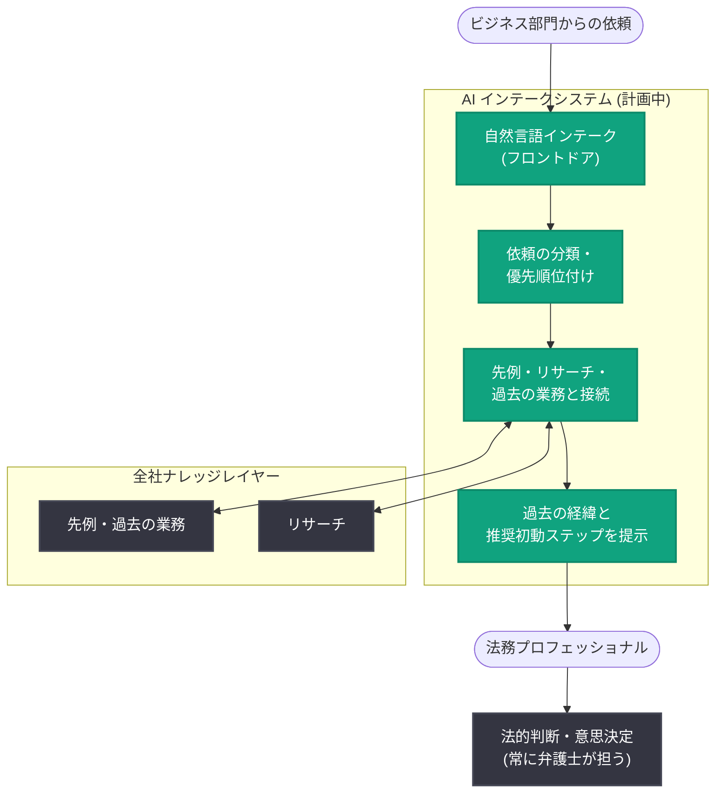

# AT&T が OpenAI と連携して社内法務業務を再構築 - LegalEdge チームによるインテーク改革と法的判断のスケール化

## メタデータ

| 項目 | 内容 |
|------|------|
| 発表日 | 2026-10-21 |
| ソース | OpenAI News |
| カテゴリ | 導入事例 |
| 公式リンク | https://openai.com/index/att-legal |

## 概要

AT&T は 2026 年 10 月 21 日、OpenAI との協業により社内法務部門の業務を再構築する取り組みを公開した。AT&T の社内法務部門には世界中に数百名の弁護士・法務プロフェッショナルが在籍しており、ビジネス部門に助言する前に、事実関係や文書、過去の関連業務を収集する必要がある。その知見はしばしば複数のチームに分散しており、こうした経験・知識へのアクセスを容易にすることが部門の業務改善の中心課題となっている。

今回の協業は、AI を主要な法務案件に適用することに注力する AT&T のチーム「LegalEdge」(弁護士、法務プロフェッショナル、技術者、プロジェクトマネージャーで構成) の活動を土台とするものである。次のステップとして、社内に蓄積された専門知識を、弁護士のデスクに届く案件により多く接続することを目指す。

## 主な内容

### 全社的な「ナレッジレイヤー」の構築

AT&T の Senior Executive Vice President 兼 General Counsel である David McAtee 氏は、OpenAI とのパートナーシップについて次のように述べている。

> 「OpenAI とのパートナーシップにより、全社のナレッジレイヤーを支える『配管 (plumbing)』を構築し、私たち全員がそこから知識を引き出せるようになる」

つまり、分散した法務知識を一元的に活用できる基盤を OpenAI と共同で整備し、部門全体がその知識基盤を利用するという構想である。

### 自然言語インテークシステムの計画

ビジネス部門からの依頼は社内のあらゆる場所から届き、法務チームはリスクを見逃すことなく迅速に対応する必要がある。助言を行う前には、問題の理解、関連コンテキストの収集、優先順位の判断が必要であり、インテーク (案件受付) はビジネスを守るうえで極めて重要なプロセスとなっている。

AT&T の Chief Compliance Officer である Bill Ryan 氏は、計画中のイニシアチブの 1 つとして、「自然言語インテークを備えたフロントドア」を持つインテークシステムを挙げている。このシステムは以下を行う。

- 依頼の分類と優先順位付け
- 関連する判例・先例、リサーチ、過去の業務との接続
- 担当する法務プロフェッショナルへの、過去の経緯 (historical context) と推奨される初動ステップの提示

これにより、弁護士は案件評価に必要な資料収集に費やす時間を減らし、より多くの情報を持った状態から業務を開始できるようになる。

### 法的判断のスケール化と人間による意思決定の堅持

Ryan 氏は「将来について最も期待しているのは、法的判断 (legal judgment) をより大きなスケールで提供できるようになることだ」と述べ、部門の判断力をビジネスのより多くのニーズに届ける機会と捉えている。

一方、McAtee 氏はこの取り組みを導く原則を明確にしている。

> 「意思決定は常に弁護士に委ねられる (The decision making will always remain with the lawyers)」

パートナーシップの目標は、より良い情報を手の届くところに置くことで、弁護士が専門性の発揮により多くの時間を使えるようにすることにある。

## ワークフロー

計画中のインテークシステムによる業務フローを整理すると以下のようになる。

## 影響

### 企業法務への影響

- 大企業の社内法務部門における AI 活用の具体的なモデルケースとなる。特に、分散した法務知識を「ナレッジレイヤー」として統合し、インテークの段階から活用するアプローチが示された
- 弁護士の業務のうち、資料収集・コンテキスト把握といった準備作業を AI が支援し、人間は判断・助言に集中するという役割分担が明確である
- 限られた人数の法務部門でも、より多くのビジネスニーズに法的判断を提供できる「スケール化」の方向性が示された

### AI と人間の役割分担

- 「意思決定は常に弁護士が行う」という原則が明示されており、AI はあくまで情報提供と初動支援に徹する設計である
- 法務・コンプライアンスという高いガバナンスが求められる領域での AI 導入事例として、他業界にも参考となる

## 関連リンク

- [公式記事: How AT&T is rethinking in-house legal work with OpenAI](https://openai.com/index/att-legal)
- [OpenAI News](https://openai.com/news)

## まとめ

AT&T は OpenAI との協業により、社内法務部門の知識基盤 (ナレッジレイヤー) の構築と、自然言語によるインテークシステムの整備を進めている。LegalEdge チームの活動を土台に、依頼の分類・優先順位付け、先例や過去の業務との接続、推奨初動ステップの提示を AI が担うことで、弁護士はより多くの情報を持った状態から案件に取り組めるようになる。「意思決定は常に弁護士が行う」という原則のもと、法的判断をより大きなスケールで提供することが狙いである。なお、使用するモデルや導入時期などの技術的詳細は公式記事には記載されていない。
