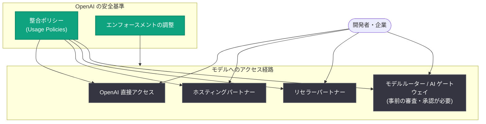

# 一貫した基準による広範なアクセス - OpenAI が配信パートナー全体で安全基準を統一

## メタデータ

| 項目 | 内容 |
|------|------|
| 発表日 | 2026-10-21 |
| ソース | OpenAI News |
| カテゴリ | ポリシー |
| 公式リンク | https://openai.com/index/broad-access-through-consistent-standards |

## 概要

OpenAI は 2026 年 10 月 21 日、モデルを提供するサービス全体で安全ポリシーを整合させる取り組みを発表した。過去数か月にわたり顧客やパートナーと協力し、OpenAI のモデルを提供する各サービスにおいてセーフガード (安全対策) を一貫して適用するための体制を整えてきたという。あわせて、開発者が要件を理解しやすくなるよう利用規約 (Usage Policies) を更新し、2026 年 11 月 20 日に発効する。

GPT-6 Astra のようなモデルの能力拡大に伴い、OpenAI は、ユーザーがモデルに直接アクセスする場合でもパートナー経由でアクセスする場合でも、セーフガードが同等に機能することを重視している。

## 主な内容

### 責任は OpenAI 自身から始まる

OpenAI は、モデル展開の前後で多層的な安全対策を講じていると説明している。

- **展開前**: モデルの能力とリスクを評価し、安全要件に従うよう訓練し、意図的な回避の試みに対してセーフガードが機能するかをテストする
- **展開後**: 潜在的な悪用を監視し、懸念を調査する。サイバー悪用の緩和では、有害なリクエストを拒否するようモデルを訓練するとともに、インタラクション全体から不審なパターンを検出するシステムを運用している
- **Trusted Access プログラム**: 最も強力な能力へのアクセスについて、適格性要件とアクセス条件を定める追加の保護層として機能する

セーフガードにはモデル自体に組み込まれるものと、モデルを取り巻くシステムや人に依存するものがあり、直接アクセスでもパートナー経由でも双方が有効である必要があるとしている。

### サービス全体での一貫した基準

開発者や企業がどのサービス経由でモデルにアクセスしても、一貫したセーフガードが適用されるべきだという考えに基づき、OpenAI はプロバイダー間でセーフガードを整合させるポリシーを策定した。

- ポリシーは、OpenAI への直接アクセス、モデルをホストするパートナー、リセラーパートナー経由のアクセスのすべてに適用される
- 各パートナーの実装が OpenAI の安全基準を満たすか上回ることを確認するための協力を進めている
- パートナーには、OpenAI と同等のセーフガードの維持、潜在的な違反の調査、懸念が特定された際の適切な対応が求められる
- エンフォースメント (執行) の調整も含まれ、アクセス制限がモデルを提供するサービス全体で有効に保たれるようにする

また、サービスごとの動作や顧客の利用方法の違いを考慮した実装も重視しており、顧客に機密データの選択権とコントロールを提供しつつ効果的なセーフガードを実現する例として、Private Safety Processing の取り組みを挙げている。

### 明確なポリシーと予測可能なエンフォースメント

2026 年 11 月 20 日発効の更新版 Usage Policies では、安全なモデル開発と AI のセンシティブな用途に関するルールが明確化される。

| 項目 | 内容 |
|------|------|
| 発効日 | 2026 年 11 月 20 日 |
| 対象 | モデルルーターや AI ゲートウェイなど、モデルへの直接アクセスを提供するサービス |
| 新要件 | アクセス提供の前に OpenAI の審査と承認を得ることが必須 |

悪用への対応については、以下の方針が示されている。

- **悪用経路の想定**: 顧客はエンドユーザー、侵害されたアカウント、漏えいした API キーを通じて悪用に直面し得るため、OpenAI は顧客と協力して問題の把握と対処にあたる
- **SafetyIDs の導入**: 顧客が提供できる識別子で、OpenAI がエンドユーザーの身元を知ることなく、調査時に個々のエンドユーザーを区別できるようにする。これにより、他のユーザーへの影響を抑えながら、潜在的な悪用により正確に対応できる
- **エンフォースメントの原則**: 文書化された行為とリスクに基づいて判断し、ルールを一貫して適用し、状況に比例した対応を行う。アクセスを制限した場合でも、行為・コミットメント・セーフガードに意味のある変化があれば制限を再検討する

## 開発者への影響

- OpenAI のモデルをどのサービス経由で利用しても、同等の安全基準とエンフォースメントが適用されるようになり、プロバイダー選択の自由度と予測可能性が高まる
- モデルルーターや AI ゲートウェイを運営する事業者は、2026 年 11 月 20 日以降、OpenAI モデルへの直接アクセスを提供する前に OpenAI の審査・承認が必要になる
- マルチテナント型のサービスを提供する開発者は、SafetyIDs を活用することで、一部のエンドユーザーによる悪用が調査対象となった場合でも、サービス全体への影響を抑えられる
- Usage Policies の更新内容を発効日までに確認し、自社サービスの運用がポリシーに適合しているかを点検する必要がある

## 関連リンク

- [公式発表: Broad access through consistent standards](https://openai.com/index/broad-access-through-consistent-standards)
- [OpenAI Usage Policies](https://openai.com/policies/usage-policies/)
- [OpenAI の安全性とアラインメントへのアプローチ](https://openai.com/safety/how-we-think-about-safety-alignment/)
- [Private Safety Processing (ゼロデータ保持の提供)](https://openai.com/index/offering-zero-data-retention-for-frontier-models/)
- [サイバーレジリエンスの強化](https://openai.com/index/strengthening-cyber-resilience/)
- [OpenAI News](https://openai.com/news)

## まとめ

OpenAI は、直接アクセス・ホスティングパートナー・リセラーのいずれの経路でも一貫したセーフガードが適用されるよう、配信パートナーとの間で安全ポリシーの整合を進めている。2026 年 11 月 20 日発効の更新版 Usage Policies では、モデルルーターや AI ゲートウェイに対する事前審査・承認の要件が加わるほか、エンドユーザーの匿名性を保ちながら悪用調査の精度を高める SafetyIDs の導入も進められる。明確なルールと一貫したセーフガードにより、開発者や企業が安心してサービスを選択し、構築・競争できる環境を整えることが狙いである。
