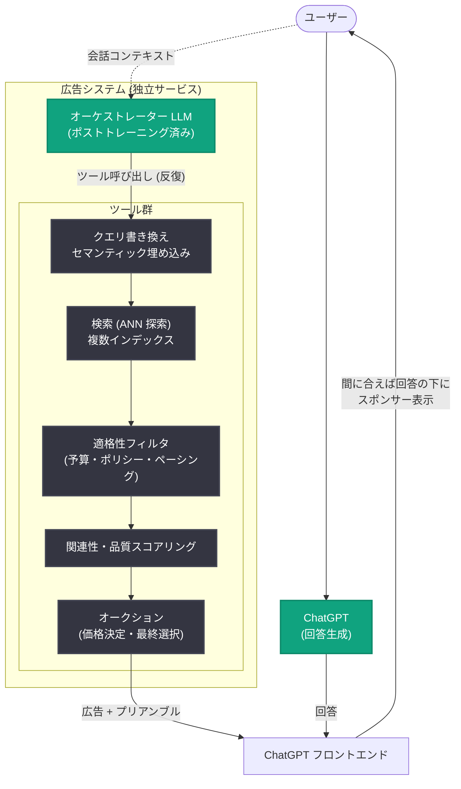

# ChatGPT の新しい広告スタックの構築 - ユーザーの信頼と関連性を支える LLM ベースのアーキテクチャ

## メタデータ

| 項目 | 内容 |
|------|------|
| 発表日 | 2026-10-21 |
| ソース | OpenAI News |
| カテゴリ | エンジニアリング |
| 公式リンク | https://openai.com/index/building-chatgpt-ad-stack |

## 概要

OpenAI は 2026 年 10 月 21 日、ChatGPT 向けに構築した新しい広告配信システム (広告スタック) の技術的な仕組みを解説する記事を公開した。従来の広告システムが検索クエリやページビューといった単発のイベントに反応する設計であるのに対し、ChatGPT ではユーザーの意図が会話の複数ターンにわたって発展・変化するため、OpenAI はポストトレーニングされたカスタムのフロンティア LLM (「オーケストレーター」と呼ばれる) を中核に据えた独自の広告スタックをゼロから構築した。

このシステムの特徴は、1) 会話をまたいで情報を記憶するステートフルな広告セッション、2) ツール呼び出しアーキテクチャで会話の文脈と意図を解釈し広告の選択・ランキング・配信を行うカスタム LLM、3) 広告選択プロセスを ChatGPT の回答生成から完全に分離し、広告が回答に影響しないようにする設計、の 3 点である。ChatGPT Ads はローンチから 200 日未満で年換算収益 10 億ドルに到達し、これまでに 10 万社以上の広告主が利用している。

## 主な内容

### エージェント型チャットにおける広告の課題

- 従来の広告システムは「検索クエリの送信」「ページの表示」といった明確なイベントを起点に、候補の取得、ランキング、オークション、表示という単純なフローで動作する
- ChatGPT の会話では、ユーザーは単発の検索ではなく「旅行の計画」「業務ソフトの選定」といった目標を持って訪れ、意図は複数ターンかけて明確になっていく
- 例として、ランニングのトレーニングに関する一般的な質問から始まった会話が、数ターン後にシューズの相談に発展するように、会話の商業的な意味は制約条件が加わるたびに変化する
- 最初のメッセージだけで判断するシステムでは誤った意図を取得し、ユーザー体験を損なうおそれがある

### ステートフルな広告セッションと回答生成からの分離

すべてのメッセージを独立したリクエストとして扱うと、1) ユーザーの目標の誤読、2) 意図が明確になる前の広告フロー開始、3) ユーザーの行動を妨げる広告表示、4) リクエスト変化のたびに広告フローを再実行する非効率、というリスクがある。そこで OpenAI は以下の設計を採用した。

- **ステートフルセッション**: 広告システム (検索・ランキング・配信) は対象ターンの間セッションを維持し、会話の進展に応じて情報を記憶・更新する
- **回答生成との分離**: 広告選択プロセスは ChatGPT の通常の応答生成と並行して、別のモデル・別のコードによる独立したサービスとして動作する。ChatGPT は広告システムに一切依存しないため、広告システムが停止・遅延しても ChatGPT の応答には影響しない
- **「広告なし」は正常な結果**: ユーザーと広告主の双方に明確な価値がある場合のみ広告を配信し、広告を返さないことも通常の成功結果として扱う

### オーケストレーター LLM とツール呼び出し

広告スタックの中核は、会話を解釈し広告フロー全体をエージェント型ループで実行するポストトレーニング済み LLM「オーケストレーター」である。オーケストレーターは以下を行う。

- 過去メッセージへの参照の解釈、仮定の話かどうかの認識、製品への言及を購買意図と混同しない判断
- ユーザーが広告のパーソナライズを選択した場合、過去の会話に関する非センシティブな情報も考慮
- 会話が進むにつれて最新の文脈でツール呼び出しを再実行し、より適切な広告を見つけてクライアントに返す

### 広告配信パイプラインの各ステージ

| ステージ | 内容 |
|---------|------|
| クエリ準備 | 多ターンの会話を要約し、商業的意図を表す 1 つ以上のクエリに書き換える。旅行の計画なら交通・宿泊・アクティビティなど複数のクエリで意図の側面を保持する |
| 検索 (Retrieval) | クエリからセマンティック埋め込みを生成し、近似最近傍 (ANN) 探索で広告候補の広いプールを高速に取得。用途別に最適化された複数のインデックスを構築 |
| フィルタリング | キャンペーンの有効性、ターゲティング、ポリシー制限、予算、ペーシング、プレースメント互換性、広告主単位の重複排除などの適格性チェック |
| 関連性・品質評価 | セマンティックな関連性、予測エンゲージメント (閲覧・クリック・コンバージョン)、過去のパフォーマンスをスコアリングツールで評価 |
| オークション | オーケストレーターは文脈に適した候補を推薦するのみで、最終的な広告選択や価格は決めない。オークションツールが参加資格、ペーシング、入札計算、品質調整ランキング、価格決定、最終選択を実施 |
| 最終適格性チェック | 会話の文脈で不適切に感じられる広告はオーケストレーターがブロック。また、ChatGPT の応答生成完了までに広告が間に合わなければタイムアウトして配信されない |

### 広告の表示と「配信」と「インプレッション」の区別

- サーバーサイドで広告が配信 (delivery) されても、ユーザーに表示 (impression) されるとは限らない。広告は現在のターンに間に合って到着する必要がある
- 広告クリエイティブ (タイトル、説明、リンク、CTA) とは別に、広告が会話とどう関係するかを説明する中立的な「プリアンブル」をモデルが生成して返す。プリアンブルとクリエイティブを分離することで、広告主のメッセージを保持しつつ ChatGPT の中立的な声を維持する
- フロントエンドは ChatGPT の応答の下に「スポンサー」と明示したうえで広告を表示する。チャット応答を広告のために遅延させることはない

### 自己改善ループと人間のフィードバック

- 従来型のロギングとデータパイプラインを採用し、「ターンが広告対象外だった」「検索が候補を返さなかった」「配信後にインタラクションがあった」など粒度の細かい結果を記録。各コンポーネントを個別に改善できる
- 最も強力な高推論モデルがシステムの結果を評価し、オーケストレーターや検索を担う小型・効率的なモデルを訓練する自己改善ループを構築
- ユーザーのクリックや非表示操作、アンケート、Ads Manager を通じた広告主からの直接フィードバックを収集し、モデルの観測的フィードバック以上にプロダクトの方向性に反映。「モデルは意図を理解できるが、センスを形づくるのは人間」としている

## アーキテクチャ

ChatGPT の回答生成と広告システムは別のモデル・別のコードで完全に分離されており、広告システムの障害や遅延が ChatGPT の応答に影響することはない。

## 開発者・業界への影響

- **広告アーキテクチャの新パラダイム**: リクエスト - レスポンス型の従来広告システムに対し、LLM がツール呼び出しで検索・ランキング・オークションをオーケストレーションするエージェント型の設計は、会話型 AI プロダクトにおける広告の参考アーキテクチャとなる
- **関心の分離の実践例**: 広告が回答に影響しないよう別サービス・別モデルで分離し、依存関係を持たせない設計は、信頼性とユーザーの信頼を両立させるアーキテクチャパターンとして参考になる
- **Codex による開発加速**: OpenAI はこのシステムの構築に Codex を全面的に活用し、ガードレールやデータ基盤プラグインを整備することで、通常なら数年かかる自己改善型広告システムの立ち上げを短期間で実現したと述べている
- **今後の展開**: 広告を通じて企業と直接対話できる機能など、よりダイナミックな広告フォーマットの実験を継続するとしている

## 関連リンク

- [公式記事: How we built ChatGPT's novel ad stack for user trust and relevance](https://openai.com/index/building-chatgpt-ad-stack)
- [ChatGPT Ads によるアクセス拡大 (10 億ドル到達の発表)](https://openai.com/index/expanding-access-to-ai-with-chatgpt-ads/)
- [OpenAI の広告に対するアプローチ (広告原則)](https://openai.com/index/our-approach-to-advertising-and-expanding-access/)
- [OpenAI News](https://openai.com/news)

## まとめ

OpenAI は、会話の中で意図が発展していくという ChatGPT 特有の性質に対応するため、ポストトレーニング済み LLM「オーケストレーター」がクエリ書き換え、ANN 検索、適格性フィルタ、品質評価、オークションといったツールを反復的に呼び出す独自の広告スタックを構築した。ステートフルなセッション管理、回答生成からの完全な分離、「広告なし」を正常とする高い配信基準、高推論モデルと人間のフィードバックによる自己改善ループが特徴である。ローンチから 200 日未満で年換算収益 10 億ドル、広告主 10 万社超という規模に達しており、会話型 AI における広告配信の新しいリファレンスアーキテクチャを示す事例となっている。
