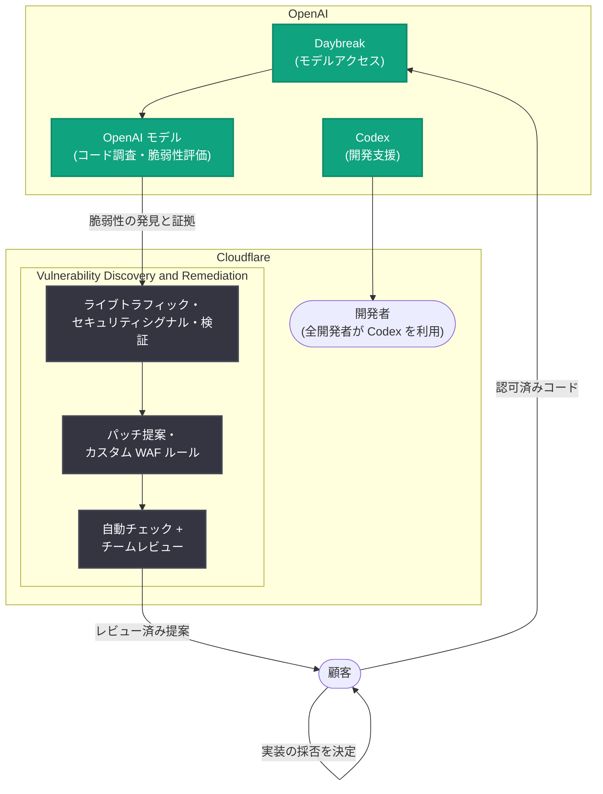

# Cloudflare が OpenAI Daybreak と Codex で脆弱性の発見から防御までを接続

## メタデータ

| 項目 | 内容 |
|------|------|
| 発表日 | 2026-10-21 |
| ソース | OpenAI News |
| カテゴリ | 導入事例 (セキュリティ) |
| 公式リンク | https://openai.com/index/cloudflare-cyber |

## 概要

OpenAI は 2026 年 10 月 21 日、Cloudflare による OpenAI モデルの活用事例を公開した。Cloudflare は世界最大級のネットワークを運用し、ウェブトラフィックの約 20% をプロキシしている企業である。同社は OpenAI Daybreak 経由でアクセスするモデルを、自社のグローバルネットワークと脅威コンテキストと組み合わせ、Cloudflare Managed Defense を通じた早期アクセスサービス「Vulnerability Discovery and Remediation」を提供している。モデルがコードを調査して潜在的な脆弱性を評価し、Cloudflare がライブトラフィックデータやセキュリティシグナル、検証を加えて、顧客がレビューできる形で緩和策やパッチの提案を準備する。

さらに、開発組織では Codex が全開発者に利用されており、開発スピードの向上とコード品質の改善に貢献している。先送りされていたプロダクトの再構築を、4 人の開発者が 3 日間、トークン費用 1,100 ドルで完了した事例も紹介されている。

## 主な内容

### Daybreak によるセキュリティ分析のスケール

セキュリティチームは、脆弱性情報とアラートの絶え間ない流入に直面している。手作業でのデータ精査には時間と労力がかかり、重要な問題の調査・対応に割ける余力が減ってしまう。Cloudflare の Mark Anderson 氏 (President of Revenue) は「従来のセキュリティチームは有用なデータを大量に持っている。ただ、それに対処する人と時間がないだけだ」と述べている。

Cloudflare のアプローチは、ソースコード内の脆弱性を本番環境で起きていることと結び付けることである。具体的には以下のシグナルを確認する。

- 影響を受けるルートはアクティブか
- 不審なトラフィックを受信しているか
- 既存のセキュリティコントロールで既に保護されているか

これらのシグナルにより、セキュリティチームは何を最初に調査すべきかを判断するためのコンテキストを得られる。

### Vulnerability Discovery and Remediation の仕組み

Cloudflare は Daybreak 経由でアクセスする OpenAI モデルを使い、顧客が許可したコードを調査し、潜在的な脆弱性を特定し、各発見を裏付ける証拠を確認する。サービスの流れは以下の通りである。

1. **コード調査**: OpenAI モデルが顧客認可済みのコードを調査し、潜在的な脆弱性を特定、証拠を確認
2. **コンテキスト付与**: Cloudflare がライブトラフィックデータ、セキュリティシグナル、検証を加えて発見の優先順位付けを実施
3. **提案の準備**: コードパッチの提案と、必要に応じて開発者が修正をレビューする間の露出を減らすカスタム WAF (Web Application Firewall) ルールを準備
4. **人間によるレビュー**: Cloudflare が自動チェックを実行し、チームがレビューしたうえで顧客に共有
5. **顧客の判断**: 顧客はどの変更を実装するかの決定権を保持

顧客にとっての利点は、脆弱性の特定から対象アプリケーションの保護までの明確な道筋が得られることである。脆弱性の優先順位付けのための証拠、露出を減らすエッジ保護の提案、レビュー可能なコード修正が提供され、変更の採否は顧客自身がコントロールする。

### Codex で 3 日間のプロダクト再構築

アプリケーションの保護は、チームが書き、維持するコードの品質にも依存する。Cloudflare では全社員の 3 分の 1 がソフトウェア開発者であり、その 100% が Codex を使ってアウトプットを高め、より良いコードを提供しているという。

Anderson 氏は、人員不足で先送りしていたプロダクトの再構築事例を紹介している。Codex なしでは数か月のスケジュール調整と「およそ 10 倍の開発者」が必要だったと見積もられる作業を、4 人の開発者チームが引き受け、「3 日間で構築し、ロールアウトしてテストし、トークンに 1,100 ドルを費やした」と述べている。Codex により開発者の生産性がスケールすることで、問いは「これに取り組めるか?」から「やらない理由があるか?」へと変わったという。

### AI と人間の判断を軸にしたサイバー防御

Anderson 氏は、AI を日常のエンジニアリングの一部にするとは「マシンを別個の要素としてではなく、ビルドプロセスに統合されたものとして念頭に置き、技術を構築する社内プロセスを再構築すること」だと語る。

> 「Daybreak と Codex が提供する自動化の素晴らしさは、単純作業をマシンに任せることで、人間が最も重要なエンジニアリングとセキュリティの意思決定に判断力を発揮できるようになる点にある」— Mark Anderson 氏 (President of Revenue, Cloudflare)

## アーキテクチャ

## 影響

### セキュリティチームへの影響

- 脆弱性情報の手作業での精査という「単純作業」を AI に委任し、人間は重要な意思決定に集中できる役割分担が示された
- ソースコードの脆弱性を本番トラフィックの実態と結び付けることで、優先順位付けが証拠ベースで行えるようになる
- 修正のレビュー期間中もカスタム WAF ルールで露出を減らせるため、発見から防御までのギャップが縮小する

### 開発組織への影響

- 全開発者が Codex を利用する体制により、人員不足で先送りされていたプロジェクトに着手できるようになる
- 「数か月 + 10 倍の開発者」規模の作業が「4 人 x 3 日間 + トークン費用 1,100 ドル」で完了した事例は、AI コーディング支援の投資対効果を示す具体的な数値である
- AI を別個のツールではなくビルドプロセスに統合する形での社内プロセス再構築が、活用の鍵として挙げられている

### ガバナンスの設計

- モデルの調査対象は顧客が認可したコードに限定される
- AI の提案は Cloudflare の自動チェックとチームレビューを経てから顧客に共有される
- どの変更を実装するかの最終決定権は顧客が保持する設計であり、AI と人間の判断を組み合わせた多層的なレビュー構造になっている

## 関連リンク

- [公式発表: Cloudflare links vulnerability discovery to defense with OpenAI](https://openai.com/index/cloudflare-cyber)
- [Cloudflare プレスリリース: Cloudflare Partners with OpenAI Daybreak Models](https://www.cloudflare.net/news/news-details/2026/Cloudflare-Partners-with-OpenAI-Daybreak-Models-to-Redefine-Vulnerability-Management-with-AI-Powered-Edge-Defense/default.aspx)
- [Cloudflare ブログ: Vulnerability Discovery and Remediation](https://blog.cloudflare.com/vulnerability-discovery-remediation/)
- [OpenAI News](https://openai.com/news)

## まとめ

Cloudflare は、OpenAI Daybreak 経由のモデルによるコード調査・脆弱性評価と、自社ネットワークのライブトラフィックデータ・脅威コンテキストを組み合わせた早期アクセスサービス「Vulnerability Discovery and Remediation」を Cloudflare Managed Defense を通じて提供している。脆弱性の発見から証拠に基づく優先順位付け、パッチ提案とカスタム WAF ルールによる保護までを一気通貫で接続しつつ、自動チェック・チームレビュー・顧客の最終決定権という多層的なガバナンスを維持している点が特徴である。あわせて、全開発者による Codex 活用で「4 人 x 3 日間 x 1,100 ドル」のプロダクト再構築を実現した事例は、AI を単純作業に割り当て人間が重要な判断に集中するという同社の方針を裏付けている。なお、Daybreak の技術的な詳細や本サービスの価格・一般提供時期は本記事には記載されていない。
