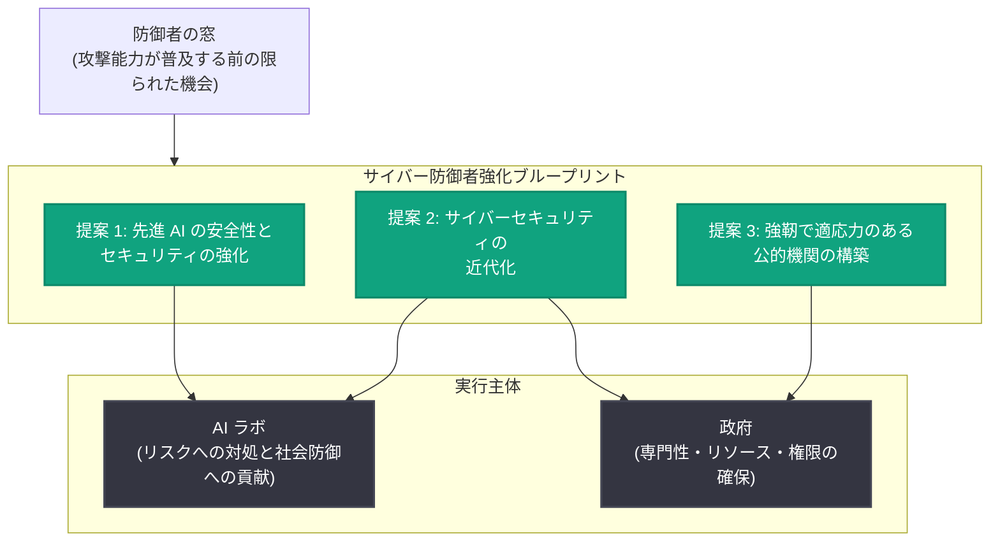

# フロンティア AI の民主的ガバナンス第 2 弾 - サイバー防御者を強化するブループリントを公開

## メタデータ

| 項目 | 内容 |
|------|------|
| 発表日 | 2026-10-21 |
| ソース | OpenAI News |
| カテゴリ | ポリシー・セキュリティ |
| 公式リンク | https://openai.com/index/empowering-cyber-defenders |

## 概要

OpenAI は 2026 年 10 月 21 日、「Democratic governance of frontier AI (フロンティア AI の民主的ガバナンス)」シリーズの第 2 弾として、サイバー防御者を強化するためのブループリント (青写真) を公開した。これは、同社が以前発表したサイバーセキュリティ・アクションプランおよびフロンティア安全性ブループリントを土台とするものである。

OpenAI は、AI がサイバーセキュリティの速度・規模・経済性を変えつつあると指摘する。AI は防御側による脆弱性の発見と修正、侵入の検知、攻撃への対応を支援できる一方で、同じ能力が悪意ある攻撃者を利するほか、AI システムが意図された境界を越えて動作する際の新たなリスクも生み出す。現在は「防御者の窓 (defender's window)」、すなわち高度なサイバー攻撃能力が広く利用可能になる前に、先進的な AI を防御者の手に届け、防護を強化できる限られた機会にあるとして、政府と産業界に対する具体的な提案を 3 つの領域で示している。

## 主な内容

### 発表の背景: 「防御者の窓」という認識

- AI はサイバーセキュリティの速度、規模、経済性を根本から変えつつある
- 防御面では、脆弱性の発見・修正、侵入検知、攻撃対応を AI が支援できる
- 一方で、同じ能力は悪意ある行為者にも利用され得るほか、AI システムが意図された境界を越えて行動することによる新たなリスクも生じる
- 高度なサイバー攻撃能力が広く利用可能になる前の限られた期間に、防御側へ先進 AI を展開し防護を固めるべきだと OpenAI は主張している
- OpenAI は、自社モデルに関わるミスアライメント (不整合) やセキュリティインシデントの経験から、業界全体でより強固なセーフガードと説明責任が必要だという教訓を得たと述べており、本ブループリントはその教訓に基づいている

### 提案 1: 先進 AI の安全性とセキュリティの強化

フロンティアモデルとエージェントの安全確保に関する責任の明確化を提案している。

- フロンティアモデルおよびエージェントをセキュアに保つための責任の明確化
- 危険な挙動の検知体制の確立
- 各組織の管理下にあるオペレーションに対する、信頼性の高いシャットダウン制御の維持

### 提案 2: インテリジェンス時代に向けたサイバーセキュリティの近代化

防御者への支援と、社会のサイバーセキュリティ基盤の底上げを提案している。

- 防御者への先進ツール、トレーニング、技術支援の提供
- 長年放置されてきたサイバーセキュリティ上の弱点への対処
- 必要不可欠なサービス (エッセンシャルサービス) のセキュリティ確保と、旧式システムの更新への投資

### 提案 3: 強靭で適応力のある公的機関の構築

政府・公的機関側の体制強化を提案している。

- 政府による評価および独立した技術的アセスメントの強化
- 一貫性のあるインシデント報告要件の確立
- 協調的な対応・復旧体制の改善

## ブループリントの全体構造

## 影響

### AI ラボ・産業界への影響

- フロンティアモデルとエージェントのセキュリティ確保、危険な挙動の検知、シャットダウン制御の維持といった責任が、業界標準として求められる方向性が示された
- OpenAI 自身のミスアライメントおよびセキュリティインシデントの経験が提案の根拠とされており、AI ラボには「自らのシステムが生むリスクに対処し、社会の防御強化を支援する責任がある」と明記されている

### 政府・政策立案者への影響

- 政府には、AI 能力の進展に応じて公衆を保護するための専門性、リソース、権限が必要であると提言されている
- OpenAI は政策立案者に対し、今すぐ行動すること、すなわちセーフガードを確立し、経験から学び、技術の進化に合わせて要件を強化していくことを推奨している
- インシデント報告要件の一貫化や独立した技術的アセスメントの強化など、規制・制度設計に直結する提案が含まれる

### セキュリティ実務者への影響

- 防御者向けの先進ツール、トレーニング、技術支援への投資が進めば、脆弱性管理や侵入検知、インシデント対応における AI 活用の裾野が広がる可能性がある
- 旧式システムの置き換えやエッセンシャルサービスのセキュリティ投資が政策課題として後押しされる

## 関連リンク

- [公式発表: Democratic governance of frontier AI, part II: Empowering cyber defenders](https://openai.com/index/empowering-cyber-defenders)
- [フロンティア安全性ブループリント (PDF)](https://cdn.openai.com/pdf/25752ecb-0e5c-47f9-b9e4-c0f4d76f8d3d/a-blueprint-for-a-federal-framework.pdf)
- [OpenAI News](https://openai.com/news)

## まとめ

OpenAI は「防御者の窓」が開いている今こそ、先進 AI を防御側に届けて社会の防護を固めるべきだとし、(1) 先進 AI の安全性・セキュリティ強化、(2) インテリジェンス時代に向けたサイバーセキュリティの近代化、(3) 強靭で適応力のある公的機関の構築、という 3 領域の具体的提案をまとめたブループリントを公開した。AI ラボと政府の双方に役割と責任を割り当て、政策立案者には「今行動し、経験から学び、技術の進化に合わせて要件を強化する」段階的アプローチを促している点が特徴である。なお、本発表はポリシー提言であり、特定の製品や API の変更を伴うものではない。
