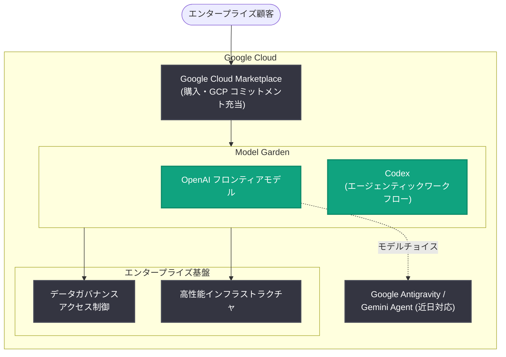

# OpenAI モデルが Google Cloud に登場 - Model Garden でフロンティアモデルと Codex を提供へ

## メタデータ

| 項目 | 内容 |
|------|------|
| 発表日 | 2026-10-21 |
| ソース | OpenAI News |
| カテゴリ | パートナーシップ・プラットフォーム |
| 公式リンク | https://openai.com/index/openai-models-google-cloud |

## 概要

OpenAI は 2026 年 10 月 21 日、Google Cloud とのパートナーシップを発表した。OpenAI のフロンティアモデルと Codex のエージェンティックワークフローが、Google Cloud の Model Garden に統合される。顧客はこれらのモデルにネイティブにアクセスでき、Google Cloud のデータガバナンスと高性能インフラストラクチャに支えられた、大規模で複雑なエージェンティックワークフローを構築できるようになる。

購入は Google Cloud Marketplace を通じて行われ、GCP の支出コミットメント (spend commitments) を持つ企業は、そのコミットメントを OpenAI モデルの購入に充当できる。一般提供 (GA) は数週間以内に予定されている。なお、Microsoft が OpenAI の主要クラウドパートナーであることに変わりはないと明記されている。

## 主な内容

### Model Garden への統合

- OpenAI のフロンティアモデルと Codex のエージェンティックワークフローが Google Cloud の Model Garden に追加される
- 開発者やデータサイエンティストは、普段から利用している Google Cloud 環境内で OpenAI モデルにネイティブにアクセスできる
- 企業はソフトウェア開発ライフサイクルの近代化、エージェンティックワークフローの構築、働き方の変革を進められる

### エンタープライズ・規制業界向けの統制

- 規制業界の組織が AI を導入するには、機密データへのアクセス権限と利用方法の統制が必要となる
- 本統合では、OpenAI のフロンティアモデルを Google Cloud の組み込みアクセス制御、一元化されたデータガバナンス、高性能インフラストラクチャと組み合わせ、要求の厳しいエンタープライズワークロードを支援する

### 購入・契約面の仕組み

- Google Cloud の顧客は、Model Garden 経由で OpenAI フロンティアモデルを購入でき、取引は Google Cloud Marketplace を通じて処理される
- Google Cloud の支出コミットメントを持つ企業は、GCP コミットメントをこれらの購入に充当 (ドローダウン) できる

### Google Antigravity と Gemini Agent への展開

- OpenAI モデルは近日中に Google Antigravity と Gemini Agent でも利用可能になる予定である
- エンタープライズ顧客は、タスクごとに最適なモデルを選択できる柔軟性 (モデルチョイス) を得られる
- 評価から本格導入までの道筋を提供することで、企業がフロンティアモデルを発見・活用する際の選択肢を広げる

## アーキテクチャ

## 開発者・企業への影響

- **アクセス経路の拡大**: OpenAI API や Azure に加えて、Google Cloud からも OpenAI のフロンティアモデルを利用できるようになり、マルチクラウド環境での選択肢が広がる
- **既存契約の活用**: GCP の支出コミットメントを OpenAI モデルの購入に充当できるため、調達・契約面のハードルが下がる
- **規制業界での導入促進**: Google Cloud のアクセス制御・データガバナンスと組み合わせることで、金融・医療などの規制業界でも OpenAI モデルを導入しやすくなる
- **開発ワークフローの統合**: Codex のエージェンティックワークフローが Google Cloud 環境で利用可能になり、GCP 上で開発する企業のソフトウェア開発ライフサイクルに AI を組み込みやすくなる
- **ツール側のモデルチョイス**: Google Antigravity や Gemini Agent で OpenAI モデルを選択できるようになる予定であり、タスクごとに最適なモデルを使い分けられる

## 関連リンク

- [公式発表: OpenAI models are coming to Google Cloud](https://openai.com/index/openai-models-google-cloud)
- [Google Cloud 公式ブログ: Google Cloud brings OpenAI models to customers](https://cloud.google.com/blog/products/ai-machine-learning/google-cloud-brings-openai-models-to-customers)
- [アクセスリクエストフォーム: OpenAI on Google Cloud](https://openai.com/form/openai-on-google-cloud/)
- [Codex](https://chatgpt.com/codex/)
- [OpenAI News](https://openai.com/news)

## まとめ

OpenAI と Google Cloud のパートナーシップにより、OpenAI のフロンティアモデルと Codex のエージェンティックワークフローが Model Garden に統合される。購入は Google Cloud Marketplace 経由で行われ、GCP 支出コミットメントの充当も可能となる。さらに Google Antigravity と Gemini Agent でも OpenAI モデルが近日利用可能になる予定であり、エンタープライズにおけるモデル選択の柔軟性が大きく向上する。一般提供は数週間以内に予定されている。一方で、Microsoft が OpenAI の主要クラウドパートナーである点は維持されることが明記されており、本発表は提供チャネルの拡大と位置づけられる。なお、対象となる具体的なモデル名や料金は公式発表には記載されていない。
