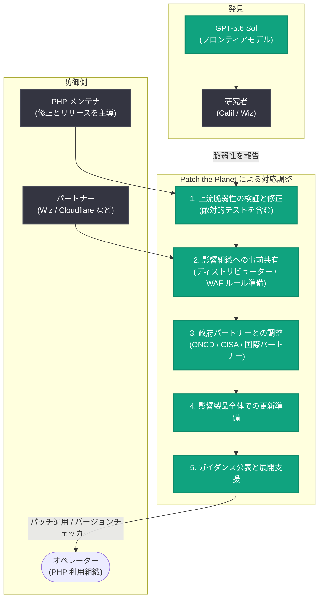

# Patch the Planet - AI エージェントが発見した重大脆弱性への世界的な対応調整

## メタデータ

| 項目 | 内容 |
|------|------|
| 発表日 | 2026-10-21 |
| ソース | OpenAI News |
| カテゴリ | セキュリティ |
| 公式リンク | https://openai.com/index/coordinated-disclosure-of-critical-vulnerabilities |

## 概要

OpenAI は 2026 年 10 月 21 日、「Patch the Planet」イニシアチブの一環として、Web サイトや Web アプリケーションの実行に広く使われるオープンソースのプログラミング言語 PHP における重大な脆弱性への対応を、メンテナ、研究者、セキュリティプロバイダーの連合体を率いて過去 2 か月にわたり実施したことを発表した。脆弱性は GPT-5.6 Sol を使用して Calif が発見し、Wiz も 2 件の脆弱性を独立に発見・報告した。修正とリリースは PHP のメンテナが主導し、OpenAI のチームと Wiz、Cloudflare などのパートナーが研究、技術支援、調整を担った。

OpenAI はこの問題を「近年で最も影響の大きいセキュリティ問題の 1 つ」と位置づけている。フロンティア AI が攻撃者より先に脆弱性を発見したことで、開示前に防御側が修正と保護策を準備できる「Defender's Window (防御者の窓)」が開いたとし、今後同様の発見が急増すると見込んで、AI 時代に適した重大脆弱性対応の枠組みを提案し、セキュリティコミュニティに改善への協力を呼びかけている。

## 主な内容

### PHP 脆弱性への対応

- Calif が GPT-5.6 Sol を用いて重大な欠陥を特定し、Wiz も独立に 2 件の脆弱性を発見・報告した
- PHP のメンテナが修正とリリースを主導し、OpenAI、Wiz、Cloudflare などが研究・技術支援・調整で貢献した
- OpenAI は、脆弱な可能性のある PHP バージョンを特定するための PHP バージョンチェッカーを Codex スキルとして公開した ([php2shell-checker](https://github.com/openai/php2shell-checker))
- PHP 利用組織にとって現在の最優先事項は修正の適用である

### 提案された対応フレームワーク (5 段階)

OpenAI は、広く使われるソフトウェアの重大脆弱性に対応するための 5 段階の枠組みを提案している。

1. **上流の脆弱性の検証と修正**: メンテナ、研究者、主要な技術パートナーが発見を確認し、影響を評価し、修正を開発・テストする。フロンティアモデルによる敵対的テストでパッチの回避方法や脆弱性の亜種も探索する
2. **影響を受ける組織に行動する時間を与える**: どの組織が保護策の準備のために事前情報を必要とするかを検討する枠組みを提案し、関与先はメンテナが決定する。ディストリビューターによる旧リリースへの修正適用、ホスティングプロバイダーによる緩和策のテスト、セキュリティプロバイダーによる WAF ルールなどの検知・防御策の準備が含まれる
3. **政府パートナーとの調整による重要システムの保護**: PHP の事例では、ホワイトハウスの Super Intelligence Force、国家サイバー局長室 (ONCD)、サイバーセキュリティ・インフラセキュリティ庁 (CISA) を含む米国政府の複数部門や国際パートナーと連携した
4. **影響を受ける製品全体での更新準備**: 修正・ガイダンス・開示計画が安定した段階で、追加のディストリビューター、ホスティング・サービスプロバイダー、対応チーム、オペレーターを巻き込み、更新準備とカバレッジの穴の解消を進める
5. **パッチ公開後のガイダンス公表と展開支援**: 公開ガイダンスにより、利用者が露出の評価、正式な更新や暫定緩和策の入手、修正の稼働確認を行えるようにする

このフレームワークでは、組織の保護上の役割 (自組織と顧客の保護)、行動に必要な時間、機密情報の取り扱い能力を考慮して事前共有先を判断する。限定的な詳細であっても脆弱性が露見し得るため、共有のリスクと得られる保護効果を比較衡量する。実際に悪用が確認された場合、情報漏えい、内容を推測できる公開パッチ、修正の停滞によるユーザーリスクの増大があった場合には、タイムラインを再評価する。

### Defender's Window と Daybreak

- フロンティア AI が攻撃者より先に脆弱性を発見したことで、開示前に修正と保護策を準備する「Defender's Window」が開いた
- 一方で、同じ能力は攻撃者による攻撃ツールやエクスプロイトの迅速な開発にも使われ得ると警告している
- より多くの防御者がこの能力を使えるよう、「Daybreak for Frontline Defenders」を通じて 10 億ドル規模の Daybreak アクセス補助を約束しており、限られたセキュリティリソースで必要不可欠なサービスを守る組織に重点を置く
- Daybreak には悪用の可能性を減らすための追加のブロッキング分類器を調整中である。悪用防止のセーフガードが正当なセキュリティ業務を阻害し得るという難しいトレードオフがあり、防御者に必要な能力を維持しつつ有害な利用を制限するバランスを継続的に調整するとしている

### メンテナへの支援

- 多くのオープンソースプロジェクトは小規模チームで運営されており、セキュリティ報告の精査を通常の開発と並行して行っている
- OpenAI は資金、高性能モデルへのアクセス、実践的なエンジニアリング支援でメンテナの作業を支援する
- 投資には、Codex for OSS によるすべてのメンテナ向けサブスクリプションや、Rust Foundation などプロジェクトへの直接スポンサーシップが含まれる
- オープンソースプロジェクトは Patch the Planet に実践的な支援を申請できる

### より安全なソフトウェア基盤の構築

個別の脆弱性の発見・修正にとどまらず、最初から安全なソフトウェアを構築する支援として、以下の領域に機会があるとしている。

| 領域 | 内容 |
|------|------|
| 最初から安全なコード | コーディングモデルが安全なデフォルトの選択、セキュリティライブラリの正しい使用、危険なパターンの検出を支援 |
| メモリ安全なソフトウェア | 重要コンポーネントのメモリ安全言語への移行で、メモリエラーの一般的なクラスを排除。AI が移行を支援し、テストと専門家レビューで動作と互換性を確認 |
| 形式検証 | 数学的証明により、重要コンポーネントが指定されたセキュリティ特性を満たすことを示す。脆弱性のクラス全体の排除に寄与し得る |
| より強固な分離 | 未発見・未修正の脆弱性に備え、信頼できないファイル・画像・メディアを処理するソフトウェアを厳格に制限されたサンドボックスで実行。AI がサンドボックス技術のテストと強化を支援 |

### コミュニティへの協力呼びかけ

OpenAI は提案した枠組みについて、特に以下の点でフィードバックを求めている。

- **開示までの猶予期間**: メンテナ、オペレーター、防御者が信頼できる修正を準備・展開するのに必要な時間と、早期開示のトリガーとなる証拠
- **緊急パッチ適用**: 管理アクセスを失ったシステムに対し、政府やオペレーターが脆弱性を利用してパッチを適用することの是非とセーフガード。既知の脆弱性に対するインターネット全体の常時スキャンと、検出時の通知またはパッチ適用という最終形も想定し得るとしている
- **早期通知**: 有用な保護行動のために事前警告を必要とする対象、段階的通知と一斉通知の使い分け、カバレッジと漏えいリスクの比較衡量
- **セキュアバイデフォルトなソフトウェアパッケージ**: 上流修正が保留中の下流パッケージの脆弱性対応や、セキュリティ更新が終了した旧バージョンへのバックポートの方法

また、アプローチのレビュー、前提への異議、ギャップの特定ができる独立したセキュリティ専門家の推薦も歓迎している。

## アーキテクチャ

提案された対応フレームワークの全体像を示す。

## 影響

### PHP 利用組織への影響

- 最優先事項は PHP メンテナの公式パッチとアップグレード手順に従った修正の適用である
- OpenAI 公開の Codex スキル「php2shell-checker」で、脆弱な可能性のある PHP バージョンを特定できる
- CISA のガイダンス (BOD 26-04) に基づき、露出・悪用状況・潜在的影響から対応の緊急度 (緊急パッチ、即時緩和、計画的更新) を評価できる。侵害済みかどうかのフォレンジックトリアージも必要に応じて検討する

### セキュリティコミュニティへの影響

- AI による脆弱性発見が急増する見込みの中で、発見を保護につなげるスケーラブルな対応プロセスの標準化が議論の俎上に載った
- 小規模チームで運営されるオープンソースプロジェクトに、資金・モデルアクセス・エンジニアリング支援という形で資源が供給される
- 防御者向けのモデルアクセス (Daybreak) と悪用防止のセーフガードのバランスという、業界全体に関わる論点が提示された

## 関連リンク

- [公式発表: Patch the Planet: global response coordination as agents uncover critical vulnerabilities](https://openai.com/index/coordinated-disclosure-of-critical-vulnerabilities)
- [Patch the Planet 公式サイト](https://patchtheplanet.org/)
- [PHP バージョンチェッカー (Codex スキル)](https://github.com/openai/php2shell-checker)
- [The Defender's Window](https://openai.com/index/the-defenders-window/)
- [Daybreak for Frontline Defenders](https://openai.com/index/daybreak-for-frontline-defenders/)
- [Codex for OSS](https://openai.com/form/codex-for-oss/)
- [CISA BOD 26-04: リスクに基づくセキュリティ更新の優先順位付け](https://www.cisa.gov/news-events/directives/bod-26-04-prioritizing-security-updates-based-risk)
- [OpenAI News](https://openai.com/news)

## まとめ

OpenAI は Patch the Planet イニシアチブを通じて、GPT-5.6 Sol が発見した PHP の重大脆弱性に対し、メンテナ主導・パートナー連携・政府調整を組み合わせた世界的な対応を 2 か月にわたり実施した。フロンティア AI が攻撃者より先に脆弱性を発見する「Defender's Window」を活かすため、検証・修正から事前共有、政府連携、更新準備、公開ガイダンスまでの 5 段階の対応フレームワークを提案し、10 億ドル規模の Daybreak アクセス補助やメンテナ支援と合わせて、AI 時代にスケールする脆弱性対応体制の構築を目指す。OpenAI は同様の発見が今後数か月で急増すると見込んでおり、開示猶予期間や緊急パッチ適用のあり方などについてセキュリティコミュニティにフィードバックを求めている。
