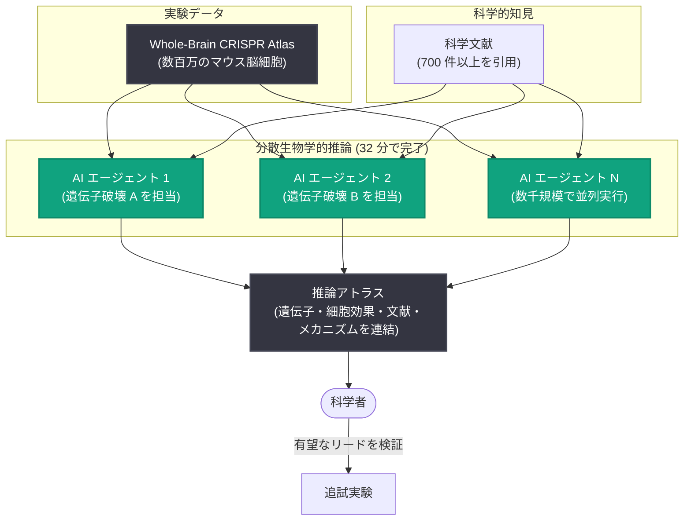

# 数千の AI エージェントで生物学データから新たな研究リードを発掘 - OpenAI、PerturbAI、Scripps Research の共同研究

## メタデータ

| 項目 | 内容 |
|------|------|
| 発表日 | 2026-10-21 |
| ソース | OpenAI Research |
| カテゴリ | 研究成果 |
| 公式リンク | https://openai.com/index/scaling-ai-research-for-complex-biological-data |

## 概要

OpenAI は 2026 年 10 月 21 日、PerturbAI および Scripps Research との共同研究として、GPT-Rosalind を搭載した数千の AI エージェントを用い、数百万のマウス脳細胞から得られた既存の実験データをわずか 32 分で分析・解釈した成果を発表した。エージェントは遺伝子破壊の影響と科学文献の知見を結び付け、疾患理解や新たな治療法の研究方向の特定に役立つ、予想外の生物学的なつながりを発見した。

研究チームの推定では、同等の分析と文献レビューを人間が摂動 (perturbation) ごとに実施した場合、数か月から 1 年を要する。エージェントは人間の分析結果を再現しただけでなく、追加の研究リードも発見しており、新規性や科学的価値の評価もブラインド条件下の人間の専門家の判断と一致した。

## 主な内容

### 分散生物学的推論 (Distributed Biological Reasoning)

現代の実験は、科学者が徹底的に調査できる量をはるかに超えるデータを生成する。数千の遺伝子を改変し、その影響を数百万の細胞にわたって測定できるようになった一方で、結果がヒトの疾患に対して持つ意味を理解するには、複雑な実験結果と数十年にわたり散在する科学的知見を結び付ける必要がある。

研究チームは分析作業を数千の AI エージェントに分割する「分散生物学的推論」と呼ぶアプローチを採用した。エージェントが調査したのは、遺伝子破壊がマウス脳全体の様々な細胞タイプにどう影響するかを示すデータセット「whole-brain CRISPR atlas」である。

- 各エージェントは 1 つの遺伝子破壊を担当し、細胞応答を分析、科学文献を検索し、結果の説明を提案する
- 各エージェントのレポートは、遺伝子・細胞への影響・関連論文・考えられる生物学的メカニズムを結び付けた「推論アトラス (reasoning atlas)」に統合される
- 推論アトラスは公開されており、研究者は関連遺伝子の比較、予想外の応答の調査、有望なリードの特定を今日から始められる

### 単一エージェントとの比較

モデルとリソースを固定した条件で、データセット全体を単一エージェントに与えた場合と、数千のエージェントで並列処理した場合を比較した。

| 比較項目 | 単一エージェント | 分散エージェント |
|----------|-----------------|------------------|
| 最大ワークロード時の引用文献数 | 11 件 | 700 件以上 |
| ブラインド比較での専門家の選好 | - | 75% の割合で分散エージェントのレポートを選好 |

ワークロードが増えるにつれ、単一エージェントは文献検索の範囲が狭まった。分散エージェントは微妙な応答や予想外の応答を含むより広い範囲を調査し、関連文献と結び付けることができる。

### 発見例 1: Tsc1 と Tsc2 の予想外の差異

エージェントは、細胞の成長・代謝・老化の主要な調節因子である mTOR を共同で制御する 2 つの遺伝子、Tsc1 と Tsc2 の間に予想外の差異を発見した。

- 複数のニューロン群では、どちらの遺伝子を破壊しても同様の影響が見られた
- しかし運動協調を担う小脳では、Tsc2 の破壊は神経伝達に関与する数十の遺伝子の活動を変化させた一方、Tsc1 の破壊はほとんど変化を生じなかった
- 結節性硬化症の患者では、小脳の異常が TSC2 変異と強く関連しており、この差異はヒトの疾患に関係する可能性がある
- mTOR 活性を抑える薬は特定の脳腫瘍やてんかん発作の治療に使えるが、学習・行動面の困難への対処は依然として課題である。エージェントは調査すべき特定のニューロン群と細胞変化を特定し、研究者に検証可能な具体的な問いを提供した

### 発見例 2: DCTN1 とコレステロール代謝の関連

エージェントは、変異がペリー症候群 (パーキンソン病様症状を伴う神経変性疾患) を引き起こす遺伝子 DCTN1 に関する研究リードも発見した。

- DCTN1 はニューロン内の物質輸送に関与する
- Whole-brain CRISPR atlas において、Dctn1 の破壊はコレステロール合成に関与する遺伝子の発現を増加させた
- エージェントはこの観察結果を、コレステロール輸送の問題が細胞のコレステロール産生を増やす可能性を示唆する研究と結び付けた
- 「DCTN1 の破壊はニューロン内のコレステロール分布を変化させるか、その変化は神経変性に寄与するか、正常な分布の回復はニューロンの保護に役立つか」という追試可能な問いが導かれた
- 人間の専門家もこの仮説を新規かつ重要で、追跡調査に値すると評価した

## アーキテクチャ

## 影響

### 生物学研究への影響

- 人間が数か月から 1 年かかる分析・文献レビューを 32 分に短縮し、大規模実験データの活用範囲を大きく広げる
- 科学者は時間の制約からデータ中の最も強いシグナルに注目しがちだが、分散エージェントは微妙・予想外な応答まで幅広く調査し、見逃されがちなリードを拾い上げる
- 分野をまたいで散在する手がかりを AI が結び付けることで、新しい疾患生物学の見方が生まれる可能性がある (ケンブリッジ大学の Sarah Teichmann 博士、UCSF の Tomasz Nowakowski 博士がコメントを寄せている)

### AI と人間の役割分担

- 発見の中心はあくまで科学者であり、AI の役割はより多くの有望なリードを提示し、どのアイデアを追求するか、実験をどう設計するか、結果をどう解釈するかの判断を支援することにある
- エージェントの提案する生物学的メカニズムは仮説であり、検証には追加実験が必要である。エージェントの成果は実験の優先順位付けに役立つ

### エージェント設計への示唆

- 同一モデル・同一リソースでも、タスクを分割して並列実行する方が、単一エージェントに大規模ワークロードを与えるより深い推論と広い文献カバレッジを実現できることが定量的に示された
- 大規模データ解釈タスクにおけるマルチエージェント構成の有効性を示す事例として、生物学以外の分野のエージェント設計にも参考になる

## 関連リンク

- [公式発表: Using thousands of AI agents to uncover new leads in biological data](https://openai.com/index/scaling-ai-research-for-complex-biological-data)
- [GPT-Rosalind 論文 (bioRxiv)](https://www.biorxiv.org/content/10.64898/2026.10.15.759436v1)
- [Whole-brain CRISPR atlas 論文 (bioRxiv)](https://www.biorxiv.org/content/10.64898/2026.03.16.711480v1)
- [データセット: wholebrain_crispr_atlas (Hugging Face)](https://huggingface.co/datasets/perturbai/wholebrain_crispr_atlas)
- [推論アトラス (GitHub)](https://github.com/jinlabneurogenomics/distributed_agent)
- [PerturbAI](http://perturb.ai/)
- [Scripps Research](http://scripps.edu/)
- [OpenAI News](https://openai.com/news)

## まとめ

OpenAI、PerturbAI、Scripps Research は、GPT-Rosalind を搭載した数千の AI エージェントによる「分散生物学的推論」で、数百万のマウス脳細胞の実験データを 32 分で分析し、Tsc1/Tsc2 の予想外の差異やコレステロール調節と神経変性の潜在的関連など、アルツハイマー病やパーキンソン病の理解につながり得る新たな研究リードを発見した。単一エージェントとの比較では、分散エージェントが引用文献数 (700 件以上対 11 件) とブラインド評価での専門家の選好 (75%) の両面で優位を示した。推論アトラスは公開されており、AI と実験生物学、人間の専門知識、科学文献を組み合わせることで、実験データをより多くの検証可能なアイデアに変えるという方向性を示す成果である。
