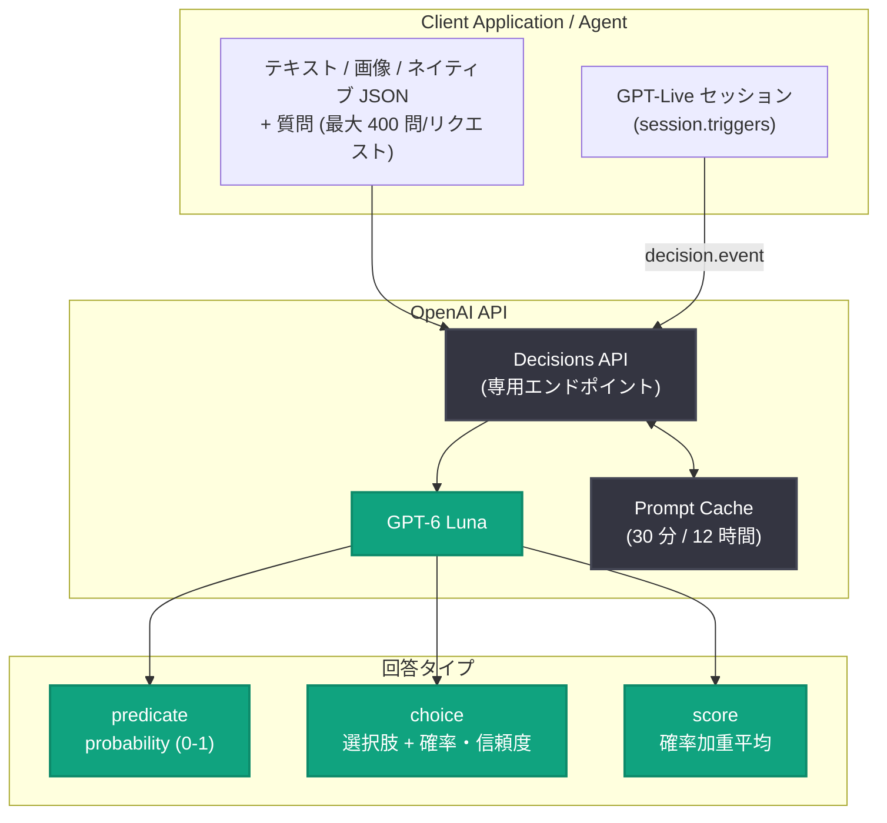

# Decisions API が一般提供開始: 高速・低コストな意思決定をアプリケーションに

## メタデータ

| 項目 | 内容 |
|------|------|
| 発表日 | 2026-10-22 |
| ソース | OpenAI News / OpenAI API Changelog |
| カテゴリ | Product / API (新機能 GA) |
| 公式リンク | https://openai.com/index/decisions-api |

## 概要

OpenAI は 2026 年 10 月 22 日、Decisions API の一般提供 (GA) を発表した。アプリケーションやエージェントはワークフローの中で、入力の分類、リクエストのルーティング、次のアクションの選択といった小さな意思決定を数多く行っており、個々は単純でも大規模化するとレイテンシとコストが積み上がる。Decisions API は GPT-6 Luna 上に構築され、答えが限定された質問 (bounded answers) に Luna の知能を集中させることで、テキスト、画像、構造化入力からほぼリアルタイムの意思決定を可能にする。Responses API 経由の GPT-6 Luna と比較して最大 10 倍高速に動作する。

料金は入力トークン 100 万あたり $0.10、キャッシュ済み入力は 100 万トークンあたり $0.01。課金は入力トークンのみで、出力トークンへの課金はない。

## 主な内容

### ベータ公開からの進化

2026 年 10 月 6 日のパブリックベータ公開 (gpt-6-luna、テキストと画像を Responses API の 10 倍速で型付き回答に変換) 以降、GA までに以下の機能が追加された。

- **GPT-Live とのネイティブ統合**: ライブ会話中の高速な意思決定が可能に
- **プロンプトキャッシュ**: 再利用されるコンテキストのキャッシュに対応 (API Changelog ではプロンプトキャッシュ共有と記載)
- **推論の地域内処理 (inference residency)**: 米国と EU で利用可能
- **ネイティブ JSON 入力 (input_json)**: 構造化データをそのまま渡せる
- **質問インストラクション内の画像対応**: 質問の指示に画像を含められる
- **質問数上限の拡大**: 1 リクエストあたり 200 問から 400 問へ倍増
- **レイテンシの継続的改善**: アジアの複数リージョンで容量を追加

### 3 つの回答タイプ

開発者は質問と許容される回答を定義し、テキスト、画像、ネイティブ JSON としてコンテキストを渡す。API は以下 3 種類のいずれかの回答タイプを返し、アプリケーションは次の動作を決定できる。

| タイプ | 用途 | 主な結果 |
|--------|------|----------|
| predicate | 条件が真である確率の推定 (例: 商品に目に見える損傷があるか) | probability: 条件が真である確率の推定値 (0 から 1) |
| choice | 事前定義した選択肢から 1 つを選択 (例: エージェントが続行・リトライ・確認質問のいずれを行うべきか) | choice: 指定した値のいずれか。確率と信頼度も返される |
| score | ルーブリックの順序付きレベルに対する評価 (例: 損傷の深刻度) | score: レベルインデックスの確率加重平均 |

### GPT-Live とのネイティブ統合によるリアルタイム音声体験

Decisions API は GPT-Live とネイティブに統合され、ライブ会話中の高速で焦点を絞った意思決定を支援する。公式記事では以下のユースケースが挙げられている。

- カスタマーサポートエージェントが、確認質問をするか、リクエストをルーティングするか、エスカレーションするかを判断
- アバターがユーザーの発話に応じて表情を調整し、言葉に基づいてウインクや笑顔で応答するインタラクティブな体験

実装としては、既存の GPT-Live セッションの `session.triggers` に設定を追加する。Live 側が `decision.event` を発行し、アプリケーションは選択された `reaction` を読み取ってキャラクターをアニメーションさせる、という流れが紹介されている。

### 活用事例

OpenAI 社内および顧客での早期採用事例として、以下が紹介されている。

- **dots チーム**: 応答時間の短縮とインタラクティブ性の向上
- **Personal Finance チーム**: 取引明細の説明文の分類
- **Communications チーム**: 報道をテーマ別に分類し、主要なナラティブを補強するか疑問を呈するかをスコアリングして、精査すべき内容を特定
- **顧客事例**: AI コストの正確な帰属づけ、語学学習体験のインタラクティブ化など

## 技術的な詳細

### 料金と提供形態

| 項目 | 内容 |
|------|------|
| 入力トークン | $0.10 / 100 万トークン |
| キャッシュ済み入力 | $0.01 / 100 万トークン |
| 出力トークン | 課金なし (入力トークンのみ課金) |
| キャッシュ書き込み | 30 分および 12 時間のキャッシュ書き込みに対応 (料金は公式料金ガイドを参照) |
| 対応モデル | GPT-6 Luna (専用 Decisions エンドポイント経由) |
| 地域内処理 | 米国と EU で利用可能 |
| データ保持 | 対象顧客には Zero Data Retention を提供 |

### 利用の始め方

公式記事では、アプリケーションが頻繁に行う意思決定を 1 つ選び、質問、可能な回答、それらを区別するのに必要なコンテキストを定義して、実際の利用を反映した例でテストする進め方が推奨されている。[Decisions Playground](https://platform.openai.com/decisions) で自分のテキストや画像を使って試すか、[開発者ガイド](https://developers.openai.com/api/docs/guides/decisions) に従って最初のリクエストを作成できる。

## アーキテクチャ

## 開発者への影響

- **小さな意思決定の高速化と低コスト化**: 分類、ルーティング、次アクション選択などの頻出タスクを、Responses API 経由の GPT-6 Luna より最大 10 倍高速に処理できる。出力トークン課金がないため、コスト見積もりが入力トークンのみで完結する
- **型付き回答による後続処理の簡素化**: predicate / choice / score の 3 タイプで回答形式が保証されるため、自由形式テキストのパースが不要になり、アプリケーションロジックに直接組み込める
- **バッチ的な質問処理**: 1 リクエストで最大 400 問 (ベータ時の 2 倍) を処理できるため、大量の分類・評価タスクをまとめて実行できる
- **音声アプリケーションへの組み込み**: GPT-Live とのネイティブ統合により、ライブ会話中のエスカレーション判断や表情制御など、リアルタイム性が求められる意思決定を実装できる
- **コンプライアンス要件への対応**: 米国・EU での地域内処理と Zero Data Retention (対象顧客向け) により、データ所在やデータ保持の要件があるワークロードでも採用しやすい
- **キャッシュによるコスト最適化**: 再利用されるコンテキストをプロンプトキャッシュ ($0.01 / 100 万トークン) で処理でき、同じ指示・ルーブリックを使い回す意思決定で効果が大きい

## 関連リンク

- [Build more responsive apps with the Decisions API (公式発表)](https://openai.com/index/decisions-api)
- [Decisions API 開発者ガイド](https://developers.openai.com/api/docs/guides/decisions)
- [Decisions API 料金と提供状況](https://developers.openai.com/api/docs/guides/decisions#pricing-and-availability)
- [Decisions API と音声の連携ガイド (GPT-Live)](https://developers.openai.com/api/docs/guides/decisions-voice)
- [Decisions Playground](https://platform.openai.com/decisions)
- [OpenAI API 料金ガイド](https://developers.openai.com/api/docs/pricing)
- [データコントロール (Zero Data Retention)](https://developers.openai.com/api/docs/guides/your-data)
- [GPT-6 Sol / Luna 発表記事](https://openai.com/index/introducing-gpt-6-sol-and-luna/)
- [OpenAI API Changelog](https://developers.openai.com/api/docs/changelog)

## まとめ

Decisions API が GPT-6 Luna で一般提供開始となった。答えが限定された質問に特化することで、テキスト・画像・ネイティブ JSON からの意思決定を Responses API 経由の GPT-6 Luna より最大 10 倍高速に処理し、predicate / choice / score の 3 つの型付き回答を返す。料金は入力 $0.10 / 100 万トークン、キャッシュ済み入力 $0.01 / 100 万トークンで、出力トークンへの課金はない。ベータからの進化として、GPT-Live ネイティブ統合、プロンプトキャッシュ、米国・EU の地域内処理、ネイティブ JSON 入力、質問インストラクション内の画像対応、質問数上限の 400 問への倍増が加わり、分類・ルーティング・リアルタイム音声まで幅広いユースケースに対応する基盤が整った。
