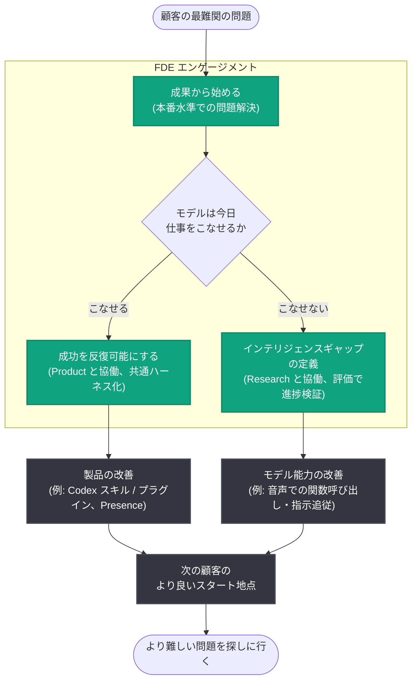

# OpenAI における FDE (Forward Deployed Engineering) とは - 「デプロイメントギャップ」を埋め、自らを不要にするチームの働き方

## メタデータ

| 項目 | 内容 |
|------|------|
| 発表日 | 2026-10-22 |
| ソース | OpenAI News |
| カテゴリ | AI Adoption (AI 導入) |
| 著者 | Colin Jarvis 氏 (Head of Forward Deployed Engineering at OpenAI) |
| 公式リンク | https://openai.com/index/forward-deployed-engineering-means |

## 概要

OpenAI の Forward Deployed Engineering (FDE) 責任者である Colin Jarvis 氏が、2026 年 10 月 22 日、OpenAI における FDE の役割と働き方を解説する記事を公開した。FDE チームは 2025 年初頭に設立され、「デプロイメントギャップ (deployment gap)」、すなわち「モデルが持つように見える能力」と「人々が実際の業務で信頼して使えるもの」との距離を埋めることを使命とする。顧客と並走して最難関の問題を理解し、本番環境で信頼できるソリューションを構築するとともに、そこで得た学びを製品開発や Research チームへの具体的な課題提供につなげている。

記事では、半導体企業・John Deere・通信事業者・Thrive Holdings (会計事務所向け Tax AI) などの具体的な取り組みと数値成果が紹介されている。Jarvis 氏は「数カ月ごとに自分たちを不要 (obsolete) にできているなら、FDE チームは仕事をうまく果たしている」と述べ、Codex がユースケースを一発で解決できるようになることをチームの成功と位置づけている。

## 主な内容

### FDE の使命: デプロイメントギャップを埋める

モデルの能力は、それを活用するためのシステムやプロセスの整備よりも速く進化してきた。欠けているのが製品の場合もあれば、ベンチマークでは高性能でも実世界の変数や制約の下では仕事をこなせないモデルの場合もある。

FDE チームの行動原理は次のとおりである。

- **モデルが今日こなせる領域**: Product チームと顧客とともにソリューションを反復可能 (repeatable) にする
- **モデルが届かない領域**: 顧客と Research チームとともにギャップを定義し、モデル改善につなげる
- **目標**: 各エンゲージメントが次の顧客により良いスタート地点を残すこと。「この種の問題の次回の解決に FDE が不要になるまで床 (floor) を引き上げられれば、仕事を果たしたことになる」

### Start with the outcome (成果から始める)

Jarvis 氏がチームセッションの冒頭で必ず掲げる中核的価値観は「**成果から始め、成功に必要なことは何でもやり、その後にスケールを続ける** (Start with the outcome, do what it takes to succeed, then follow with scale)」である。印象的なデモは実世界で機能するかを問われる前に独り歩きしがちだが、FDE の仕事は「本番環境で保証できる水準で顧客の問題を解決すること」だとしている。

**事例: 大手半導体企業 (2025 年中頃)**

- 約 15 名の FDE が 10 以上のユースケースに取り組み、検証 (verification) プロセスの AI ネイティブ化を推進
- 対象: 指向性テスト生成 (directed test generation)、根本原因分析とデバッグ、アーキテクチャアシスタント
- この業界では検証がプロジェクト工数の約 70% を占めることもある
- 入社数日の FDE もいたが、顧客の検証チームに入り込み (embed)、空き時間にチップ設計を学び、エンジニアとともに評価 (eval) を構築した
- 最初の 3-6 カ月で全ユースケースが本番稼働と初期ユーザー採用に到達

成果の数値は以下のとおり。

| 指標 | 成果 |
|------|------|
| AI による指向性テスト生成 | 約 48% の時間削減 |
| カーネル最適化 | 中央値 22% の性能改善 |
| デバッグ | 数週間の作業を数時間に短縮 |

顧客の Chief Hardware Officer からは「君たちは入社前にチップ設計者だったのか?」と問われたという。FDE は初日から業界知識を持つ必要はないが、それを学ぶのは本人の責任である。チームはジェネラリストとドメインエキスパートを混成しており、ライフサイエンス分野では FDE の科学的バックグラウンドが、標的検証・優先順位付け、遺伝子発現解析、化学合成経路の再構築といった前臨床創薬タスクに取り組む研究者からの信頼獲得に役立っている。

**事例: John Deere**

創業 200 年の農業機械企業 John Deere の課題は、農家向けのパーソナライズされたアドバイスのスケール化だった。同社の精密除草技術「See & Spray」はカメラと機械学習で雑草を特定して散布し、農薬使用量を最大 70% 削減するが、その効果は農家が技術を正しく設定・運用できるかに依存する。John Deere は OpenAI の API を導入し、自然言語での質問応答、個別のセットアップガイダンスと推奨、機器が本来の性能を発揮していない場合の検知、技術から得ている価値の理解支援を実現した。

### Make success repeatable (成功を反復可能にする)

半導体企業でのワークフローは価値を実証したものの、他チームへの展開には過剰なカスタム統合が必要だった。Codex の能力向上を受け、1 人の FDE がアプリケーションを Codex 中心に再構築するテストを行い、各ユースケースを Codex をコアとする共通ハーネスに移行した。

- カスタムアプリケーションは、共通の Codex プリミティブ上に構築されたプラグインとスキルになった
- Codex 自体がインターフェイスとなり、ユースケースごとに書いていた個別のターミナル UI や CLI を廃止できた
- 各プロジェクトから**約 90% のカスタムコードを削減**
- 主要機能はスキル・プラグインとして束ねられ、共有や AI CoE (Center of Excellence) による集中管理が容易になった。別チームへの展開は、新しいコネクタ /MCP サーバーの差し替えと評価の新規構築 (これもスキル化済み) だけで済むようになった
- 2026 年 8 月の例では、初回デプロイに 2 カ月を要したユースケースを、2 番目のチームへは 1 日で展開できた

**事例: OpenAI Presence と Thrive Holdings**

- エンタープライズ向け音声・チャットエージェント製品「OpenAI Presence」は、実際の顧客デプロイから生まれた。Swarm に始まり Agents API を経て進化し、現在ではある顧客が**通話の半数以上を AI で処理**している
- Thrive Holdings との協業では、FDE と研究者がエンジニア・会計士とともに Crete の会計事務所向けに「Tax AI」を構築。パイロット期間中に **7,000 件の税務申告を処理し、スループットを約 50% 向上**させた
- 最難関だった賃貸不動産申告の自動化は、6 週間のエンジニアリングと実務家レビューを経て**精度 (precision)・再現率 (recall) 90%** に到達。この作業で生まれた再利用可能なパターンにより、他の複雑な税務スケジュールへの拡張が容易になった。現在は簿記・監査・IT サポートにも同じアプローチを適用中である

### Close the intelligence gaps as they appear (インテリジェンスギャップを埋める)

製品の進化で構築物を簡素化できる場合もあるが、モデル自体がまだ仕事をこなせない場合もある。今日のモデルで可能なことだけを作っていては、Research が次に埋めるべきインテリジェンスギャップは見つからない。そのため重要なエンゲージメントの多くは、顧客・FDE・Research が協働してモデルの限界から始まる。

**事例: 大手通信事業者の音声対応**

- 既に構築済みのカスタマーサービスプラットフォームを音声に拡張する取り組み。音声はカスタマーサービス量の約 90% を占め、チャットより封じ込めコストが高く、アクセント・トーン・レイテンシ / 精度を本番品質にする新たな技術課題があった
- スコーピング時点で、本番投入可否を判断する主要評価でのモデルスコアは約 60% にとどまり、モデル能力の限界に達していた。カスタマーサービスシナリオでの関数呼び出しと指示追従の改善が必要だった
- FDE は顧客とともにプラットフォームを構築してモデルに必要な要件を定義し、Research が能力ギャップの解消に取り組んだ。連続的なモデルスナップショットで顧客要件に対する進捗を検証
- **6 カ月で主要評価のスコアは約 60% から 80%、そして 90% 以上に向上**し、本番に必要な水準へ到達
- この音声モデルは現在、当該顧客のデプロイに加え、他のカスタム顧客サービスデプロイや Presence 経由のマネージドデプロイも支えている

### Go find the harder problem (より難しい問題を探しに行く)

Jarvis 氏は「LLM 開発の大半のケースではオッカムの剃刀が当てはまる。最もシンプルな解が最良だ」と述べ、誇大宣伝に染まった業界の中で「現場の人々が信頼できる、確実に動くものを作る」ことを志向する。各エンゲージメントの目標は、次に来るものを改善すること、すなわち「よりデプロイしやすい製品」「より難しいタスクをこなせるモデル」「次の顧客のためのカスタム作業の削減」である。

冒頭の問い「Codex が数カ月かけて構築したユースケースを一発でこなせるようになったら何をするのか?」への答えは、「**より難しい問題を探しに行く**」である。

## FDE の働き方 (エンゲージメントループ)

## 影響

### 企業の AI 導入への影響

- 「デプロイメントギャップ」という概念が明示され、ベンチマーク性能と実務での信頼性の差を埋める専門職能 (FDE) の具体的な働き方が公開された。AI 導入を進める企業にとって、デモではなく本番水準の成果から始めるアプローチの参考になる
- 半導体 (テスト生成で約 48% の時間削減)、税務 (スループット約 50% 向上)、カスタマーサービス (通話の半数以上を AI 化) など、業種横断の定量的成果が示された
- Codex を共通ハーネスとし、カスタムコードを約 90% 削減してスキル / プラグイン化するパターンは、社内横展開 (初回 2 カ月 → 2 チーム目 1 日) のモデルケースとなる

### OpenAI の製品・研究開発への影響

- FDE が顧客現場で特定した能力ギャップ (例: 音声での関数呼び出し・指示追従) が Research の改善対象となり、その成果が Presence などの製品として他の顧客にも還元される好循環が示された
- 顧客個別のソリューションが Swarm → Agents API → Presence のように製品へ昇華される経路が明らかになった

## 関連リンク

- [公式記事: What FDE means at OpenAI](https://openai.com/index/forward-deployed-engineering-means)
- [OpenAI News](https://openai.com/news)
- [OpenAI API ドキュメント](https://platform.openai.com/docs)

## まとめ

OpenAI の FDE チームは、モデルの見かけの能力と実務での信頼性の間にある「デプロイメントギャップ」を埋めるために 2025 年初頭に設立された。「成果から始め、成功に必要なことは何でもやり、その後にスケールする」を中核的価値観とし、半導体検証の AI ネイティブ化 (テスト生成で約 48% の時間削減)、John Deere の農家支援、通信事業者の音声対応 (評価スコアを 6 カ月で約 60% から 90% 以上へ)、Thrive Holdings の Tax AI (7,000 件の申告処理、スループット約 50% 向上) などの成果を上げてきた。モデルが解ける問題は製品化・共通化で反復可能にし、解けない問題は Research と協働して将来のモデル能力に転換する。「自らを数カ月ごとに不要にすること」が成功の定義であり、その先には常に「より難しい問題を探しに行く」という姿勢がある。
