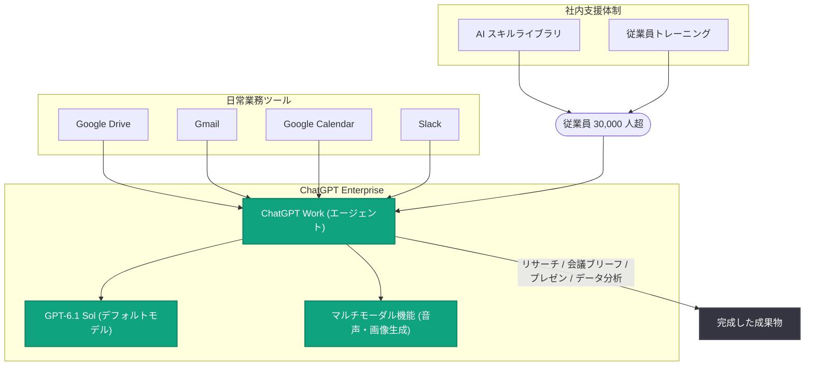

# Uber が全従業員 30,000 人超に ChatGPT Work を全社展開

## メタデータ

| 項目 | 内容 |
|------|------|
| 発表日 | 2026-10-22 |
| ソース | OpenAI News |
| カテゴリ | 導入事例 (ChatGPT Work / ChatGPT Enterprise) |
| 公式リンク | https://openai.com/index/uber-chatgpt-work-rollout |

## 概要

Uber は、ChatGPT Enterprise 内で従業員の幅広いタスクを支援するエージェント「ChatGPT Work」の全社展開を発表した。この展開により、Uber のグローバル従業員 30,000 人超が ChatGPT Work を利用できるようになる。

当初 1,000 人の従業員を対象としたパイロットから拡大したもので、ナレッジワーク向けに設計されたエージェント型プラットフォームとしては Uber 初の全社導入となる。複雑なマルチステップのタスクを引き受け、完成した成果物を提供することを目的としている。

## 主な内容

### 日常業務ツールとの連携によるワークフロー支援

ChatGPT Work は、Uber のような企業が日常的に使用するツールと連携する。対象ツールは以下の通り。

- Google Drive
- Gmail
- Google Calendar
- Slack

これにより、従業員は情報のリサーチ、会議ブリーフの準備、プレゼンテーションの作成、データ分析、アプリケーションをまたいだワークフローの完遂が可能になる。

### フロンティアモデルとマルチモーダル機能へのアクセス

ChatGPT Work を通じて、Uber は OpenAI のフロンティアモデル群を利用できる。ChatGPT Work 内のデフォルト機能として [GPT-6.1 Sol](https://openai.com/index/introducing-gpt-6-1-sol/) がデプロイされ、フロンティア性能とコスト効率のバランスを提供する。

また、音声や画像生成を含む OpenAI のマルチモーダル機能も利用でき、チームはニーズに応じて適切なモデルとツールを柔軟に選択できる。

### 組織的な導入支援体制

今回の展開は、以下の社内施策によって支えられる。

- **社内 AI スキルライブラリ**: 従業員が活用パターンを参照できる仕組み
- **承認済みインテグレーション**: 安全に利用できる連携ツールの整備
- **専任の従業員トレーニング**: オペレーション、財務、マーケティング、プロダクトなど各部門での活用を支援

さらに、Uber の開発者およびソフトウェアエンジニアリングチームは、引き続き Codex を使用してソフトウェア開発の加速とコーディングワークフローの効率化を進める。

### OpenAI との協業における位置づけ

今回の拡大は、Uber の広範な AI 戦略と [OpenAI との協業](https://openai.com/index/uber/)における新たな一歩である。両社は、展開の進行に伴い、導入状況、ユースケース、測定可能な成果に関する知見を今後共有していく予定としている。

## 導入構成の概要

## 展開規模まとめ

| 項目 | 内容 |
|------|------|
| 初期パイロット | 従業員 1,000 人 |
| 全社展開 | グローバル従業員 30,000 人超 |
| 対象部門 | オペレーション、財務、マーケティング、プロダクトなど |
| 開発部門 | Codex を継続利用 |

## ビジネスへの影響

本発表は、エージェント型 AI プラットフォームの大規模な企業導入事例として重要な意味を持つ。

- **エージェント型プラットフォームの全社導入**: 単なるチャットアシスタントではなく、複雑なマルチステップタスクを完遂するエージェントを 30,000 人超の規模で展開する先行事例となる
- **段階的な展開モデル**: 1,000 人のパイロットで検証した上で全社展開するアプローチは、大企業における AI 導入の実践的なモデルケースとなる
- **既存ツールチェーンとの統合**: Google Workspace や Slack といった既存ツールと連携することで、業務フローを変えずに AI を組み込める点が導入障壁を下げている
- **用途別のツール使い分け**: ナレッジワークには ChatGPT Work、ソフトウェア開発には Codex という使い分けが示されている

## 関連リンク

- [公式記事: Uber brings ChatGPT Work to all employees with OpenAI](https://openai.com/index/uber-chatgpt-work-rollout)
- [ChatGPT Work の紹介](https://openai.com/index/chatgpt-for-your-most-ambitious-work/)
- [GPT-6.1 Sol の発表](https://openai.com/index/introducing-gpt-6-1-sol/)
- [Uber と OpenAI の協業](https://openai.com/index/uber/)
- [OpenAI News](https://openai.com/news)

## まとめ

Uber は、1,000 人のパイロットを経て、ChatGPT Enterprise 内のエージェント「ChatGPT Work」をグローバル従業員 30,000 人超に全社展開した。Google Drive、Gmail、Google Calendar、Slack と連携し、リサーチ、会議ブリーフ作成、プレゼン作成、データ分析、アプリ横断のワークフロー完遂を支援する。デフォルトモデルには GPT-6.1 Sol が採用され、社内 AI スキルライブラリや従業員トレーニングが導入を後押しする。開発チームは引き続き Codex を活用し、両社は今後、導入状況や測定可能な成果に関する知見を共有していく予定である。
