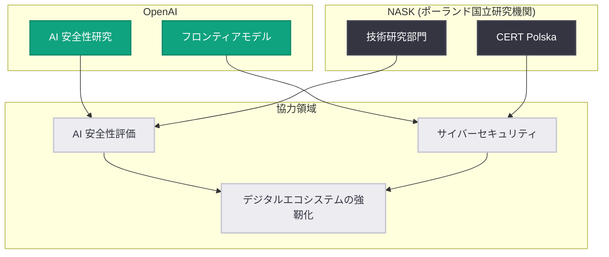

# OpenAI とポーランド NASK が AI 安全性・セキュリティの推進で提携

## メタデータ

| 項目 | 内容 |
|------|------|
| 発表日 | 2026-10-23 |
| ソース | OpenAI News |
| カテゴリ | パートナーシップ / AI 安全性 / セキュリティ |
| 公式リンク | https://openai.com/index/openai-nask-ai-safety-security-partnership |

> **注記**: 本レポート作成時点で記事本文の取得ができなかったため (openai.com が HTTP 403 を返却)、公式発表の概要および NASK に関する公開情報に基づいて作成している。詳細は公式リンクを参照のこと。

## 概要

OpenAI は 2026 年 10 月 23 日、ポーランドの国立研究機関である NASK (Naukowa i Akademicka Sieć Komputerowa、国立研究機関としての研究・学術コンピュータネットワーク) とのパートナーシップを発表した。両者は AI の安全性、セキュリティ、技術研究の分野で協力し、ポーランドおよび地域のデジタルエコシステムの強靭化 (レジリエンス強化) を支援する。

本提携は、OpenAI が各国の政府系研究機関や安全性機関と連携して AI の安全な展開を進める一連の取り組みの一環であり、中東欧地域における AI 安全性・サイバーセキュリティ分野での協力体制を強化するものである。

## 主な内容

### パートナーシップの柱

公式発表の概要によると、本提携は以下の領域を対象とする。

- **AI 安全性 (AI Safety)**: AI モデルの安全な利用・展開に関する評価や研究での協力
- **セキュリティ (Security)**: サイバーセキュリティ分野での知見共有と、AI を活用した防御能力の強化
- **技術研究 (Technical Research)**: AI 技術に関する共同研究・技術交流
- **デジタルエコシステムの強靭化**: ポーランド国内のデジタルインフラとオンライン環境の安全性・耐性の向上支援

### NASK とは

NASK はポーランドの国立研究機関であり、同国のインターネット基盤とサイバーセキュリティにおいて中心的な役割を担っている。

| 項目 | 内容 |
|------|------|
| 正式名称 | Naukowa i Akademicka Sieć Komputerowa (研究・学術コンピュータネットワーク) |
| 設立 | 1991 年 (ポーランドをインターネットに接続した草分け的機関) |
| 主な役割 | `.pl` 国別ドメインレジストリの運営 |
| セキュリティ | 国家レベル CSIRT の 1 つである CERT Polska を運営 |
| 研究分野 | サイバーセキュリティ、AI、偽情報対策、ネットワーク技術 |

CERT Polska を擁する NASK は、ポーランドにおけるインシデント対応・脅威分析の中核であり、AI を悪用した脅威 (ディープフェイク、偽情報、フィッシングなど) への対策研究でも知られる。OpenAI にとっては、フロンティア AI の安全性評価と悪用対策の両面で実務的な知見を持つパートナーといえる。

## 協力の構図

## 背景と意義

- OpenAI は近年、各国政府・公的機関との提携を拡大しており、AI の安全性評価やセキュリティ対策を一企業で閉じず、各国の専門機関と連携して進める方針を強めている
- ポーランドは中東欧におけるデジタル化とサイバーセキュリティの重要拠点であり、NASK との提携は同地域での AI の責任ある普及に向けた足がかりとなる
- CERT Polska のような実運用のインシデント対応組織との連携は、AI の悪用 (偽情報、サイバー攻撃への転用など) に対する実践的な防御知見を OpenAI の安全対策に還元できる点で意義が大きい

## 開発者・利用者への影響

- 本発表は API や製品機能の変更ではなく、直接的な開発者向けの変更は含まれない
- 中長期的には、AI の安全性評価手法やセキュリティベストプラクティスが公的機関との共同研究を通じて整備され、エコシステム全体の信頼性向上につながることが期待される
- ポーランドおよび EU 域内で AI を活用する組織にとって、現地の公的機関が関与する安全性の枠組みは、規制対応や導入判断の参考となり得る

## 関連リンク

- [公式発表 (OpenAI News)](https://openai.com/index/openai-nask-ai-safety-security-partnership)
- [NASK 公式サイト](https://www.nask.pl/)
- [CERT Polska](https://cert.pl/)
- [OpenAI Safety](https://openai.com/safety)

## まとめ

OpenAI とポーランドの国立研究機関 NASK が、AI 安全性・セキュリティ・技術研究の 3 領域で提携した。CERT Polska を運営する NASK の実践的なサイバーセキュリティ知見と OpenAI のフロンティア AI 研究を組み合わせ、ポーランドのデジタルエコシステムの強靭化を支援する。API や製品への直接的な変更はないが、公的機関と連携した AI 安全性の国際的な枠組みづくりが進む動きとして注目される。
