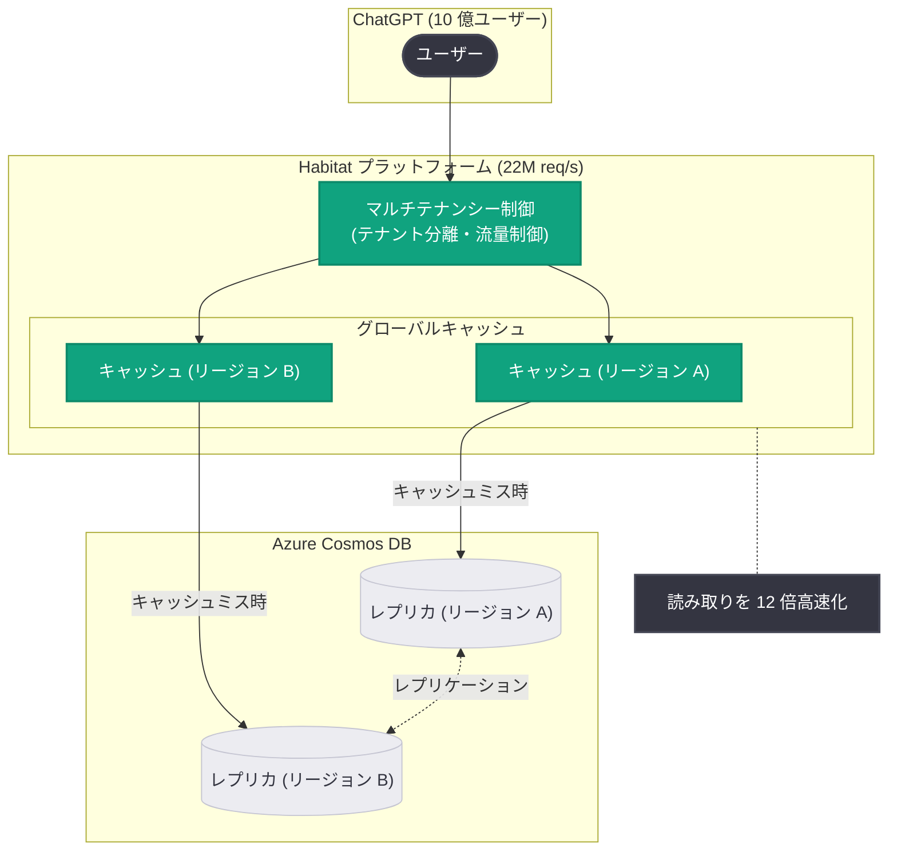

# 10 億人の ChatGPT ユーザーを支えるオンラインストレージの急速なスケーリング (Part 2)

## メタデータ

| 項目 | 内容 |
|------|------|
| 発表日 | 2026-10-23 |
| ソース | OpenAI News |
| カテゴリ | エンジニアリング |
| 公式リンク | https://openai.com/index/scaling-storage-one-billion-users-part-two |

> **注**: 本レポート作成時点で記事ページへのアクセスが制限されていた (HTTP 403) ため、公式 RSS フィードの説明文および公開済みの概要をもとに作成しています。概要に含まれない技術的詳細については推測を避け、「公式情報での確認が必要」と明示しています。

## 概要

OpenAI は、社内ストレージ基盤「Habitat」のスケーリングを解説するエンジニアリング記事シリーズの第 2 回 (Part 2) を公開しました。公式 RSS の説明文によると、本記事では **信頼性の高いマルチテナンシー (reliable multi-tenancy)**、**グローバルキャッシュ (global caching)**、**Azure Cosmos DB** を活用して Habitat をスケールさせ、ChatGPT の読み取り処理を **12 倍高速化** した方法が解説されています。

Part 1 (2026-09-11 公開) では、Habitat が Python ライブラリから 10 億人の ChatGPT ユーザーと秒間 2,200 万リクエストを支えるグローバル分散ストレージプラットフォームへ進化した経緯が紹介されており、本 Part 2 はその続編として、より具体的な基盤技術 (データストア、キャッシュ戦略、テナント分離) に踏み込む内容となっています。

## 主な内容

### Part 1 からの文脈

Part 1 で確認された事実は以下のとおりです。

- Habitat は Python ライブラリとして誕生し、グローバル分散ストレージプラットフォームへ進化した
- 10 億人以上の ChatGPT ユーザーを支え、秒間 2,200 万リクエスト (22M req/s) を処理している

Part 2 は、この規模を支えるための具体的な 3 つの柱 (マルチテナンシー、グローバルキャッシュ、Azure Cosmos DB) を扱います。

### 信頼性の高いマルチテナンシー

公式概要によると、Habitat は「reliable multi-tenancy」によってスケールしたとされています。一般に、単一のストレージ基盤を複数のサービス・ワークロード (テナント) で共有する場合、以下のような課題への対応が必要です。

- 特定テナントの負荷急増が他テナントの性能を劣化させる「ノイジーネイバー」問題の抑制
- テナントごとのクォータ、レート制限、優先度制御
- 障害の影響範囲 (ブラストラディウス) の限定

Habitat が実際にどの分離手法 (論理分離、物理分離、アドミッションコントロールなど) を採用しているかは、公式記事本文での確認が必要です。

### グローバルキャッシュによる読み取りの 12 倍高速化

公式概要で示された最も具体的な成果は、**ChatGPT の読み取り (read) 処理を 12 倍高速化した** という点です。グローバルキャッシュがこの高速化に寄与したとされています。

ChatGPT のワークロードは、会話履歴の表示・継続など読み取りが支配的と考えられるため、ユーザーに近いロケーションでキャッシュを提供することはレイテンシ削減とバックエンド負荷軽減の両面で効果が大きい設計です。ただし、キャッシュの実装方式 (キャッシュ層の技術、整合性モデル、無効化戦略、ヒット率など) は概要に含まれておらず、公式情報での確認が必要です。

### Azure Cosmos DB の採用

公式概要によると、Habitat のスケーリングには **Azure Cosmos DB** が用いられています。Azure Cosmos DB は Microsoft Azure のグローバル分散型マルチモデルデータベースであり、一般に以下の特性で知られています。

- 複数リージョンへのデータレプリケーションとマルチリージョン書き込み
- 複数の整合性レベル (strong から eventual まで) の選択
- パーティションキーに基づく水平スケーリング

OpenAI が Microsoft Azure 上でインフラを運用してきた経緯と整合する技術選定ですが、Cosmos DB の具体的な利用形態 (API の種類、整合性レベル、パーティション設計、リージョン構成など) は公式記事本文での確認が必要です。

## 技術的な詳細

公式 RSS の説明文および概要から確認できる事実は以下のとおりです。

| 項目 | 内容 |
|------|------|
| 対象基盤 | Habitat (OpenAI 社内ストレージプラットフォーム) |
| スケーリングの柱 | マルチテナンシー、グローバルキャッシュ、Azure Cosmos DB |
| 成果 | ChatGPT の読み取りを 12 倍高速化 |
| 前提規模 (Part 1 より) | 10 億人以上のユーザー、秒間 2,200 万リクエスト |

12 倍という高速化は、単なるハードウェア増強ではなく、キャッシュ階層の導入やデータ配置の見直しといったアーキテクチャレベルの改善によって達成された可能性が高いと考えられますが、内訳 (どの施策が何倍寄与したか) は公式情報での確認が必要です。

## アーキテクチャ

以下は公式概要に記載された構成要素 (マルチテナンシー、グローバルキャッシュ、Azure Cosmos DB) を図示した概念図です。内部の詳細構成は公式記事での確認が必要です。

## 開発者への影響

本記事は API の変更ではなくエンジニアリング事例の共有であるため、OpenAI API 利用者への直接的な影響はありません。一方、大規模システムを設計・運用するエンジニアには以下の示唆があります。

- **マネージドデータベースの大規模実績**: 10 億ユーザー規模のワークロードで Azure Cosmos DB が採用されたことは、マネージド分散データベースの実用上限を考えるうえで有力な参照事例となる
- **読み取り最適化の優先度**: 対話型 AI サービスでは読み取りが支配的であり、グローバルキャッシュへの投資が 12 倍という大きなリターンを生み得ることを示している
- **マルチテナンシー設計の重要性**: 社内共通基盤として複数ワークロードを収容する場合、テナント分離の信頼性がスケーラビリティの前提条件になる (具体的手法は公式情報での確認が必要)

## 関連リンク

- [記事本文: Rapidly scaling online storage to serve over 1 billion ChatGPT users (Part II)](https://openai.com/index/scaling-storage-one-billion-users-part-two)
- [Part 1: Rapidly scaling online storage to serve over 1 billion ChatGPT users](https://openai.com/index/scaling-storage-one-billion-users-part-one)
- [Part 1 の解説レポート](./2026-09-11-scaling-storage-one-billion-users.md)
- [Azure Cosmos DB 公式ドキュメント](https://learn.microsoft.com/azure/cosmos-db/)
- [OpenAI News](https://openai.com/news)

## まとめ

- OpenAI がストレージ基盤「Habitat」のスケーリングを解説するエンジニアリング記事シリーズの Part 2 を公開した
- 信頼性の高いマルチテナンシー、グローバルキャッシュ、Azure Cosmos DB の 3 つを柱として Habitat をスケールさせた
- その結果、ChatGPT の読み取り処理を 12 倍高速化した
- キャッシュの整合性モデルやテナント分離の具体的手法などの詳細は、公式記事本文での確認が必要である
