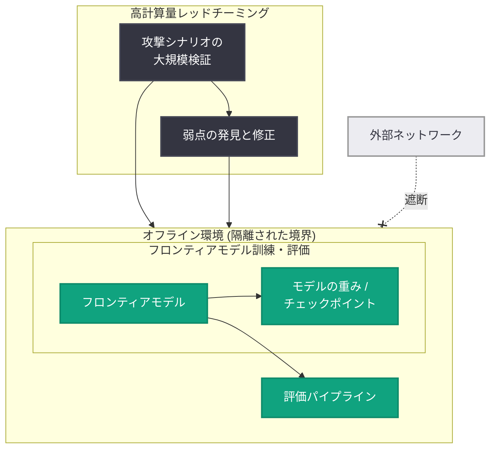

# フロンティアモデル訓練環境のセキュリティ強化 - オフライン環境と高計算量レッドチーミングによる封じ込め

## メタデータ

| 項目 | 内容 |
|------|------|
| 発表日 | 2026-10-23 |
| ソース | OpenAI News |
| カテゴリ | セキュリティ |
| 公式リンク | https://openai.com/index/securing-our-frontier-model-training-environment |

> **注記**: 本レポート作成時点で記事本文ページへのアクセスが制限されていたため (HTTP 403)、内容は OpenAI 公式 RSS フィードの説明文および公開されている記事概要に基づいている。公式説明文は「OpenAI explains how we strengthened containment for frontier model training and evaluation, including offline environments and high-compute red-teaming. (OpenAI は、オフライン環境や高計算量レッドチーミングを含む、フロンティアモデルの訓練と評価における封じ込めをどのように強化したかを解説する)」である。詳細な技術仕様については公式記事の原文を参照されたい。

## 概要

OpenAI は 2026 年 10 月 23 日、フロンティアモデル (最先端の大規模 AI モデル) の訓練および評価環境におけるセキュリティ強化の取り組みを解説する記事を公開した。本発表はセキュリティカテゴリに分類されており、訓練・評価プロセスにおける「封じ込め (containment)」の強化が主題である。

公式の説明によれば、強化策にはオフライン環境 (外部ネットワークから隔離された環境) の活用と、高計算量レッドチーミング (high-compute red-teaming) が含まれる。これは、モデルの能力が高度化するなかで、訓練中・評価中のモデルが意図しない形で外部に影響を及ぼすリスクや、モデルの重み (weights) などの知的財産が漏えいするリスクに対して、インフラレベルで防御を固める動きと位置付けられる。

## 主な内容

### 封じ込め (Containment) の強化

公式説明文で中心に据えられているのが、フロンティアモデルの訓練と評価における封じ込めの強化である。

- 封じ込めとは、訓練中・評価中のモデルおよびその成果物 (モデルの重み、チェックポイントなど) を、制御された境界の内側にとどめるためのセキュリティ設計を指す
- 訓練と評価の両フェーズが対象として明記されており、モデルのライフサイクル全体を通じた防御が意図されている
- OpenAI は従来から「Preparedness Framework」などで高度なモデルのリスク管理方針を示しており、本発表はそれをインフラ・運用面から支える取り組みと考えられる

### オフライン環境 (Offline Environments)

強化策の 1 つ目として、オフライン環境の活用が挙げられている。

- オフライン環境とは、一般に外部ネットワークから物理的または論理的に隔離された実行環境を指す
- 訓練・評価をこうした隔離環境で行うことで、(1) 外部からの侵入によるモデル重みの窃取、(2) 訓練・評価中のモデルによる意図しない外部通信、の双方を構造的に防ぐことができる
- フロンティアモデルの重みは極めて価値の高い資産であり、国家レベルの攻撃者を想定した防御が業界全体の課題となっている

### 高計算量レッドチーミング (High-Compute Red-Teaming)

強化策の 2 つ目は、高計算量レッドチーミングである。

- レッドチーミングとは、攻撃者の視点からシステムやモデルの弱点を体系的に検証する手法である
- 「高計算量 (high-compute)」と明記されていることから、大規模な計算資源を投入し、通常の手動テストでは到達できない規模・強度でモデルや封じ込め機構の限界を検証するアプローチと考えられる
- 封じ込め環境自体に対して高強度の検証を行うことで、実際の攻撃や想定外のモデル挙動に先回りして弱点を発見・修正する狙いがあるとみられる

## アーキテクチャ (概念図)

公式説明文に基づく、封じ込め強化の概念的な構造を以下に示す。

## 影響

### AI 開発者・研究者への影響

- 本発表は OpenAI の内部インフラとセキュリティ運用に関するものであり、API や製品仕様の直接的な変更を伴うものではない
- フロンティアモデルを扱う他の組織にとって、オフライン環境での訓練・評価や高計算量レッドチーミングといった手法は、自社のモデルセキュリティ体制を設計するうえでの参考になる

### セキュリティ実務者への影響

- モデルの重みの保護や訓練環境の隔離は、AI 固有のセキュリティ領域として重要性が高まっており、本発表は業界のベストプラクティス形成に寄与する可能性がある
- 封じ込め機構そのものを高計算量で検証するというアプローチは、従来の手動ペネトレーションテストを補完する新しい検証モデルとして注目される

### 業界・政策面への影響

- フロンティア AI の安全性をめぐる政策議論では、モデル重みのセキュリティや訓練環境の管理が主要トピックとなっており、OpenAI が自社の取り組みを公開することは、透明性と説明責任の観点からも意味を持つ
- 同社が 2026 年 10 月 21 日に公開したサイバー防御者強化ブループリントなど、一連のセキュリティ関連発表と連続した動きとして捉えられる

## 関連リンク

- [公式発表: Securing our frontier model training environment](https://openai.com/index/securing-our-frontier-model-training-environment)
- [OpenAI Security](https://openai.com/security-and-privacy/)
- [OpenAI Preparedness Framework](https://openai.com/safety/)
- [OpenAI News](https://openai.com/news)

## まとめ

OpenAI は、フロンティアモデルの訓練・評価環境における封じ込めを強化した取り組みを公開した。公式説明文によれば、その柱は (1) 外部ネットワークから隔離されたオフライン環境の活用と、(2) 大規模計算資源を投入した高計算量レッドチーミングである。モデル能力の高度化に伴い、モデルの重みの保護と訓練・評価中のモデルの制御は業界全体の重要課題となっており、本発表はインフラ・運用レベルでの防御強化を対外的に示すものである。API や製品への直接的な変更はないが、フロンティア AI のセキュリティ実務における参照事例として意義がある。
