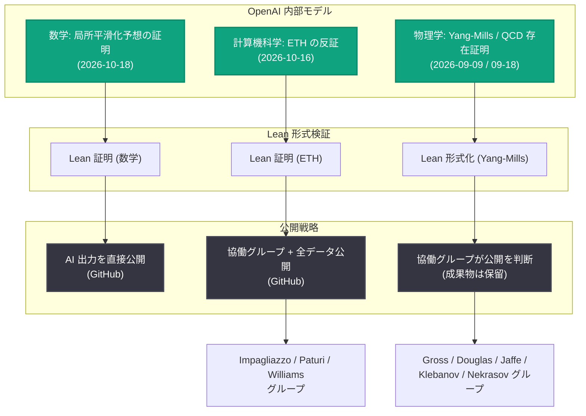

# 学術コミュニティと協働し科学的理解を構築 - カケヤ予想・指数時間仮説・量子色力学に関するモデルの成果を公開

## メタデータ

| 項目 | 内容 |
|------|------|
| 発表日 | 2026-10-26 |
| ソース | OpenAI Research |
| カテゴリ | 研究成果 |
| 公式リンク | https://openai.com/index/building-scientific-understanding-with-academic-communities |

## 概要

OpenAI は 2026 年 10 月 26 日、数学・計算機科学・物理学の 3 分野における新たな発見を発表した。内容は、調和解析における局所平滑化予想 (local smoothing conjecture) の全次元での証明 (カケヤ予想と Stein の制限予想の解決を含む)、計算量理論における指数時間仮説 (Exponential Time Hypothesis、ETH) の反証、そして量子色力学 (QCD) を含む 4 次元の相互作用する量子場理論の数学的に厳密な存在証明である。

OpenAI はこれらの成果物を「生の研究データ」と位置付け、科学的理解へ変換するための新しいアプローチを実験している。外部の専門家に「シェパード (shepherd)」として結果を理解するためのグループの組織化を依頼し、成果ごとに異なる 3 つの公開戦略を採用した。研究者が検証・発展できるよう、数学と計算機科学の成果については AI の自然言語出力と Lean 形式証明を公開 GitHub リポジトリで公開している。

## 主な内容

### 新しい公開プロセス: 3 つの戦略

OpenAI の公開プロセスは、関連する学術コミュニティからのフィードバックを受けて進化を続けている。今回は外部専門家の助言に基づき、成果ごとに異なる公開戦略を採用した。

| 分野 | 公開戦略 |
|------|----------|
| 数学 | AI 出力を公開し、研究者が自由に結果の解明に取り組めるようにする |
| 計算機科学 | 外部の協働グループを結成して結果を説明しつつ、AI 出力は誰でも検証・発展できるよう公開する |
| 物理学 | 外部の協働グループを結成し、資料の公開はグループの判断に委ねる |

OpenAI は、どのアプローチが最も有用かはまだ分からないとして、フィードバックを歓迎している。

### 外部協働の 4 原則

外部との協働は以下の 4 原則に従う。

1. **透明性 (Transparency)**: 協働の存在を公開する。参加者は秘密保持契約への署名を求められず、作業について自由に議論し、中間成果物を共有し、結論を公表できる
2. **学術的功績を求めない (No Academic Credit)**: OpenAI は内部モデルが生み出した発見について学術的功績を求めない。協働の運営を依頼された研究者やそのグループが元の発見をしたことを意味するものでもない
3. **承認 (Recognition)**: グループは、自らが発展させた理解、執筆した解説、作成した資料について評価を受けるべきである。グループは、この研究が依拠する研究者・技法・アイデアへの適切なクレジット付与も支援する
4. **独立性 (Independence)**: 参加は自発的かつ無償である。ワーキンググループのメンバーは独立して参加し、その結論は各自のものである。メンバーは OpenAI を代表して発言せず、OpenAI もメンバーを代表して発言しない

### 局所平滑化予想とカケヤ予想 (数学)

数学の成果は調和解析に関するものである。1991 年に Sogge が提唱した局所平滑化予想は、波が集束する際の振る舞いに関する予想で、最も極端な集束は短命でなければならないと述べる。この現象は基本的なものであるため、数学解析全体に広範な含意を持ち、カケヤ予想や Stein の制限予想を導く。

- 2019 年に Guth、Wang、Zhang が 2 次元空間での局所平滑化予想を証明
- 2025 年に Wang と Zahl が 3 次元でのカケヤ予想を証明
- OpenAI のモデルは**あらゆる次元での局所平滑化予想の証明**を生成し、結果として全次元でのカケヤ予想と Stein の制限予想も解決した
- 新しい証明は、新規の補助的な偏微分方程式に基づいている

AI 出力は 2026 年 10 月 18 日に得られ、翌日に Lean で形式化された。専門家の推薦に従い、2026 年 10 月 6 日の公開 (「Sharing AI progress in mathematics」) と同じ戦略で AI 出力を公開することを決定し、モデルが生成した自然言語の解説と Lean 証明の両方を公開 GitHub リポジトリで公開している。

### 指数時間仮説 (ETH) は偽である (計算機科学)

ETH はブール式充足可能性問題の計算量に関する長年の予想で、P 対 NP 問題と深く関係する。ETH は広く真であると信じられ、グラフ理論、計算生物学、データベース、計算幾何学など幅広い分野の数百の論文で条件付き計算困難性の導出に使われてきた。

- 驚くべきことに、OpenAI のシステムは **ETH が偽であることを証明**し、その結果はその後 Lean で検証された
- ETH の反証は、これらのタスクがどれだけ高速化できるかという問いを再び開き、より良いアルゴリズムの探索の指針となる可能性がある。理論的進展を実用的改善に変えるには、さらなる研究が必要である
- AI は 2026 年 10 月 16 日に自然言語での反証を発見し、2026 年 10 月 17 日に Lean で形式化された

この研究は、Russell Impagliazzo (UC San Diego)、Ramamohan Paturi (UC San Diego)、Ryan Williams (MIT) が率いるグループが検証・シェパードを行う。Impagliazzo と Paturi は Francis Zane とともに ETH の元の提唱者であり、Williams は ETH の強いバージョンの反証や ETH を用いた困難性の結果などで知られる。

OpenAI はグループの要請に応じ、コミュニティによる独立した検証を可能にするため結果の生データすべてを公開し、この研究が分野全体に与える影響を理解するためのカンファレンスへの資金提供を確約した。グループは、ETH の主張の公開検証の組織化と、AI が生み出すブレークスルーが検証・アクセス・クレジット・研究の未来について提起する広範な問いの議論への参加をコミュニティに呼びかけている。

### 量子色力学の存在と標準模型の完成 (物理学)

物理学の成果は、ゲージ場とフェルミオンを含む 4 次元の相互作用する量子場理論について数学的に厳密な存在証明を与えるもので、量子色力学 (QCD) と素粒子物理学の標準模型の統一的完成を含む。この研究は構成的場の量子論における Balaban のアプローチに基づいている。

- 部分問題として、**純粋 Yang-Mills 理論の存在証明**を含む。これはクレイ数学研究所のミレニアム懸賞問題「量子 Yang-Mills 理論」の一部である
- 存在証明は、標準模型のゲージ場とフェルミオンを含む最も単純な大統一理論に関するものである (標準模型自体は任意に短い距離まで外挿できないため)
- モデルは 2026 年 9 月 9 日に Yang-Mills 存在の自然言語証明を、9 月 18 日に QCD の証明を生成した。研究の長さと複雑さを考慮し、Lean 形式化の完了まで公開を延期し、Yang-Mills 存在の形式化は 2026 年 10 月 16 日に完了した

この研究は、David Gross が率い、Michael Douglas、Arthur Jaffe、Igor Klebanov、Nikita Nekrasov を含むグループがシェパードを行う。

| メンバー | 主な実績 |
|----------|----------|
| David Gross | 1973 年の Yang-Mills 理論における漸近的自由性の研究で QCD を強い相互作用の理論として確立、2004 年ノーベル物理学賞を共同受賞 |
| Arthur Jaffe | Witten とともに量子 Yang-Mills 理論ミレニアム懸賞問題を定式化、クレイ数学研究所を共同設立 |
| Michael Douglas | 過去 20 年にわたりこの問題のスチュワードを務め、2004 年と 2026 年初頭に進捗を報告 |
| Igor Klebanov | ゲージ・弦双対性の閉じ込めへの応用を開拓、Simons Collaboration on Confinement and QCD Strings をディレクターとして主導 |
| Nikita Nekrasov | Yang-Mills 理論の一般化に対する厳密手法の先駆的研究、2023 年 Dannie Heineman 数理物理学賞を受賞 |

物理学の協働グループは AI 生成の成果物の公開を保留し、自ら解説の執筆に取り組むことを決定した。グループへの連絡は専用のメールアカウント (YANGMILLS4D@gmail.com) に送るよう要請されている。

OpenAI は、これらの結果が、現代理論物理学で最も重要な枠組みである量子場理論が数学的に厳密な分野へと移行する始まりとなることを期待すると述べている。

### 科学者への支援

OpenAI はこれらの結果の理解と発展を支援することを確約している。今回の協働は、最近発表した Simons Foundation への 500 万ドルの拠出を補完するものである。この資金は Simons Foundation が管理・授与し、AI が生成した結果を研究者が理解・発展させるためのワークショップ、カンファレンス、特別プログラムを支援する。

## アーキテクチャ

## 研究者・開発者への影響

- **独立検証の機会**: 数学 (局所平滑化予想) と計算機科学 (ETH 反証) については、AI の自然言語出力と Lean 証明が OpenAI の公開 GitHub リポジトリで入手でき、誰でも検証・発展が可能
- **アルゴリズム研究への波及**: ETH の反証は、ETH に依拠してきた数百の条件付き困難性の結果に影響し、グラフ理論・計算生物学・データベース・計算幾何学などの分野でより高速なアルゴリズムを探索する動機となり得る
- **ミレニアム懸賞問題への進展**: 純粋 Yang-Mills 理論の存在証明は、クレイ数学研究所のミレニアム懸賞問題の一部に関わる成果である
- **AI 時代の研究プロセスの先例**: 透明性・功績の不請求・承認・独立性という 4 原則に基づく協働モデルは、AI が生み出す発見の検証・アクセス・クレジットのあり方に関する議論の出発点となる
- **資金面の支援**: ETH に関するカンファレンスへの資金提供、Simons Foundation への 500 万ドル拠出など、研究者が結果を独立に検証・説明・発展させるための資金が確保される

## 関連リンク

- [公式発表: Working with academic communities to build scientific understanding](https://openai.com/index/building-scientific-understanding-with-academic-communities)
- [Sharing AI progress in mathematics (2026 年 10 月 6 日)](https://openai.com/index/sharing-ai-progress-in-mathematics)
- [OpenAI Research](https://openai.com/research)
- [OpenAI News](https://openai.com/news)

## まとめ

OpenAI は数学 (全次元での局所平滑化予想の証明によるカケヤ予想・Stein の制限予想の解決)、計算機科学 (指数時間仮説の反証)、物理学 (QCD と標準模型の統一的完成を含む量子場理論の存在証明) という 3 つの重要な発見を発表した。いずれも Lean による形式検証を経ており、成果ごとに異なる公開戦略を実験している。外部専門家が率いる協働グループが結果の検証と解説を担い、OpenAI は資金提供と資料公開でこれを支援する。AI による科学的発見をどのように学術コミュニティと共有し、科学的理解へ変換するかという、研究プロセスそのものの新しいモデルを提示する発表である。
