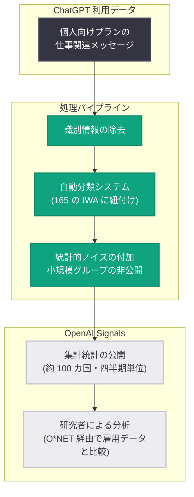

# ChatGPT の広がる仕事の世界: OpenAI Signals が 165 の業務活動データを公開

## メタデータ

| 項目 | 内容 |
|------|------|
| 発表日 | 2026-10-26 |
| ソース | OpenAI Research |
| カテゴリ | 研究成果 / データ公開 |
| 公式リンク | https://openai.com/index/chatgpt-expanding-world-of-work |

## 概要

OpenAI は 2026 年 10 月 26 日、消費者が ChatGPT を仕事にどのように使っているかを示す新しいデータを「OpenAI Signals」の一環として公開した。このデータは約 100 カ国にわたる 165 の業務活動 (Intermediate Work Activities、IWA) をカバーし、研究者が AI の経済的役割を研究するための新たな手段を提供する。

データからは、ChatGPT の仕事利用が時間の経過とともに最頻出の活動への集中度を下げ、より多様な業務へ広がっていることが明らかになった。また、国ごとに異なる種類の業務に特化していく傾向も観測されており、各国の経済構造や AI ツールへのアクセス状況の違いを映し出すデータとして注目される。

## 主な内容

### データの構造と範囲

今回公開されたデータセットの特徴は以下のとおり。

| 項目 | 内容 |
|------|------|
| 分類枠組み | 165 の業務活動カテゴリ「Intermediate Work Activities (IWA)」 |
| 基盤 | O*NET (職業別タスクを職業横断の活動カテゴリに分類する標準フレームワーク) |
| 期間 | 2025 年第 1 四半期から 2026 年第 3 四半期まで (四半期単位) |
| 対象 | 個人向け ChatGPT プランの仕事関連メッセージのみ |
| 対象外 | エンタープライズ利用および Codex の利用 |
| 対象国 | 約 100 カ国 |

O*NET を基盤とすることで、他の職業・雇用データとの比較が可能になっている。業務活動の例としては、教材の作成、マーケティングコンテンツの開発、プログラミング、ビジネスデータの分析などが挙げられている。

### 主要な発見: 利用の多様化

- 仕事利用は時間の経過とともに、最頻出の活動への集中度が低下している
- 全四半期で観測された 74 カ国において、上位 10 活動が各国の分類済み仕事メッセージに占める割合は、2025 年第 1 四半期の平均 56.0% から 2026 年第 3 四半期には 51.1% に低下した
- 各国が異なる種類の業務に特化していく傾向が見られた
- 国家間の差異は、業務内容そのものの違い、または AI ツールへのアクセス格差を反映している可能性がある

### 米国経済との比較

- ChatGPT 利用の分布と、米国の雇用加重タスク構成は大きく異なる
- 主な要因は、マッピングされた米国職業のタスク構成の約 43% が、個別報告カテゴリ外の「その他 IWA」に該当すること。例として、資材の運搬、車両の運転、医療記録の管理などが挙げられる
- これらの除外カテゴリは、元の米国 ChatGPT サンプルにおいて一貫した代表性の基準を満たさなかったため、個別には報告されていない

### 方法論とプライバシー保護

データ公開にあたり、以下のプライバシー保護措置が講じられている。

- 研究者は個別の会話を読まない
- 識別情報の除去後、自動システムがメッセージを分類する
- 集計統計のみを公開し、小規模グループの結果は非公開とする
- 個別メッセージ保護のため、統計的ノイズを付加する

## データ処理の流れ

## 影響

### 研究者への影響

本データにより、研究者は以下のような分析が可能になる。

- 国ごとの ChatGPT 仕事利用の違いの探索
- 時系列での利用パターンの変化の追跡
- 他の経済指標とのデータ照合
- これらのパターンが労働者や企業にとって何を意味するかの調査

### 利用上の留意点

- データは個人向け ChatGPT プランの仕事関連メッセージに限定されており、エンタープライズ利用や Codex の利用は含まれない
- 米国職業のタスク構成の約 43% が「その他 IWA」に分類されるため、雇用データとの直接比較には注意が必要
- 国家間の差異の解釈には、業務内容の違いと AI ツールへのアクセス格差の両方の可能性を考慮する必要がある

## 関連リンク

- [公式発表 (OpenAI Research)](https://openai.com/index/chatgpt-expanding-world-of-work)
- [OpenAI Research](https://openai.com/research)
- [O*NET OnLine](https://www.onetonline.org/)

## まとめ

OpenAI は「OpenAI Signals」の一環として、約 100 カ国・165 の業務活動にわたる ChatGPT の仕事利用データを公開した。上位 10 活動への集中度が 2025 年第 1 四半期の 56.0% から 2026 年第 3 四半期の 51.1% へ低下するなど、利用は時間とともに多様化しており、各国が異なる業務に特化していく傾向も見られる。O*NET を基盤とした分類により他の雇用データとの比較が可能で、プライバシー保護を徹底した集計統計として、AI の経済的役割を研究するための新たな基盤となる。
