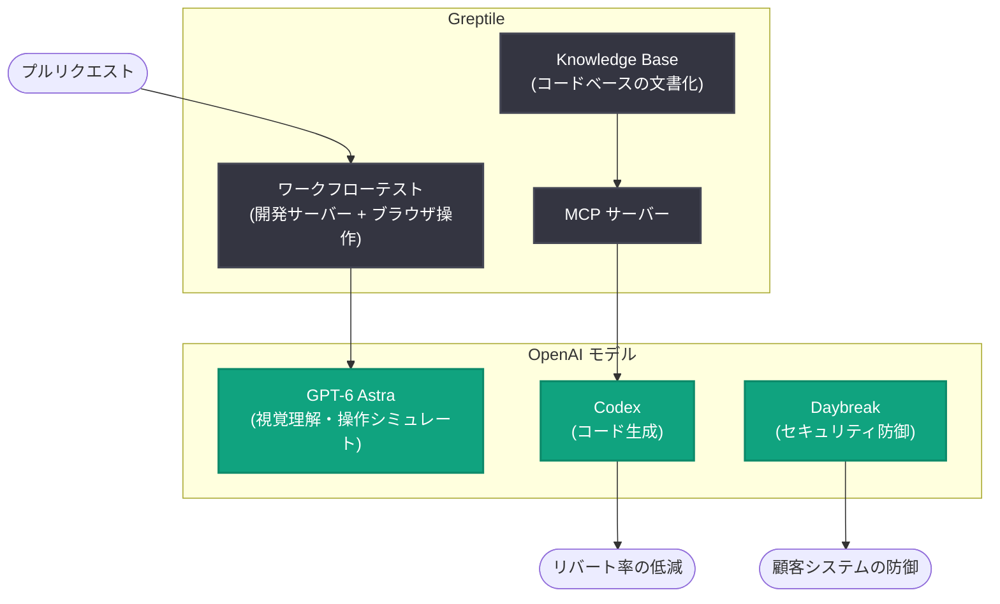

# Greptile、GPT-6 Astra でコードレビューを超えたバグ検出を実現

## メタデータ

| 項目 | 内容 |
|------|------|
| 発表日 | 2026-10-26 |
| ソース | OpenAI News/Blog |
| カテゴリ | スタートアップ (顧客事例) |
| 公式リンク | https://openai.com/index/greptile-code-review-codex-astra |

## 概要

コードベース全体の文脈を踏まえてコード変更のレビューとテストを行う AI エージェントを開発するスタートアップ Greptile の顧客事例が公開された。同社は GPT-6 Astra によるユーザーワークフローの実機テスト、Daybreak による顧客のセキュリティ防御強化、そして Codex による手戻り (リバート) の削減という 3 つの軸で OpenAI のモデルを活用している。

共同創業者兼 CEO の Daksh Gupta 氏は、同社のミッションについて「We are in the business of reducing bugs and making the world's software more reliable (私たちはバグを減らし、世界のソフトウェアをより信頼できるものにするビジネスをしている)」と述べている。

## 主な内容

### GPT-6 Astra: アプリケーションの大規模テスト

コードを読むだけでは発見できない問題を検出するため、Greptile は GPT-6 Astra を使って実際にアプリケーションを動かすテストを自動化している。

- 具体例として、iPhone で表示するとボタンが消えるケースが挙げられている。プルリクエストごとに開発サーバーを起動し、ブラウザを iPhone サイズのビューポートに変更してユーザー操作をシミュレートする。モデルの視覚理解により画面を検査し、消えたボタンを発見できる
- Gupta 氏は、従来型の QA 会社によるテストは現在の開発速度に対して「impractically slow (非現実的なほど遅い)」と指摘している

### Daybreak: 顧客のセキュリティ防御強化

強力なモデルは攻撃者による悪用も容易にするため、従来は標的にならなかった企業もリスクに晒されると Gupta 氏は指摘する。同社は Daybreak を活用し、「We want to make it very easy for even a startup to secure their systems (スタートアップでも自社システムを簡単に守れるようにしたい)」として、顧客の防御力が攻撃者の攻撃力を上回る状態を安全に実現することを目指している。

### Codex: バグと手戻りの削減

- Greptile の Knowledge Base が企業のコードベースをインデックス化し、人間とエージェントの双方が読める形で文書化。これを MCP (Model Context Protocol) サーバー経由で Codex に提供する
- これにより Codex が顧客の既存パターンに沿ったコードを書けるようになる
- 既に数千の顧客が Codex を Greptile のナレッジベースに接続している
- 効果測定は AI 生成コードのリバート (差し戻し) 率で実施。「When we provide agents with context, fewer reverts happen (エージェントにコンテキストを与えるとリバートが減る)」とし、顧客は時間と推論コストを節約できるとしている
- Greptile 自身も「We are massive users of Codex (私たちは Codex のヘビーユーザーだ)」と述べ、エンジニアリングを中心に全部門で Codex を利用している

### Ultrafast: 今後の展望

Gupta 氏は、真のボトルネックはアイデアを動くソフトウェアに変換する速度であり、多くのタスクにおいてモデルの知能は既に十分だと考えている。そのため Ultrafast を開発高速化の手段と位置付けている。長期目標は、重要なエンタープライズソフトウェアの変更・リリースをサイドプロジェクト並みに容易にすることであり、そのための検証機能を OpenAI と共に構築する意向を示している。

## アーキテクチャ

## 開発者への影響

- コードレビューに加え、実際のユーザー操作をシミュレートした UI レベルのバグ検出 (レスポンシブ表示の崩れなど) をプルリクエストごとに自動化できる事例が示された
- MCP サーバー経由でコードベースの文脈をエージェントに提供することで、AI 生成コードのリバート率を下げ、時間と推論コストを削減できるパターンが実証された
- 強力なモデルの普及により攻撃側の能力も向上するため、スタートアップを含むあらゆる規模の組織でセキュリティ防御の強化が重要になる

## 関連リンク

- [Greptile takes bug detection beyond code review with GPT-6 Astra (OpenAI)](https://openai.com/index/greptile-code-review-codex-astra)
- [OpenAI News](https://openai.com/news)
- [OpenAI 公式ドキュメント](https://platform.openai.com/docs)

## まとめ

Greptile は GPT-6 Astra による実アプリのワークフローテスト、Daybreak によるセキュリティ防御、Codex と MCP 連携による文脈提供という 3 つのアプローチで、コードレビューの枠を超えたバグ削減を実現している。数千の顧客が Codex を同社のナレッジベースに接続しており、エージェントへの文脈提供がリバート率低減につながることが示された。今後は Ultrafast を活用し、エンタープライズソフトウェアの変更・リリースを容易にする検証機能の構築を目指す。
