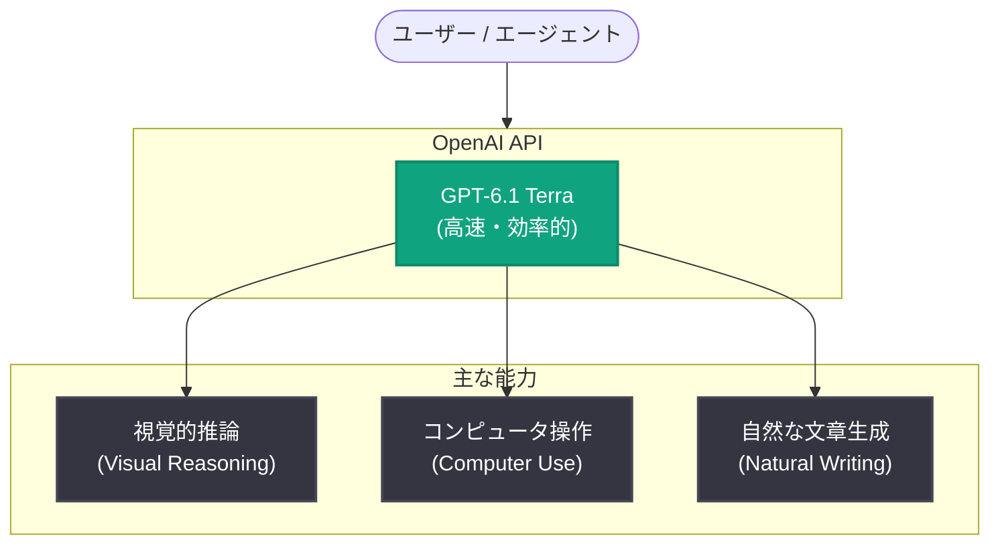

# GPT-6.1 Terra の発表 — 高速かつ高性能なコンピュータ操作をすべての人に

## メタデータ

| 項目 | 内容 |
|------|------|
| 発表日 | 2026-10-26 |
| ソース | OpenAI News / API Changelog |
| カテゴリ | 新機能 (Product) |
| 公式リンク | https://openai.com/index/introducing-gpt-6-1-terra |

> **注記**: 本レポート作成時点で詳細ページ本文の取得がアクセス制限 (Cloudflare チャレンジ) により行えなかったため、内容は OpenAI の公式発表サマリーおよび API Changelog (2026-10-26) に記載された情報のみに基づいています。

## 概要

OpenAI は 2026 年 10 月 26 日、新モデル **GPT-6.1 Terra** を発表した。公式発表では「高速かつ高性能なコンピュータ操作 (computer use) をすべての人に届ける」モデルと位置づけられている。

同日の API Changelog によると、GPT-6.1 Terra は**視覚的推論 (visual reasoning)、コンピュータ操作 (computer use)、自然な文章生成 (natural writing)** に対応した、高速かつ効率的なモデルとして API でリリースされた。

## 詳細

### 発表のポイント

公式発表および API Changelog で確認できる内容は以下のとおり。

- **高速・効率的なモデル**: 速度と効率を重視した設計で、コンピュータ操作を広いユーザー層に提供することを目的としている
- **視覚的推論**: 画面などの視覚情報を理解・推論する能力を備える
- **コンピュータ操作**: GUI 操作などのコンピュータ操作タスクに対応する
- **自然な文章生成**: 自然な文章を書く能力が特徴として挙げられている

### API での提供

API Changelog (2026-10-26) にて、GPT-6.1 Terra のリリースが同日付で告知されており、発表と同時に API 経由で利用可能になったことが示されている。

モデル ID、価格、コンテキストウィンドウ、レート制限などの詳細仕様は、本レポート作成時点では一次情報を確認できていない。最新情報は公式ドキュメントを参照のこと。

## アーキテクチャ

発表内容 (視覚的推論・コンピュータ操作・自然な文章生成) に基づく概念図。

## 影響

開発者への想定される影響は以下のとおり。

- **コンピュータ操作エージェントの構築**: 高速・効率的なモデルとして提供されるため、画面操作を伴うエージェント型アプリケーションを、より広いユースケースで実用化しやすくなる可能性がある
- **視覚的推論を伴うワークフロー**: スクリーンショットや UI の理解を必要とするタスク (テスト自動化、業務自動化など) への適用が考えられる
- **文章生成用途との両立**: コンピュータ操作に加えて自然な文章生成も特徴とされており、操作と文書作成を組み合わせたワークフローへの活用が期待できる
- **仕様確認の必要性**: モデル ID や価格などの詳細は未確認のため、導入前に公式ドキュメントでの確認が必要

## 関連リンク

- [Introducing GPT-6.1 Terra (公式発表)](https://openai.com/index/introducing-gpt-6-1-terra)
- [OpenAI API Changelog](https://platform.openai.com/docs/changelog)
- [OpenAI 公式ドキュメント](https://platform.openai.com/docs)
- [OpenAI News](https://openai.com/news)

## まとめ

GPT-6.1 Terra は、2026 年 10 月 26 日に発表・API リリースされた高速・効率的なモデルで、視覚的推論、コンピュータ操作、自然な文章生成を特徴とする。「コンピュータ操作をすべての人に」という位置づけから、エージェント型のコンピュータ操作ユースケースの普及を狙ったモデルと考えられる。詳細仕様は公式ドキュメントでの確認が推奨される。
