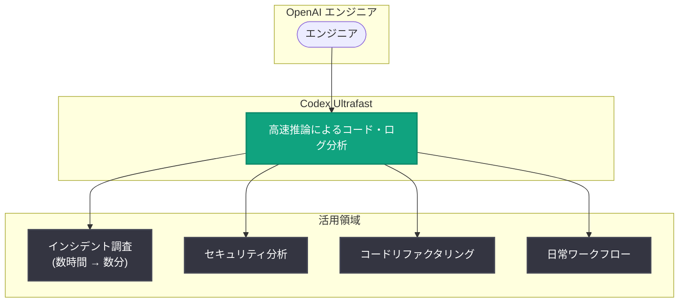

# Ultrafast が OpenAI のインシデント調査を数時間から数分に短縮

## メタデータ

| 項目 | 内容 |
|------|------|
| 発表日 | 2026-10-26 |
| ソース | OpenAI News/Blog |
| カテゴリ | OpenAI on OpenAI |
| 公式リンク | https://openai.com/index/openai-cut-incident-investigation |

> **注意**: 本レポート作成時点で、詳細ページ (上記公式リンク) は Cloudflare のチャレンジページによりアクセスできなかったため (WebFetch は HTTP 403、curl はチャレンジページを返却)、本レポートは公開されているメタデータ (タイトル、日付、説明文、カテゴリ) のみに基づいて作成している。詳細な数値や事例については、必ず公式ページを直接参照すること。

## 概要

OpenAI は、社内エンジニアが Codex Ultrafast を活用してインシデント調査を数分で完了する方法を紹介する記事を公開した。本記事は「OpenAI on OpenAI」カテゴリに属し、OpenAI 自身が自社製品をどのように業務で活用しているかを紹介するシリーズの一つである。

公式の説明文によると、記事ではインシデント調査が従来の数時間から数分に短縮された事例に加え、より高速なセキュリティ分析、コードリファクタリング、日常的なワークフローへの Codex Ultrafast の適用についても解説されている。

## 主な内容

### インシデント調査の高速化

タイトルおよび説明文によると、OpenAI のエンジニアは Codex Ultrafast を使用することで、従来は数時間かかっていたインシデント調査を数分で完了できるようになった。

### その他の活用領域

説明文では、インシデント調査以外に以下の活用領域が挙げられている。

- **セキュリティ分析**: より高速なセキュリティ分析の実現
- **コードリファクタリング**: コードの改善作業への適用
- **日常ワークフロー**: エンジニアの日々の業務への組み込み

※ 各領域の具体的な手法や数値は、詳細ページにアクセスできなかったため本レポートには含まれていない。

## ワークフローのイメージ

公開されている説明文に基づく、Codex Ultrafast の活用領域の概念図。

## 開発者への影響

- OpenAI 自身の運用事例として、AI コーディングエージェントをインシデント対応やセキュリティ分析に適用する具体的なユースケースが示された
- インシデント調査の所要時間が「数時間から数分」に短縮されたという事例は、SRE やセキュリティチームが同様のワークフローを検討する際の参考になる
- Codex を単発のコード生成だけでなく、調査・分析・リファクタリングといった日常業務全体に組み込むアプローチの実例となる

## 関連リンク

- [How Ultrafast cut incident investigation from hours to minutes at OpenAI (公式記事)](https://openai.com/index/openai-cut-incident-investigation)
- [OpenAI Codex](https://openai.com/codex/)
- [OpenAI News](https://openai.com/news)

## まとめ

OpenAI は、社内エンジニアが Codex Ultrafast を活用してインシデント調査を数時間から数分に短縮した事例を公開した。セキュリティ分析、コードリファクタリング、日常ワークフローへの適用についても紹介されている。本レポートは詳細ページにアクセスできなかったため公開メタデータのみに基づいており、具体的な手法や数値については公式記事を参照されたい。
