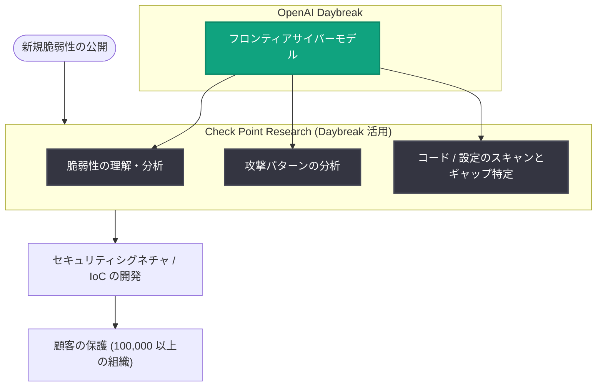

# Check Point が OpenAI Daybreak で脆弱性リサーチを数時間から数分に短縮

## メタデータ

| 項目 | 内容 |
|------|------|
| 発表日 | 2026-10-27 |
| ソース | OpenAI News |
| カテゴリ | セキュリティ / 導入事例 |
| 公式リンク | https://openai.com/index/check-point-daybreak |

## 概要

サイバーセキュリティ企業 Check Point が、OpenAI Daybreak を活用して脆弱性リサーチのワークフローを加速している事例が紹介された。同社 CTO の Jonathan Zanger 氏によれば、従来は数時間かかっていた脆弱性リサーチ作業が、OpenAI Daybreak Defense Network の一員として Daybreak を利用することで数分に短縮されたという。

Daybreak は、脆弱性の分析、攻撃経路の推論、コードや設定のセキュリティギャップの特定が可能な OpenAI のフロンティアサイバーモデルへのアクセスを防御側に提供するものである。Check Point はこの能力を既存のセキュリティワークフローに組み込み、脆弱性インテリジェンスを顧客向けの防御策へより速く転換している。

## 主な内容

### Check Point と脆弱性リサーチの課題

Check Point は AI、ワークスペース、クラウド、ネットワークセキュリティ製品を通じて 100,000 以上の組織のセキュリティを支援している。同社のリサーチ部門である Check Point Research は、「予防第一 (prevention-first)」のアプローチのもと、新たに出現する脆弱性を調査し、その知見を顧客向けの防御策に変換する役割を担う。

Zanger 氏は「サイバー脅威は増加しており、ますます高度化している」と述べ、新しい脆弱性が公開された際に「顧客をできるだけ早く保護することが我々の仕事だ」と説明する。この作業は、脆弱性を調査し、その結果を Check Point のシステムが脅威を認識するために使うセキュリティシグネチャや IoC (Indicators of Compromise、侵害指標) に変換する専門アナリストに依存しており、従来はアナリストの人数がチームの処理能力の制約となっていた。

### Daybreak による脆弱性リサーチの自動化

Check Point は OpenAI Daybreak を使ってこのワークフローの多くを自動化している。Zanger 氏は「Daybreak を活用してこのプロセスを高速化・自動化し、数時間かかっていた作業を数分で行えるようになった」と語る。価値の源泉は、モデルがセキュリティ問題について推論できる能力にある。

> 「OpenAI Daybreak は脆弱性を理解し、さまざまな攻撃パターンを分析し、コードをスキャンしてギャップを特定できる」
>
> — Jonathan Zanger 氏 (CTO, Check Point)

Zanger 氏は、複雑なコードや設定の理解、システムが攻撃に晒され得る経路の特定における進歩も指摘しており、Check Point はこれらの能力がサイバーセキュリティワークフローに組み込めるだけの成熟度に達したと判断している。脆弱性リサーチにおいて Daybreak は、シグネチャや IoC の開発の前提となる調査作業を支援し、脅威の理解から防御策の開発までの道のりを短縮する。

### 自律的なネットワークセキュリティへの展開

Check Point はさらに、Daybreak を用いた Agentic Network Security Orchestration ソリューションの開発にも OpenAI と共同で取り組んでいる。Zanger 氏が説明するアプローチは、顧客環境の継続的な監視と、明確に定義された運用境界、そして重大なアクションに対する人間の承認を組み合わせたものである。顧客がセキュリティ目標を設定すると、システムは発見事項、推奨アクション、関連リスクを説明し、顧客が対応を判断できるようにする。

脆弱性リサーチが数分で完了するようになった今、Check Point の次の優先事項は修復 (remediation) である。同社は、特定したギャップへの対処をセキュリティチームが容易に行えるよう、Daybreak の能力の活用を検討している。

> 「OpenAI の Daybreak を我々の既存のセキュリティワークフローと組み合わせることで、リアルタイムに脅威を防止できるレベルの自動化が実現する」
>
> — Jonathan Zanger 氏 (CTO, Check Point)

## 技術的な詳細

記事で言及されている Daybreak の能力は以下のとおり。

- 脆弱性の理解と分析
- 攻撃パターン・攻撃経路の推論
- コードや設定のスキャンによるセキュリティギャップの特定
- 複雑なコードや設定の理解と、システムの攻撃露出経路の特定

これらの出力は、Check Point のアナリストがセキュリティシグネチャや IoC を開発するための調査作業に活用されている。

## アーキテクチャ

## 開発者・セキュリティ担当者への影響

- 脆弱性リサーチの所要時間が数時間から数分に短縮され、新規脆弱性への防御策展開までのリードタイムが大幅に縮小する事例が示された
- アナリストの人数に制約されていた調査能力を、フロンティアサイバーモデルによる自動化で拡張できることが実証された
- 運用境界の定義と重大アクションへの人間の承認を組み合わせた、エージェント型ネットワークセキュリティの設計アプローチが提示された

## 関連リンク

- [How Check Point accelerates vulnerability research with Daybreak (OpenAI 公式)](https://openai.com/index/check-point-daybreak)
- [OpenAI News](https://openai.com/news)
- [Check Point 公式サイト](https://www.checkpoint.com/)

## まとめ

Check Point は OpenAI Daybreak Defense Network の一員として、脆弱性リサーチのワークフローを数時間から数分へ短縮した。Daybreak のフロンティアサイバーモデルは脆弱性の理解、攻撃パターンの分析、コードのギャップ特定を担い、アナリストによるシグネチャ・IoC 開発を加速している。今後は Agentic Network Security Orchestration の開発と修復 (remediation) の自動化へと取り組みを拡大し、顧客が目標を設定し重大アクションを承認する、より自律的な防御の実現を目指す。
