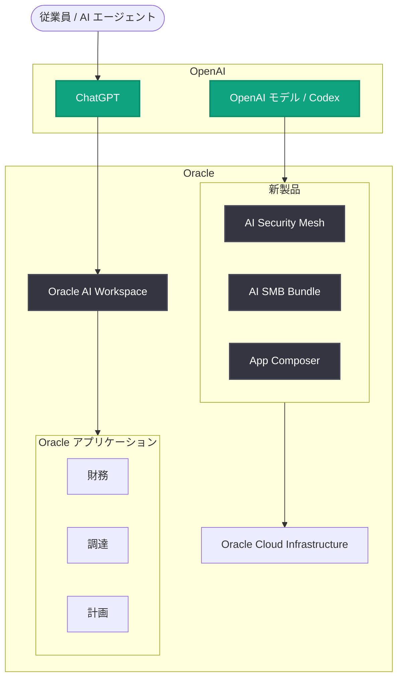

# OpenAI が Oracle とのパートナーシップを拡大、Oracle アプリを ChatGPT に統合へ

## メタデータ

| 項目 | 内容 |
|------|------|
| 発表日 | 2026-10-27 |
| ソース | OpenAI News |
| カテゴリ | 企業 (Company) |
| 公式リンク | https://openai.com/index/oracle-apps-in-chatgpt |

## 概要

OpenAI と Oracle は、Oracle のビジネスアプリケーションとデータを ChatGPT に統合するとともに、OpenAI のモデルと製品で Oracle の新しい製品・サービスを強化するため、パートナーシップを拡大すると発表した。両社は、企業が AI を活用して中核業務の運営、より良いアプリケーションの構築、セキュリティの強化を実現できるよう支援することを目指す。

今回の発表は、OpenAI API、ChatGPT Work、Codex にまたがる既存の商業的関係を基盤とするもの。Oracle 社内では 130,000 人のアクティブな ChatGPT ユーザーと 95,000 人超のアクティブな Codex ユーザーがいると報告されており、同社の採用チームは、従来 2〜4 日かかっていた市場調査の準備を ChatGPT Work により 15〜20 分に短縮している。

## 主な内容

### エージェント対応エンタープライズのビジョン

OpenAI と Oracle は、人と AI エージェントが 1 つの接続された環境でビジネスアプリケーションを横断して働く「エージェント対応エンタープライズ (agent-ready enterprise)」のビジョンを共有している。両社の目標は、よりシンプルな管理、統一されたサインイン、各組織の権限と承認に基づくアクセス制御によって、Oracle ソフトウェアをより発見・利用・管理しやすくすることである。

### ChatGPT 内での Oracle との連携 (Oracle AI Workspace)

Oracle は、Oracle アプリケーションおよびデータとの統合を通じてこのビジョンを ChatGPT 内で実現する **Oracle AI Workspace** を開発している。ユーザーが達成したいことを記述するだけで、適切な情報を見つけ、承認済みのビジネスワークフローを 1 か所で完了できるようにすることが目標である。

例として、財務チームの新メンバーが ChatGPT を使ってコストを調査し、購買の意思決定を理解し、月次決算までに残っている作業を特定するといった利用シーンが示されている。財務、調達、計画の各アプリケーションからの情報を統合し、組織の権限と承認の範囲内でより多くの従業員が Oracle ソフトウェアを活用できるようにする。

### OpenAI のモデルを活用した Oracle の新製品

Oracle AI Workspace に加え、Oracle は OpenAI のモデルとツールを活用した以下のアップデートと新サービスを発表している。

- **Oracle AI Security Mesh**: OpenAI のサイバーモデルを使用して、アプリケーションとインフラストラクチャの脆弱性の発見と修正を支援する。Oracle がテストインフラを管理し、顧客が認可された範囲内で安全にこれらの機能を活用できるようにする
- **Oracle AI SMB Bundle**: ChatGPT Business と Codex を Oracle アプリケーションおよび継続的な Oracle Cloud Infrastructure クレジットと組み合わせ、中小企業の製品開発と業務管理を支援する
- **Oracle App Composer**: Codex などの AI ツールを使ったアプリ構築、承認済みの Oracle データ・ワークフローへの接続、組織内での共有を支援する。Oracle が Oracle Cloud Infrastructure 上のデプロイを管理し、企業の権限とアクセス制御が組み込まれる

### Oracle Marketplace 経由での OpenAI 製品の購入

米国の Oracle 顧客は、既存の調達プロセスと対象となる Oracle Universal Credits を使用して、Oracle Marketplace 経由で OpenAI API、Codex、ChatGPT Work へのアクセスを購入できる。

## アーキテクチャ

## 開発者・企業への影響

- Oracle アプリケーション (財務、調達、計画など) の情報を ChatGPT 上で横断的に参照し、承認済みワークフローを完了できるようになる見込み
- Oracle App Composer により、Codex などの AI ツールで構築したアプリを承認済みの Oracle データ・ワークフローに接続し、OCI 上で権限管理付きでデプロイ・共有できる
- 中小企業は Oracle AI SMB Bundle を通じて ChatGPT Business、Codex、Oracle アプリケーション、OCI クレジットをまとめて利用できる
- 米国の Oracle 顧客は、既存の調達プロセスと Oracle Universal Credits を使い、Oracle Marketplace から OpenAI API、Codex、ChatGPT Work を購入できる

## 関連リンク

- [公式発表: OpenAI expands partnership with Oracle to bring its apps to ChatGPT](https://openai.com/index/oracle-apps-in-chatgpt)
- [Oracle パートナーページ (Oracle AI Workspace)](https://openai.com/business/partners/oracle/)
- [OpenAI on Oracle Cloud (Oracle Marketplace)](https://openai.com/index/openai-on-oracle-cloud/)
- [Oracle 導入事例 (OpenAI)](https://openai.com/index/oracle/)
- [OpenAI News](https://openai.com/news)

## まとめ

OpenAI と Oracle のパートナーシップ拡大により、Oracle アプリケーションとデータが ChatGPT に統合され (Oracle AI Workspace)、OpenAI のモデルを活用した Oracle の新製品 (AI Security Mesh、AI SMB Bundle、App Composer) が展開される。権限と承認に基づくガバナンスを前提に、人と AI エージェントが業務アプリケーションを横断して協働する「エージェント対応エンタープライズ」の実現を両社は目指している。米国では Oracle Marketplace 経由で OpenAI 製品の購入も可能になる。
