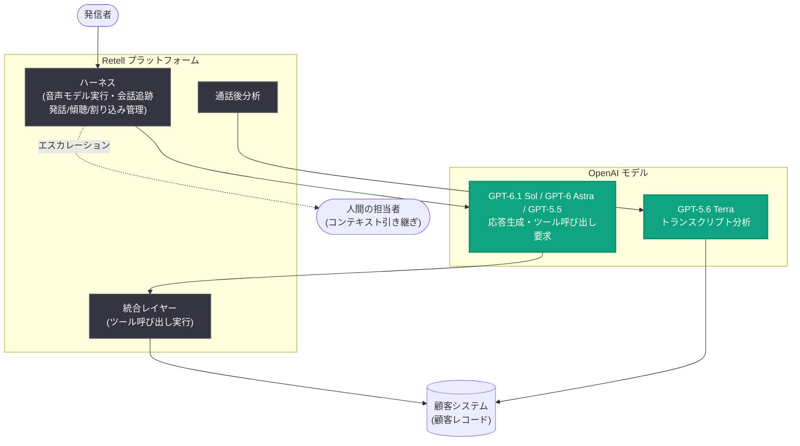

# Retell、OpenAI モデルを活用し月間 1 億件の通話を支援

## メタデータ

| 項目 | 内容 |
|------|------|
| 発表日 | 2026-10-27 |
| ソース | OpenAI News |
| カテゴリ | 導入事例 (Customer Story) |
| 公式リンク | https://openai.com/index/retell-ai |

## 概要

コンタクトセンター向け音声 AI プラットフォームの [Retell AI](https://www.retellai.com/) は、質問への回答、アクションの実行、必要に応じた担当者への接続を行う音声エージェントの構築を支援している。現在 4,000 社以上が利用しており、月間通話数は 2026 年初頭の 3,000 万件から同年 9 月には 1 億件超へと成長した。

Retell のプラットフォーム上の通話の 80% で OpenAI モデルが応答を生成しており、顧客は 80% を超える解決率を達成している。OpenAI モデル全体でのトークン消費量は累計 1 兆トークンを突破した。また、エンジニアリング面では Codex を開発全般に、GPT-6 Astra をフロントエンドのテストに活用し、従業員 1 人あたり年間 160 万ドルの収益ランレートを実現している。

> "We choose models the way our customers choose vendors: on real calls, not demos. OpenAI keeps earning its spot."
>
> — Bing Wu 氏 (Retell AI 共同創業者 兼 CEO)

## 主な内容

### ライブ通話の要求に応える OpenAI モデルの選定

エンタープライズ向け音声エージェントは、会話が変化しても企業ポリシーに従い、割り当てられた役割の範囲内にとどまる必要がある。Retell は実運用シナリオから抽出した難易度の高いマルチターン会話を用いて数十のモデルを比較する独自ベンチマーク「vCX」を構築した。

vCX ベンチマークは、指示追従性、与えられた情報へのグラウンディング、正しいツール呼び出し、自然な会話表現の 4 点を評価する。2026 年 10 月 13 日のベンチマークでは、**GPT-6 Astra が指示追従性で 89.7% を記録し首位**となった。

また、GPT-6 Astra 公開前に実施された評価では、GPT-5.5 が reasoning 有効時に非ハルシネーション率 (88.0%) とツール呼び出し正確性 (88.3%) の両方で最高位となり、Gemini-3.1-Pro と Claude-4.6 を上回った。reasoning 無効時も非ハルシネーション率で首位だった。

Retell の顧客は Realtime API 経由の OpenAI Realtime モデルや、音声エンジンとしての OpenAI text-to-speech も利用できる。Retell は新しい OpenAI モデルをリリース当日から提供し、モデルの改善に合わせてベンチマークを再実行している。

### エージェントによる顧客リクエストの 80% 超の解決

コンタクトセンターのチームは Retell を使ってエージェントのビジネスコンテキスト、目標、ルールを定義し、開発者がワークフローと統合をさらに構成する。

通話中は Retell のハーネスが音声モデルを実行し、会話を追跡し、エージェントが話す・聞く・割り込みに応答するタイミングを管理する。**GPT-6.1 Sol、GPT-6 Astra、GPT-5.5** を含む OpenAI モデルが、顧客の指示と会話コンテキストに基づいて応答を生成し、ツール呼び出しを要求する。Retell はそれらの呼び出しを顧客システムとの統合を通じて実行し、結果を顧客レコードに書き戻すことができる。

人間の判断が必要な場合、音声エージェントは担当者にコンテキストを説明し、フォローアップの質問に答え、準備完了を確認してから顧客を接続する。通話後は **GPT-5.6 Terra** がトランスクリプトを分析し、結果やその他のデータを抽出する。

**導入企業の実績:**

- **Anker (電子機器)**: 米国・英国の Tier-1 アフターサポート (注文追跡、保証確認、トラブルシューティング) をエージェントが対応。ケース解決率 80.4%、NPS 63 を達成。トーン、ペース、温かみは人間のエージェントに期待する水準を満たしたと評価
- **Pine Park Health (医療)**: 予約リマインダーと能動的なスケジューリングを担当し、結果を患者の医療カルテに記録。医療アシスタントの時間をフルタイム 2.1 人分回復させ、患者ケアに再配分。スケジューリングエージェントは患者に到達した際に 55.7% の予約率を達成

### 通話量の増加に対する応答性の維持

Retell プラットフォームの日中トラフィックは夜間の最低値の 50 倍以上に達することがある。ピーク時でも通話の応答性を保つため、Retell は顧客間で共有される OpenAI の専用サーバー (dedicated servers) を利用している。2026 年 10 月 13 日のベンチマークでは、GPT-6 Astra と GPT-6 Sol がそれぞれ**最初の 1 文までの中央値レイテンシ 883 ミリ秒**を記録し、GPT-5.6 Luna が 497 ミリ秒で最速だった。

OpenAI のリージョナル API エンドポイントにより、トラフィックを特定の地理的リージョンにルーティングでき、ネットワーク伝送時間の削減に加え、医療や金融サービスなどの業界における顧客のデータレジデンシー要件への対応が可能になっている。

さらに Retell はサービスの各レイヤーに冗長性を組み込んでいる。独自のテレフォニースタックを運用し、障害時に引き継ぐセカンダリスタックに加え、音声サービスとモデルサービスのバックアップも用意している。

### Codex による調査・構築・デバッグ

エンタープライズの成長に伴いカスタムワークフローや統合の要望が増える中、Retell のエンジニアはコードベースの不慣れな部分で作業することが多い。コードを書く前に Codex へ高レベルの要件を伝えると、Codex がコードを調査し、実データと照合し、変更が必要な箇所を説明する。あるエンジニアは「Codex は自分よりも優れた調査を、はるかに速く行った」と述べている。

実装中は、エンジニアが考慮していなかった詳細を Codex が指摘することも多い。デバッグでは、Codex がログやデータベースレコードをコードと相互参照して状況を調査する。顧客向けのプロンプト作成 (モデルの応答を導く指示の記述) の高速化にも Codex を活用している。

Web インターフェースの変更テストには **GPT-6 Astra の computer use** を利用している。エンジニアがフロントエンドのプルリクエストを開くと、GPT-6 Astra がインターフェースを開き、クリック操作でフローをテストし、破壊を試み、発見した問題を報告する。以前のモデルではこの作業を確実に実行できなかったという。

Retell は採用を継続しているが、エンジニアリングチームはビジネスと同じペースで拡大する必要がなくなっており、**従業員 1 人あたり年間 160 万ドルの収益ランレート**を報告している。

> "By using Codex, the engineering team has a virtual teammate that can pair with them on any kind of difficult task."
>
> — Bing Wu 氏 (Retell AI 共同創業者 兼 CEO)

## 技術的な詳細

### 使用されている OpenAI モデルと役割

| モデル | 役割 |
|--------|------|
| GPT-6.1 Sol / GPT-6 Astra / GPT-5.5 | 通話中の応答生成とツール呼び出し要求 |
| GPT-5.6 Terra | 通話後のトランスクリプト分析と結果抽出 |
| GPT-6 Astra (computer use) | フロントエンド UI の自動テスト |
| Realtime モデル (Realtime API) | 顧客向けリアルタイム音声 |
| OpenAI text-to-speech | 音声エンジン |
| Codex | コード調査、機能開発、デバッグ |

### vCX ベンチマーク結果 (2026 年 10 月 13 日)

| 指標 | 結果 |
|------|------|
| 指示追従性 | GPT-6 Astra が 89.7% で首位 |
| 非ハルシネーション率 (reasoning 有効) | GPT-5.5 が 88.0% で首位 (GPT-6 Astra 公開前の評価) |
| ツール呼び出し正確性 (reasoning 有効) | GPT-5.5 が 88.3% で首位 (GPT-6 Astra 公開前の評価) |
| 最初の 1 文までの中央値レイテンシ | GPT-5.6 Luna が 497 ms で最速、GPT-6 Astra / GPT-6 Sol は各 883 ms |

## アーキテクチャ

## 開発者への影響

- **実運用ベースのモデル評価の参考例**: デモではなく実際の通話データに基づくマルチターンベンチマーク (vCX) によるモデル選定は、音声エージェント開発者のモデル評価手法の参考になる
- **レイテンシ設計の指標**: 最初の 1 文までの中央値レイテンシ (GPT-5.6 Luna で 497 ms) や専用サーバー、リージョナル API エンドポイントの活用は、リアルタイム音声アプリケーションの設計指針となる
- **computer use による UI テスト自動化**: GPT-6 Astra の computer use をフロントエンドのプルリクエストテストに組み込む運用は、開発ワークフロー自動化の具体例を示している
- **Codex による開発効率化**: コード調査からデバッグまで Codex を活用することで、ビジネス成長に対してエンジニアリングチームの拡大を抑制できた事例 (従業員 1 人あたり年間 160 万ドルの収益ランレート)

## 関連リンク

- [Retell uses OpenAI models to help power 100M monthly calls (OpenAI 公式)](https://openai.com/index/retell-ai)
- [Retell AI 公式サイト](https://www.retellai.com/)
- [OpenAI Realtime API ドキュメント](https://platform.openai.com/docs/guides/realtime)
- [Codex](https://openai.com/codex/)
- [OpenAI News](https://openai.com/news)

## まとめ

Retell AI は OpenAI モデルを中核に据えた音声 AI プラットフォームで、月間通話数を 2026 年初頭の 3,000 万件から 9 月には 1 億件超に拡大し、累計 1 兆トークンを消費した。独自の vCX ベンチマークでは GPT-6 Astra が指示追従性 89.7% で首位となり、通話の 80% で OpenAI モデルが応答を生成、顧客は 80% 超の解決率を達成している。開発面では Codex と GPT-6 Astra の computer use を活用し、従業員 1 人あたり年間 160 万ドルの収益ランレートを実現。今後は品質保証・シミュレーションの拡充、多言語対応、ナレッジベースの自動学習の開発を計画している。
