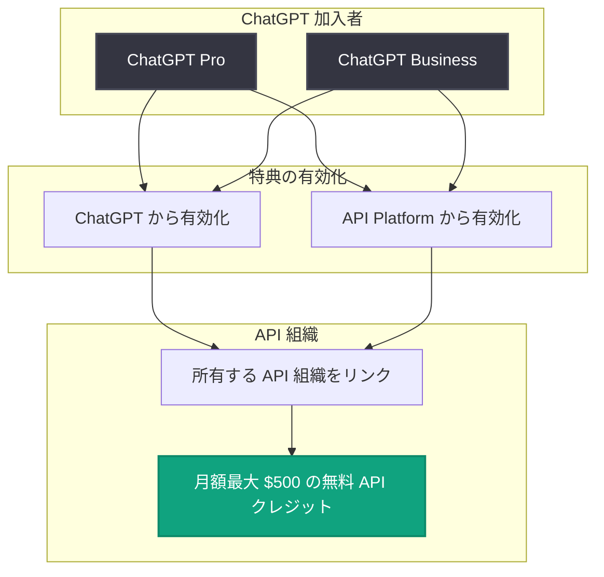

# ChatGPT Pro および Business の対象加入者向けに月額最大 $500 の無料 API クレジット特典を開始

## メタデータ

| 項目 | 内容 |
|------|------|
| 発表日 | 2026-10-28 |
| ソース | OpenAI API Changelog |
| カテゴリ | API 更新 / 料金 |
| 公式リンク | https://developers.openai.com/api/docs/changelog |

## 概要

OpenAI は 2026 年 10 月 28 日、対象となる ChatGPT Pro および Business 加入者に対し、サブスクリプション特典として月額最大 $500 の無料 API クレジットを提供する機能を発表した。Changelog の原文では "up to $500 per month in free API credits" と表現されており、加入者は自身が所有する API 組織をリンクすることで特典を有効化できる。

ChatGPT のサブスクリプションと API プラットフォームの利用をつなぐ特典であり、ChatGPT の有料加入者が追加コストなしで API 開発を試せるようになる点で、開発者にとって重要なアップデートとなる。

## 主な内容

### 特典の内容

- **特典額**: 月額最大 $500 の無料 API クレジット (原文: "up to $500 per month in free API credits")
- **位置づけ**: ChatGPT サブスクリプションの特典 ("subscription benefit") として提供
- **対象者**: 資格のある ChatGPT Pro および Business 加入者 (原文: "Eligible ChatGPT Pro and Business subscribers")

### 対象プランと特典内容の比較

| 項目 | ChatGPT Pro | ChatGPT Business |
|------|-------------|------------------|
| 特典の対象 | 対象 (資格要件あり) | 対象 (資格要件あり) |
| 無料 API クレジット | 月額最大 $500 | 月額最大 $500 |
| 有効化方法 | ChatGPT または API Platform から有効化 | ChatGPT または API Platform から有効化 |
| 必要な手続き | 自身が所有する API 組織のリンク | 自身が所有する API 組織のリンク |

**注記**: Changelog には "up to $500 per month" とのみ記載されており、プラン別の具体的なクレジット額や詳細な適格基準は公式ガイド ([API credits for ChatGPT subscribers](https://developers.openai.com/api/docs/guides/chatgpt-api-credits)) に記載されている。

### 利用方法

1. **特典の有効化**: ChatGPT または API Platform から特典を有効化する
2. **API 組織のリンク**: 自身が所有する API 組織をリンクする (原文: "by linking an API organization you own")

## 技術的な詳細

本アップデートは API のエンドポイントやパラメータの変更ではなく、課金・特典に関する変更である。クレジット額、対象条件、申請方法 (原文: "credit amounts, eligibility, and how to claim") の詳細は、公式ガイド「API credits for ChatGPT subscribers」にまとめられている。

## アーキテクチャ

特典の有効化フローの概要を以下に示す。

## 開発者への影響

- **API 利用コストの削減**: ChatGPT Pro / Business 加入者は、月額最大 $500 分まで追加コストなしで API を利用できるようになる
- **プロトタイピングの促進**: 個人開発者やチームが、API を使った開発・検証を無料クレジットの範囲で開始しやすくなる
- **手続きの確認が必要**: 特典を受けるには、自身が所有する API 組織をリンクする手続きが必要となる。適格基準の詳細は公式ガイドで確認する必要がある

## 関連リンク

- [OpenAI API Changelog (公式)](https://developers.openai.com/api/docs/changelog)
- [API credits for ChatGPT subscribers (公式ガイド)](https://developers.openai.com/api/docs/guides/chatgpt-api-credits)
- [OpenAI API リファレンス](https://platform.openai.com/docs/api-reference)
- [OpenAI News](https://openai.com/news)

## まとめ

OpenAI は ChatGPT Pro および Business の対象加入者に対し、月額最大 $500 の無料 API クレジットをサブスクリプション特典として提供開始した。特典は ChatGPT または API Platform から有効化し、自身が所有する API 組織をリンクすることで利用できる。プラン別のクレジット額や詳細な適格基準は公式ガイドに記載されているため、利用前に確認が必要である。
