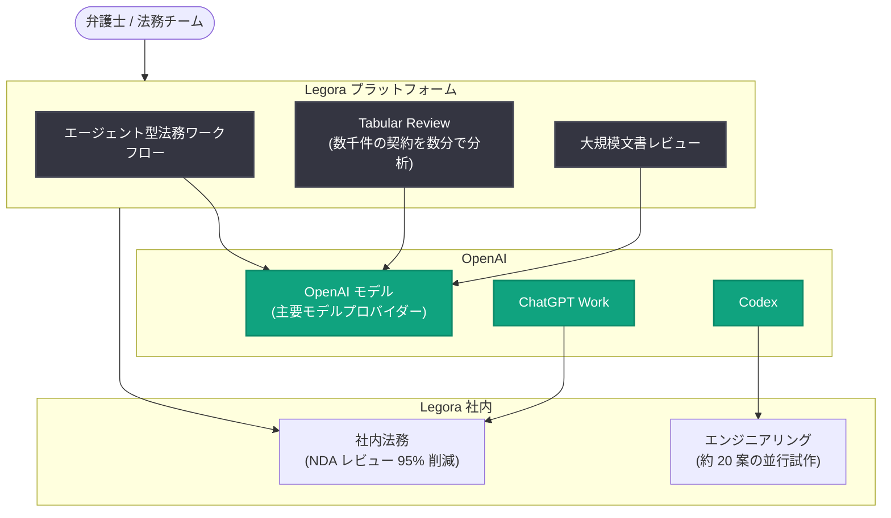

# Legora: 法務業務のためのエージェント型オペレーティングシステムを構築

## メタデータ

| 項目 | 内容 |
|------|------|
| 発表日 | 2026-10-28 |
| ソース | OpenAI News |
| カテゴリ | 導入事例 |
| 公式リンク | https://openai.com/index/legora/ |

## 概要

2023 年にストックホルムで創業した Legora は、OpenAI モデルを中核とした「法務業務のためのエージェント型オペレーティングシステム」を構築している。法務チームの慢性的な時間不足という課題に対し、エージェント型の法務ワークフローから大規模な契約・文書レビューまでを AI で支援する。GPT-3.5 のリリースが転機となり、構想していた法務ユースケースが現実のものとなった。

本事例では、Fortune 100 企業の顧客が契約処理時間を 90% 短縮し、外部費用を 2,000 万ドル以上削減するなど、具体的な成果が示されている。さらに Legora 自身も ChatGPT や Codex を全社的に活用する「AI ネイティブ」な組織運営を実践しており、プロダクトと組織の両面で AI 活用のモデルケースとなっている。

## 主な内容

### エージェント型の法務プラットフォーム

Legora は OpenAI を主要モデルプロバイダーとして採用し、エージェント型の法務業務から大規模文書レビューまでをカバーするプラットフォームを提供している。代表的な機能である Tabular Review ワークフローでは、数千件の契約を数分で分析できる。

CEO 兼共同創業者の Max Junestrand 氏は「It's the best time in history to be a lawyer. (弁護士にとって歴史上最良の時代だ)」と語り、AI が弁護士の仕事を奪うのではなく、高付加価値業務へのシフトを可能にすると強調している。

### AI ネイティブな社内運営

Legora は自社でも ChatGPT Work や Codex を全面的に活用している。

- **並行プロトタイピング**: CTO の Jacob Lauritzen 氏によれば、コーディングエージェントにより約 20 の解決策を同時に試作し、数日で最適案を選定できる
- **バグ修正の高速化**: バグ報告から修正完了まで約 5 分で済むケースもある (従来は複数エンジニアが数時間かけて調査)

### 社内法務チームの変革

Legora の社内法務チーム自身も自社プロダクトで変革を遂げている。

- **NDA レビュー時間**: 法務チームの業務時間の約 20% から 1% 未満へ (95% 超の削減)
- **事業拡大の支援**: 1 年間で拠点が 3 から 18 に拡大し、資金調達 3 回、買収 5 件を少人数の法務チームが支援
- General Counsel の Kadri Bergström 氏: 「AI doesn't just make you faster. It also increases quality. (AI は速くするだけでなく、品質も高める)」

### 顧客の成果 (Fortune 100 企業の例)

| 指標 | 成果 |
|------|------|
| 契約処理時間 | 90% 短縮 |
| 外部訴訟・デューデリジェンス費用 | 2,000 万ドル以上削減 |
| 弁護士 1 人あたりの時間創出 | 週 9.5 時間を高付加価値業務に転換 |
| 契約分析 | 数千件の契約を数分で分析 (Tabular Review) |

### リーダーシップの教訓

記事では AI 導入を成功させるためのリーダーシップの教訓も共有されている。

- **リーダー自身が活用する**: リーダーの 75% 超が自ら AI を活用すると、組織全体の利用率中央値が 3 倍に
- **問題起点で考える**: 技術ではなく解決すべき課題から出発する
- **社内チャンピオンを育てる**: 活用を牽引する人材を育成する
- **再構築を恐れない**: モデルの進化に合わせてプロダクトを作り直す
- **信頼を設計に組み込む**: 法務という高リスク領域で信頼性を担保する

## 技術的な詳細

Legora のワークフローは、弁護士の操作を起点に OpenAI モデルを活用したエージェントが契約分析・文書レビューを実行する構成となっている。開発面では Codex がエンジニアリングを加速し、社内業務では ChatGPT Work が活用されている。

## アーキテクチャ

## 開発者への影響

- **エージェント型ワークフローの実例**: 法務のような高リスク・高精度が求められる領域でも、OpenAI モデルを中核としたエージェント設計が実用段階にあることを示す
- **Codex による開発プロセス変革**: 複数解決策の並行試作やバグ修正の大幅な高速化など、コーディングエージェントの具体的な活用パターンが参考になる
- **再構築を前提とした設計**: モデルの進化が速いため「隔週でロードマップを見直す」姿勢が求められ、アーキテクチャにも柔軟性が必要
- **ドメイン特化 AI の成功パターン**: 問題起点の設計、社内チャンピオンの育成、信頼性の組み込みといった導入手法は他ドメインにも応用可能

## 関連リンク

- [Legora is building the agentic operating system for legal work (OpenAI 公式)](https://openai.com/index/legora/)
- [OpenAI News](https://openai.com/news)
- [Codex](https://openai.com/codex/)
- [ChatGPT for Work](https://openai.com/business/)

## まとめ

Legora は OpenAI モデル、ChatGPT、Codex を活用して法務業務のエージェント型オペレーティングシステムを構築し、Fortune 100 企業の顧客で契約処理時間 90% 短縮、外部費用 2,000 万ドル以上の削減という成果を上げた。自社でも AI ネイティブな運営を徹底し、NDA レビュー時間を 95% 以上削減するなど、プロダクトと組織の両面で AI 活用を体現している。今後は数百万ページ規模のデューデリジェンスを夜間に実行する長時間自律エージェントや、弁護士と AI のリアルタイム協働の実現を目指す。
