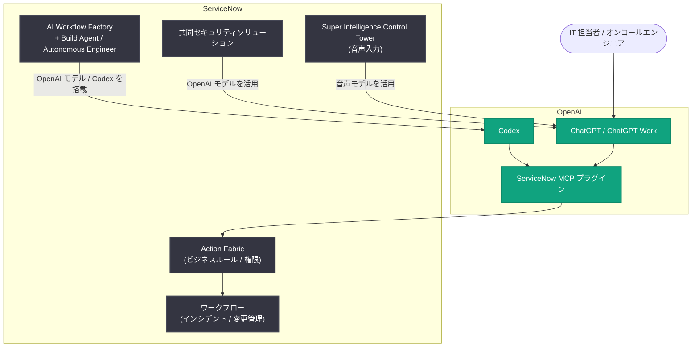

# OpenAI と ServiceNow、エンタープライズワークフロー全体でパートナーシップを拡大

## メタデータ

| 項目 | 内容 |
|------|------|
| 発表日 | 2026-10-28 |
| ソース | OpenAI News |
| カテゴリ | パートナーシップ / 新機能 |
| 公式リンク | https://openai.com/index/openai-servicenow-partnership-expansion/ |

## 概要

OpenAI と ServiceNow は、2026 年 1 月に発表した提携を拡大し、双方向の統合を進めることを発表した。具体的には、OpenAI のモデルとエージェントを ServiceNow 製品群に組み込むとともに、ServiceNow のワークフローを ChatGPT と Codex から直接利用できるようにする。

この提携拡大により、IT 運用、アプリ開発、サイバーセキュリティ、音声インターフェースといった幅広いエンタープライズ業務領域で、AI を活用したワークフローの自動化と効率化が可能になる。両社は自社内でも相互の製品を本格展開し、実運用に基づく改善を進める方針を示している。

## 主な内容

### ChatGPT から ServiceNow ワークフローを直接操作

新しい統合により、ChatGPT 内で業務コンテキストとワークフローアクションを直接利用できるようになる。

- **インシデント対応**: IT 担当者は類似インシデントの検索、変更リスクの評価、レコードの更新を ChatGPT 内で完結できる
- **権限とガバナンス**: 「Action Fabric」が既存のビジネスルールと権限を適用し、組織ごとの設定を反映した安全な操作を実現する
- **対話型オンコール体験**: オンコールエンジニアがアラートの確認からチームへの割り当てまでを ChatGPT 内の対話で対応できる体験もプレビュー中

ServiceNow MCP プラグインは OpenAI のマーケットプレイスですでに提供されており、2026 年末まで継続的に機能強化が行われる。

### ServiceNow 製品への OpenAI 技術の統合

ServiceNow 製品側には、3 つの分野で OpenAI の技術が統合される。

- **アプリ開発**: AI Workflow Factory への Codex 統合に加え、Build Agent と Autonomous Engineer に OpenAI のモデルを搭載
- **サイバーセキュリティ**: 脆弱性調査、リスクの優先順位付け、修復調整を支援する共同セキュリティソリューションを提供
- **音声**: Super Intelligence Control Tower において、音声による AI ユースケースの記述や評価項目の入力を支援

### 両社での社内展開

ServiceNow は、エンジニア組織を超えて全従業員に ChatGPT Work と Codex へのアクセスを提供する予定である。一方、OpenAI 側も ServiceNow のワークフローを自社の運用に活用し、双方が実際のユーザーとして製品を磨き込む体制をとる。

## 技術的な詳細

### 提供時期

| 機能 | 提供時期 |
|------|---------|
| ServiceNow MCP プラグイン (OpenAI マーケットプレイス) | 提供中 (機能強化は 2026 年末まで継続) |
| 音声機能 (Super Intelligence Control Tower) | 2027 年第 1 四半期 |
| セキュリティ機能 | 2027 年 1 月に早期アクセス、第 2 四半期に一般提供 |
| AI Workflow Factory の Codex 統合 | 2027 年 |

### 統合の仕組み

ChatGPT と ServiceNow の連携は MCP (Model Context Protocol) プラグインを介して行われ、Action Fabric が ServiceNow 側のビジネスルールと権限モデルを適用する。これにより、AI エージェントが実行するアクションも既存のガバナンス設定の範囲内に収まる。

## アーキテクチャ

## 開発者への影響

- **IT 運用の効率化**: インシデント検索、リスク評価、レコード更新などを ChatGPT 内で完結でき、ツール間の切り替えコストが削減される
- **MCP エコシステムの拡大**: ServiceNow MCP プラグインがマーケットプレイスで提供されることで、MCP を軸としたエンタープライズ統合のリファレンスが増える
- **アプリ開発の自動化**: AI Workflow Factory への Codex 統合により、ServiceNow プラットフォーム上の開発作業で AI コーディング支援が利用可能になる
- **セキュリティ運用の強化**: 脆弱性調査から修復調整までを AI が支援する共同ソリューションにより、セキュリティチームの対応速度向上が期待される
- **ガバナンスの担保**: Action Fabric により既存の権限設定が AI 操作にも適用されるため、統制を維持したまま AI を導入できる

## 関連リンク

- [公式発表: OpenAI and ServiceNow expand partnership across enterprise workflows](https://openai.com/index/openai-servicenow-partnership-expansion/)
- [OpenAI News](https://openai.com/news)
- [OpenAI 公式ドキュメント](https://platform.openai.com/docs)

## まとめ

OpenAI と ServiceNow の提携拡大は、ChatGPT・Codex と ServiceNow ワークフローの双方向統合という形で、エンタープライズ AI の実用段階を一歩進めるものである。MCP プラグインによる連携と Action Fabric によるガバナンス適用により、権限管理を維持したまま AI エージェントが業務アクションを実行できる点が特徴だ。提供は段階的で、MCP プラグインは提供中、セキュリティ機能は 2027 年初頭、音声機能と Codex 統合は 2027 年中の展開が予定されている。
