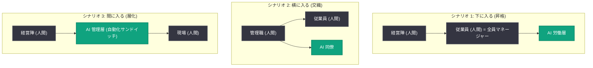

# The future of the firm: AI は組織図のどこに組み込まれるのか

## メタデータ

| 項目 | 内容 |
|------|------|
| 発表日 | 2026-10-28 |
| ソース | OpenAI News |
| カテゴリ | 考察記事 (Intelligence Age シリーズ) |
| 公式リンク | https://openai.com/index/the-future-of-the-firm/ |

## 概要

OpenAI の「次の経済」シリーズ第 2 弾となるエッセイ「The future of the firm」が公開された。24 歳で OpenAI のチーム管理を始めた 2 人の著者が、"Management has instead come down to our rung" (管理が自分たちの階層まで降りてきた) という実体験を起点に、AI が企業の組織図にどのように組み込まれていくかを 3 つのシナリオで考察している (本記事は著者の個人的見解であり、OpenAI の公式見解ではない)。

記事の中心的な主張は、完全自動化された「AI 企業」への一足飛びの移行ではなく、AI が既存組織に織り込まれる「ハイブリッド企業」の移行期こそが重要だという点にある。経済的 AGI の基準は個人の能力ではなく、組織としての人間の調整能力 ("people, not person") に達することだと著者らは論じている。

## 主な内容

### シナリオ 1: 下に入る (Beneath us) - 「昇格」シナリオ

人間は現在の席を保ったまま、その下に AI の労働層が形成されるシナリオ。

- **全員がマネージャーに**: 各従業員が AI エージェント群を管理し、最終的には各自が小さな「AI 企業」の取締役のような存在になる
- **レイオフを伴わない自動化**: 過去の自分の仕事を自動化し、より大きな責任範囲へ移行していく
- **キャリアパスへの影響**: 新入社員にとって組織の最下層が消滅し、徒弟制度的な学習経路は失われる一方、若手でもすぐに大きな裁量を持てるようになる

### シナリオ 2: 横に入る (Beside us) - 「交織」シナリオ

AI が同僚として既存の管理職の直属に加わるシナリオ。

- **鍵となる非対称性**: 範囲の広い AI は構築が難しいが、"bigger scope is easier to adopt" (広い範囲を担う AI ほど採用は容易) という逆転が起こる
- **適応の方向が逆転**: 従来の技術は企業側が使い方を学習する必要があったが、優れた労働力としての AI は自ら組織に適応する

### シナリオ 3: 間に入る (Between us) - 「層化」シナリオ

人間・AI・人間という「自動化サンドイッチ」構造が生まれるシナリオ。

- **常時監視する AI コンサルタント**: AI が組織全体を常時監視し、経営陣に問題を能動的に報告する
- **管理職が先に自動化される可能性**: 管理職の仕事は認知労働中心のため、現場業務より先に自動化される可能性がある
- **中央集権化の効果**: 中間層が AI に置き換わることで、経営陣と現場の距離が縮まる

### 組織構造の変化 (3 つのシナリオ)

## 記事が提起する 4 つの問い

### 1. 官僚的手続きはどうなるか

構築コストの低下により、組織は「狙いを減らし、撃つ回数を増やす」方向へ向かう。承認プロセスや調整業務を担っていた中間管理層が減る可能性がある。

### 2. 労働者の裁量は増えるか減るか

AI による監視は両刃の剣だが、著者らは正味で労働者の自律性が増すと予測している。優れた AI の助言を得た個人は、より大きな判断を任されるようになる。

### 3. 企業規模はどう変わるか

小規模企業の増加と、共通資産 (工場・ロボット群など) を保有する大型「AI 持株会社」の併存を予想している。

### 4. 賃金格差は縮小するか拡大するか

全員が優れた AI の助言を得られれば格差は縮小する一方、判断力・センス・管理範囲の差が大きな報酬差を生む可能性もあり、両方向の力が働く。

## ビジネス・開発者への影響

- **影響 1**: 若手人材の育成モデルの再設計が必要になる。最下層の定型業務が消えることで、徒弟制度的な OJT に代わる学習経路の整備が課題となる
- **影響 2**: AI エージェントを「ツール」ではなく「労働力」として組織図に位置付ける視点が求められる。範囲の広いエージェントほど組織への適応コストが低いという非対称性は、エージェント製品の設計指針になる
- **影響 3**: 中間管理層の役割が変化する。調整・報告・監視といった認知労働は AI に移り、人間には判断・センス・責任の引き受けが残る

## 関連リンク

- [The future of the firm (OpenAI 公式)](https://openai.com/index/the-future-of-the-firm/)
- [OpenAI News](https://openai.com/news)

## まとめ

本エッセイは、AI による企業変革を「完全自動化」の一点で捉えるのではなく、AI が組織図の「下」「横」「間」のどこに入るかという 3 つのシナリオで整理した考察記事である。著者らは移行期の「ハイブリッド企業」に注目し、経済的 AGI の真の基準は個人の知能 ("person") ではなく、組織として人間が発揮してきた調整能力 ("people") に AI が到達することだと結論付けている。管理という仕事が組織の下層へ降りてくる変化は既に始まっており、企業・労働者の双方にキャリアと組織設計の再考を迫る内容となっている。
