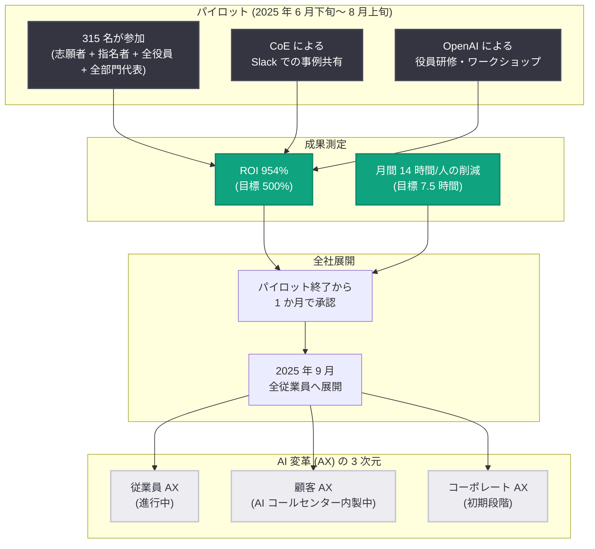

# クレディセゾン、ChatGPT Enterprise パイロットで 954% の ROI を達成

## メタデータ

| 項目 | 内容 |
|------|------|
| 発表日 | 2026-10-29 |
| ソース | OpenAI News |
| カテゴリ | 導入事例 |
| 公式リンク | https://openai.com/index/credit-saison |

## 概要

クレジットカード事業を中核に、ファイナンス事業や国際事業を展開するクレディセゾン (カード会員数約 3,116 万人、国内従業員数約 3,700 名) が、ChatGPT Enterprise のパイロット導入で 954% の ROI を達成した事例が公開されました。目標としていた 500% を大幅に上回り、従業員 1 人あたり月間 14 時間 (年間約 169 時間相当) の時間削減を実現しています。

パイロットは 2025 年 6 月下旬から 8 月上旬までの約 1 か月強で実施され、全従業員の 10% 弱にあたる 315 名が参加しました。経営層の率先垂範と CoE (Center of Excellence) によるオープンな事例共有が成功の鍵となり、パイロット終了からわずか 1 か月で全社展開が承認され、2025 年 9 月に全従業員への展開が完了しています。

## 主な内容

### 導入の背景

クレディセゾンはジェネラリスト職の従業員が多く、AI が日常業務をどう改善し、具体的な成果を生むかを検証する必要がありました。専務執行役員 CDO 兼 CTO の小野和俊氏は「実際に使ってみないと分からない」(原文: "We won't know until we really put it to work.") という方針を示し、実践を通じた検証を重視しました。

### パイロットの設計

- **期間**: 2025 年 6 月下旬〜 8 月上旬 (約 1 か月強)
- **対象**: 315 名 (全従業員の 10% 弱)
- **構成**: 志願者、プロジェクトチームによる指名者、社長を含む全役員、全部門の代表者

社長を含む全役員が参加した点が特徴的です。小野氏は代表取締役社長執行役員 COO の水野克己氏に率先垂範を促し、「従業員に利用を奨励するだけでは不十分。リーダー自身が日常的に使う必要がある」(原文: "It's not enough to encourage employees to use it. Leaders need to use it regularly themselves.") と述べています。水野氏自身も企業調査用のカスタム GPT を作成し、日常業務に活用しました。

### 成果指標

| 指標 | 結果 | 目標 |
|------|------|------|
| ROI | 954% | 500% |
| 時間削減 (1 人あたり) | 月間 14 時間 (年間約 169 時間相当) | 月 7.5 時間 |

パイロット後の調査では、以下の結果が報告されています。

- 管理職の 75%、非管理職の 70% が「ChatGPT Enterprise なしでは仕事ができない」と回答
- 法務部門の約 80% が業務遂行能力の向上を実感
- IT 部門の 80% 超が仕事の満足度向上を報告
- エンジニアリング領域では Codex により月平均 850 時間の作業を削減

### 主な活用事例

1. **リテール営業**: 店舗実績報告用 GPT が日次ミーティングの音声から各従業員の実績や引継ぎ事項などを自動要約。全拠点で利用中
2. **法人営業**: 企業調査用 GPT で顧客分析を行い、提案品質を向上。従業員自身が認識していなかった課題を発見した事例も
3. **インサイドセールス**: 見込み客ロールプレイ用 GPT により、新人が音声で商談練習とフィードバックを受けられる仕組みを構築

音声モードを使用した株主総会シミュレーション用カスタム GPT は経営幹部の強い関心を集め、音声 AI の社内普及を後押ししました。

## 導入プロセス

導入にあたっては、以下の取り組みが行われました。

- **CoE (Center of Excellence)**: 専用 Slack チャンネルで成功事例と失敗事例をオープンに共有
- **OpenAI による支援**: 役員向け研修と初心者向け実践ワークショップを提供
- **経営層の率先垂範**: 社長を含む全役員がパイロットに参加し、自らカスタム GPT を作成・活用

## 導入展開フロー

## 今後の計画

クレディセゾンは AI 変革 (AX) を 3 つの次元で推進していく計画です。

- **従業員 AX**: 働き方の変革 (現在進行中)
- **顧客 AX**: 顧客体験・UI/UX の改善。AI コールセンターを内製開発中
- **コーポレート AX**: AI を起点とした組織構造・役割の再設計 (初期段階)

小野氏は「従業員 AX で止まるわけにはいかない。この先の挑戦は、コーポレート AX へどこまで進めるかだ」(原文: "We can't stop at Employee AX. The challenge ahead is how far we can progress toward Corporate AX") と述べています。また、ChatGPT Work の導入も検討中であり、顧客情報保護を前提に、セキュリティにはより慎重なアプローチを採用する方針です。「Assistive Intelligence (支援的知能)」というアプローチを全社的な変革へ拡大することを目指しています。

## 企業への示唆

- **経営層の率先垂範が普及を加速**: 社長を含む全役員がパイロットに参加し、自らカスタム GPT を活用したことが全社的な利用文化の醸成につながった
- **明確な目標設定と測定**: ROI 500%、月 7.5 時間の削減という定量目標を事前に設定し、成果を測定したことで迅速な全社展開の意思決定が可能になった
- **オープンな事例共有**: CoE が Slack で成功事例だけでなく失敗事例も共有したことが、組織全体の学習を促進した
- **音声モードやカスタム GPT の活用**: 株主総会シミュレーションや商談ロールプレイなど、業務に即したカスタム GPT が実用的な価値を生んだ

## 関連リンク

- [Credit Saison achieves 954% ROI in a ChatGPT Enterprise pilot (OpenAI 公式)](https://openai.com/index/credit-saison)
- [ChatGPT Enterprise](https://openai.com/chatgpt/enterprise/)
- [OpenAI News](https://openai.com/news)

## まとめ

クレディセゾンによる ChatGPT Enterprise パイロットは、目標 500% を大きく上回る 954% の ROI と、1 人あたり月間 14 時間の時間削減を達成しました。経営層の率先垂範、CoE によるオープンな事例共有、OpenAI による研修支援が成功要因となり、パイロット終了からわずか 1 か月で全社展開が承認され、2025 年 9 月に全従業員への展開が完了しました。今後は従業員 AX にとどまらず、顧客 AX、コーポレート AX へと AI 変革を拡大していく計画です。
