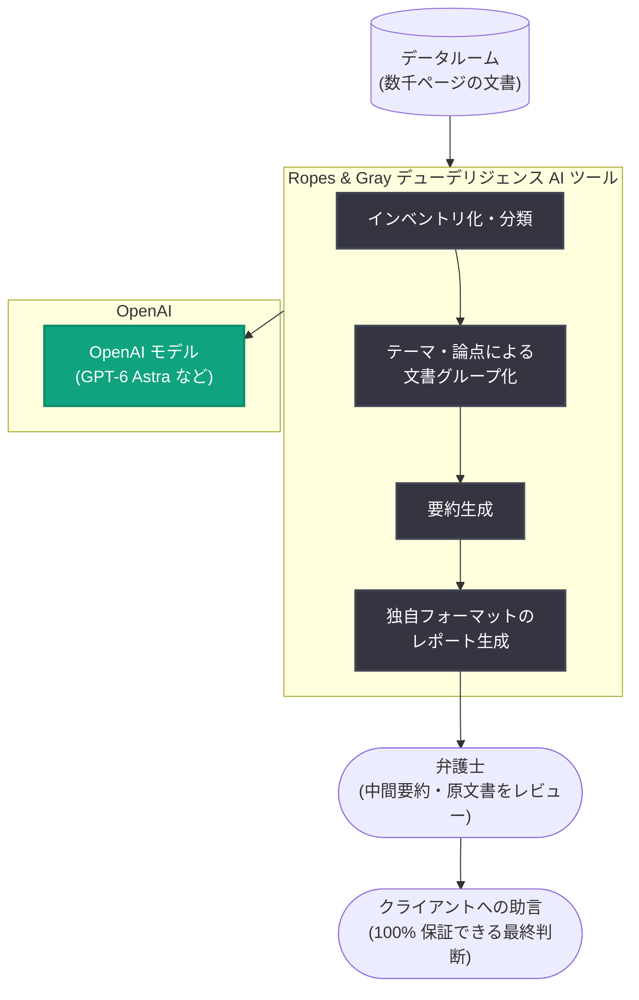

# Ropes & Gray: OpenAI と共同で取引デューデリジェンス AI ツールを開発

## メタデータ

| 項目 | 内容 |
|------|------|
| 発表日 | 2026-10-29 |
| ソース | OpenAI News |
| カテゴリ | 導入事例 (法律事務所) |
| 公式リンク | https://openai.com/index/ropes-gray-ai-diligence |

## 概要

大手法律事務所の Ropes & Gray (パートナー 340 名、弁護士 1,500 名) は、OpenAI とのパートナーシップのもと、取引デューデリジェンス (transactional diligence) 向けの独自 AI ツールを開発している。買収前のデューデリジェンスでは、弁護士チームが厳しい期限のなかで膨大な文書を精査する必要があるが、この AI ツールが「ファーストパス (一次レビュー)」を担うことで、弁護士はレビューと判断というより高付加価値な業務に集中できるようになる。

ツールはデータルームの文書をインベントリ化・分類し、テーマや論点ごとに関連文書をグループ化したうえで、要約と Ropes & Gray 独自フォーマットのレポートを自動生成する。弁護士は中間要約と原文書を必ずレビューしてからクライアントに助言を提供する設計となっており、「AI による一次処理 + 弁護士による最終判断」という法務 AI の実践的な分業モデルを示す事例である。

## 主な内容

### 商業契約デューデリジェンスのファーストパスを構築

買収を確定する前に、買い手は売り手の財務・法務上の主張を検証する徹底的な調査を行う必要がある。このデューデリジェンスではリスクと負債を洗い出すためにデータ集約的なリサーチが求められ、通常は弁護士チーム全体が関与し、短期間での入札準備には数日の集中的な作業を要する。

Practice AI 責任者でパートナーの Howard Glazer 氏は次のように語っている。

> 「このツールのおかげで、当事務所のすべての弁護士が本来やるべき仕事に取り組めるようになっています。クライアントは契約をレビューするために私たちに報酬を払っているのではありません。契約の内容に基づいて判断を下すために払っているのです」

ツールの主な機能は以下のとおり。

- **一次レビューの自動化**: 数千ページの文書を精査し、関連文書を特定してテーマ・論点ごとに自動グループ化
- **データルームの構造化**: データルーム全体をインベントリ化・分類し、個別文書ではなく関係性全体をレビュー可能に
- **レポート生成**: リサーチ結果に加え、要約と Ropes & Gray 独自フォーマットの完成レポートを出力
- **検証可能性**: 弁護士がグループ化や分類を検査し、漏れがないことを確認できる

### 人間のレポートと比較しながら改善

初期の開発は重要な商業契約 (material commercial contracts) に焦点を当てている。ワーキングセッションでは、弁護士がツールのテスト出力を完了済み案件の人間作成デューデリジェンスレポートと比較し、ドラフトの成功点と不足点に基づいて評価基準 (ルーブリック) とレポートフォーマットを改善した。

ツールは、一次レビューから要約、上位レビューまで、チームが実際に踏む手順を忠実に再現する一貫したクエリとフレームワークで設計されている。その品質は「有能なジュニアからミッドレベルのアソシエイト」の仕事に匹敵するとされ、プロセスのファーストパスとして一貫して高品質な成果物を提供する。

### 弁護士によるレビューを前提とした設計

ERISA Fiduciary プラクティス責任者でパートナーの Josh Lichtenstein 氏は、人間による検証の重要性を強調している。

> 「弁護士は依然としてすべてをレビューする必要があります。クライアントに提供するものはすべて、100% の自信を持って保証できなければならないからです。だからこそ、このツールは弁護士が中間要約と実際の文書を容易にレビューできるように設計されています」

一次レビューをツールに任せることで、弁護士はレビューと推敲により多くの時間を割けるようになり、最終的な判断の質が向上する。同氏は AI について「品質と一貫性を維持しながらより速いペースで動くための鍵となる手段、おそらく唯一の手段」とも述べている。

### 複雑な取引への適用と成果

Ropes & Gray は、詳細な論点レベルのデューデリジェンスレポートを「数週間ではなく数時間で」作成するという目標を公に掲げている。独自のデューデリジェンスツールや GPT-6 Astra などのツールにより、クライアントの課題をこれまでより大幅に速く解決できるようになったとしている。

**成果の概要:**

| 項目 | 内容 |
|------|------|
| データルーム処理 | インベントリ化・分類し、テーマ・論点で関連文書をグループ化 |
| 成果物 | 要約と Ropes & Gray フォーマットのレポートを自動生成 |
| 品質保証 | 弁護士が中間要約と原文書をレビューしてからクライアントに提供 |
| 改善プロセス | ドラフト出力を弁護士作成レポートと比較し、ルーブリックとフォーマットを改善 |
| 目標 | 論点レベルの詳細レポートを数週間から数時間へ短縮 |

### リーダーシップの教訓

Lichtenstein 氏と Glazer 氏は、AI 活用の経験から 2 つの教訓を共有している。

- **あらゆることに AI を使って実験する**: Lichtenstein 氏は靴探しから子ども向けゲームのバイブコーディングまで生活のあらゆる場面で AI を使用。「最も学びが大きいのはうまくいったときではなく、ミスを見つけて対処法を考えるとき。そこで遊び道具から本当に強力なプロフェッショナルツールに変わった」と語る
- **クライアントを第一に考える**: Glazer 氏は「どうすればクライアントの利益のために使えるかに集中している。それができれば、すべてうまくいく」と述べ、技術ではなくクライアント価値を起点に AI ツールとワークフローを設計する姿勢を強調

## 技術的な詳細

本事例は導入事例のため API レベルの詳細は公開されていないが、記事からは以下の構成が読み取れる。

- **利用製品**: ChatGPT (企業向け)。モデルとしては GPT-6 Astra への言及がある
- **ワークフロー設計**: 弁護士チームの実際の手順 (一次レビュー → 要約 → 上位レビュー) を再現する一貫したクエリとフレームワーク
- **評価手法**: 完了案件の人間作成レポートを正解データとして、ルーブリックベースでツール出力を評価・改善

## アーキテクチャ

## 開発者への影響

- **「ファーストパス + 人間レビュー」モデルの実例**: 高リスク領域で AI を導入する際の実践的なパターンとして、AI が一次処理を行い、人間が中間成果物と原データを検証できる設計が参考になる
- **既存ワークフローの忠実な再現**: 専門家チームの実際の手順をクエリとフレームワークに落とし込むアプローチは、ドメイン特化 AI ツールの設計手法として有効
- **人間の成果物を基準とした評価**: 過去の完了案件の人間作成レポートと比較してルーブリックを改善するという評価ループは、LLM アプリケーションの品質改善手法として応用可能
- **文書の関係性レビュー**: 個別文書ではなくデータルーム全体を構造化して「関係性全体」をレビューする設計は、大規模文書処理システムの設計指針となる

## 関連リンク

- [How Ropes & Gray is developing AI for transactional diligence (OpenAI 公式)](https://openai.com/index/ropes-gray-ai-diligence)
- [OpenAI News](https://openai.com/news)
- [ChatGPT for Work](https://openai.com/business/)
- [関連事例: Sullivan & Cromwell brings legal expertise into agreement review](https://openai.com/index/sullivan-cromwell/)

## まとめ

Ropes & Gray は OpenAI とのパートナーシップのもと、取引デューデリジェンスの一次レビューを担う独自 AI ツールを開発した。ツールはデータルームの文書をテーマ・論点ごとに分類・グループ化し、要約と事務所独自フォーマットのレポートを生成する。品質は有能なジュニアからミッドレベルのアソシエイト相当とされ、弁護士が中間要約と原文書を必ずレビューする設計により、クライアントへの助言品質を担保している。同事務所は論点レベルの詳細レポート作成を数週間から数時間に短縮することを目指しており、今後は 1,500 名の弁護士が持つ知識を結集する「集合知」の構築にも AI を活用していく構想である。
