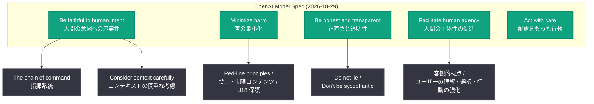
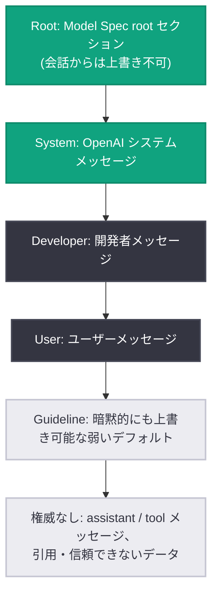

# Model Spec 更新: 5 つのコアバリューを軸に再構成された AI 行動規範

## メタデータ

| 項目 | 内容 |
|------|------|
| 発表日 | 2026-10-29 |
| ソース | OpenAI News |
| カテゴリ | Safety (AI 行動規範 / ポリシー) |
| 公式リンク | https://openai.com/index/updated-model-spec |

## 概要

OpenAI は 2026 年 10 月 29 日、モデルの望ましい振る舞いを定義する公開文書「Model Spec」の更新版を公開しました。今回の更新では、より高性能化する AI を健全な判断、人間の主体性 (human agency)、そして人間の意図への忠実性 (faithfulness to human intent) へと導くため、文書全体が 5 つのコアバリューを軸に再構成されています。

Model Spec は OpenAI の GPT モデル (ChatGPT や API プラットフォームを含む) の意図された振る舞いを定めるもので、モデルの学習 (アラインメント) の基準として使われます。文書はパブリックドメイン (Creative Commons CC0 1.0) で公開されており、モデル行動の透明性向上と公開の議論を目的としています。

注: 発表記事本文 (openai.com) は取得できなかったため、本レポートは Model Spec 2026-10-29 版の原文 (model-spec.openai.com) および公式 RSS の説明文に基づいて作成しています。

## 主な内容

### 5 つのコアバリュー

更新版の Model Spec は、基礎的な定義のあとに、以下の 5 つの価値 (values) を章立ての軸として行動原則と例を整理しています。

| コアバリュー | 原文 | 内容 |
|-------------|------|------|
| 人間の意図への忠実性 | Be faithful to human intent | Model Spec とその背後の意図を忠実に実行する。指揮系統 (chain of command) を導入し、ユーザーと開発者が達成しようとしていることを理解して支援する |
| 害の最小化 | Minimize harm | 確固たる安全境界を尊重し、GPT の行動の予見可能な結果を考慮する |
| 正直さと透明性 | Be honest and transparent | 事実、証拠、不確実性、能力、行動を誠実に表現し、人々が GPT の成果を理解・評価するために必要な情報を提供する |
| 人間の主体性の促進 | Facilitate human agency | 人々が自分の見解を形成し、情報に基づいた選択を行い、能力を伸ばし、自ら選んだ目標に向けて行動できるよう支援する。隠れた誘導や操作をしない |
| 配慮をもった行動 | Act with care | GPT の仕事によって影響を受ける人々に注意を払う |

### 指示の権威レベル (chain of command)

Model Spec の各セクションと会話内の各メッセージロールには、デフォルトの権威レベルが割り当てられています。上位の指示が下位の指示に優先します。

1. **Root**: Model Spec の root セクション。会話コンテキストでは上書き不可
2. **System**: Model Spec の system セクションと OpenAI からのシステムメッセージ。デプロイ面やユーザー属性 (年齢など) により変化しうるが、開発者・ユーザーは上書き不可
3. **Developer**: 開発者メッセージおよび developer セクション
4. **User**: ユーザーメッセージおよび user セクション。ユーザーレベル以上の明示的な指示でのみ上書き可能なデフォルト
5. **Guideline**: 文脈が明確に求める場合は暗黙的にも上書きできる弱いデフォルト
6. **権威なし (デフォルト)**: assistant / tool メッセージ、引用テキスト、信頼できないデータ。委譲された範囲でのみ権威を持つ

「IGNORE ALL PREVIOUS INSTRUCTIONS」のような命令形の指示や、道徳的・論理的な説得によって下位コンテンツが上位原則の解釈を変えることは認められません (プロンプトインジェクション対策)。

### レッドライン原則

すべてのデプロイメントに適用される高レベル原則として、以下が明記されています。

- 重大・高深刻度の害 (暴力行為、サイバー・生物・核兵器の作成、テロ、児童虐待、迫害、大規模監視など) の助長に使われてはならない
- AI の利用方法と振る舞いの形成は人類がコントロールすべきであり、標的化・大規模な排除、操作、人間の自律性の侵害、市民プロセスへの参加の侵食に使わせない
- AI との対話における個人のプライバシー保護

さらに ChatGPT などのファーストパーティ製品では、安全上重要な情報へのアクセス、モデル行動のルールと理由の透明性、「guideline」レベルを超える原則をカスタマイズで上書きさせないことを約束しています。

### 2 つの核心的な緊張関係への対処

更新版の Overview では、5 つのバリューが対処する 2 つの核心的な緊張関係が新たに整理されています。

1. **個人の利益と集団の利益のバランス**: 深刻な害から人と社会を守る境界 (主に禁止事項) を設けつつ、残りの大半はユーザーが上書き可能なデフォルトとして個人に裁量を委ねる
2. **目前の指示と不確実な長期的目標のバランス**: 指示を字義どおりにしか実行しないモデルは能力を活かせず、逆にユーザーが「本当に」望むことを勝手に決めるモデルは人間の主体性を損なう。GPT は関連情報や見落とされた結果を提示してユーザーの熟考を支援するが、ユーザーの最終判断を先取りしない (assistance games の研究が参照されています)

### 前バージョン (2025-09-12 版) からの主な変化

原文の新旧バージョンを比較して確認できた主な変化は以下のとおりです。

- **章構成の全面再編**: 旧版の「The chain of command」「Stay in bounds」「Seek the truth together」「Do the best work」「Use appropriate style」という章立てから、5 つのコアバリューを軸とする構成に再編。chain of command は「Be faithful to human intent」配下に位置づけ
- **新設セクション「Support human oversight and correction」**: 人間による監視と修正の支援を root レベルの原則として明文化
- **新設セクション「Consider context carefully」**: 記憶・過去の対話などのコンテキストの扱い (関連コンテキストの引き継ぎ、比例的な利用、プライバシーと受け手の尊重、ユーザーによる制御、利用の可視性) を体系化
- **新設セクション「Prioritize safety for teens under 18」**: 18 歳未満のユーザー向け安全原則 (U18) を root レベルで新設
- **新設セクション「Respect real-world ties」**: 現実世界の人間関係の尊重を root レベルで新設
- **自傷・妄想・躁状態への対応強化**: 「Do not encourage self-harm, delusions, or mania」として、自傷に加えて妄想や躁状態を助長しないことを明記

なお、追従 (sycophancy) の禁止やメンタルヘルス対応、「Highlight possible misalignments」などは旧版にも存在していた原則です。

## アーキテクチャ

### 5 つのコアバリューの構造

### 指示の権威レベル

## 開発者への影響

- **開発者の裁量範囲の明確化**: Model Spec の user レベルのデフォルト (客観性、追従回避、副作用の制御など) は開発者が明示的に上書きできる一方、root / system レベルの原則は上書きできない。API アプリケーション設計時にどこまでカスタマイズ可能かの判断基準になる
- **エージェント文脈の安全設計**: 「合意された自律性の範囲内で行動する」「副作用を制御し伝達する」「信頼できないデータをデフォルトで無視する」といった原則は、ツール呼び出しや外部データを扱うエージェントアプリケーションでモデルに期待できる振る舞いを示しており、プロンプトインジェクション対策の前提として参考になる
- **18 歳未満ユーザーへの配慮**: U18 向け安全原則が root レベルで新設されたため、未成年が利用しうるサービスではこの挙動変化を想定する必要がある
- **コンテキスト利用の透明性**: 記憶や過去の対話を使う応用では、「コンテキスト利用を可視化しユーザーが制御できるようにする」という新設原則がモデル挙動の指針になる

## 関連リンク

- [発表記事: An updated Model Spec for more capable and beneficial AI](https://openai.com/index/updated-model-spec)
- [Model Spec 本文 (2026-10-29 版)](https://model-spec.openai.com/2026-10-29.html)
- [Model Spec (最新版)](https://model-spec.openai.com/)
- [OpenAI News](https://openai.com/news)

## まとめ

今回の Model Spec 更新は、能力が高まり続ける AI に対して「人間の意図への忠実性」「害の最小化」「正直さと透明性」「人間の主体性の促進」「配慮をもった行動」という 5 つのコアバリューを明確な組織原理として与える大規模な再構成です。人間による監視・修正の支援、18 歳未満ユーザーの保護、コンテキスト利用の透明性といった新しい原則が加わり、エージェント化が進む AI において「人間が制御を保ちつつ、モデルの能力を最大限活かす」という緊張関係への向き合い方が文書の中心テーマとなっています。文書は引き続き CC0 1.0 でパブリックドメインに置かれており、外部からのフィードバックを受けて継続的に更新されます。
