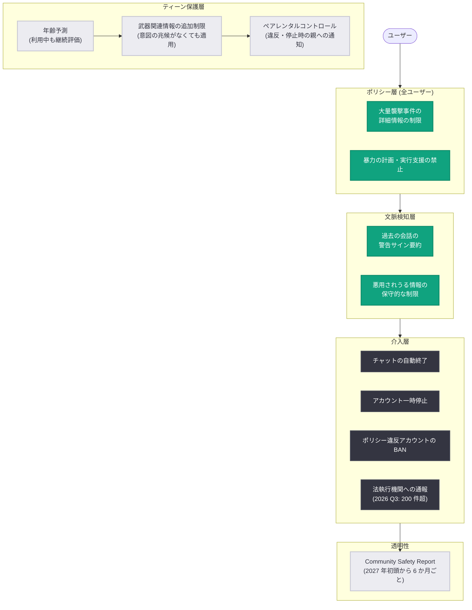

# Community Safety Report の定期公開とティーン向け新保護策: ChatGPT の暴力防止策を強化

## メタデータ

| 項目 | 内容 |
|------|------|
| 発表日 | 2026-10-30 |
| ソース | OpenAI News |
| カテゴリ | 安全性 / ポリシー / ティーン保護 |
| 公式リンク | https://openai.com/index/community-safety-report-and-new-protections-for-teens |

## 概要

OpenAI は 2026 年 10 月 30 日、ChatGPT における暴力防止策の強化として 2 つの発表を行った。1 つ目は、暴力防止をはじめとするコミュニティ安全上の課題と安全対策の有効性をまとめた「Community Safety Report (コミュニティ安全レポート)」の定期公開への新たなコミットメントである。初回レポートは 2026 年後半を対象期間として 2027 年初頭に公開され、以降 6 か月ごとに更新される。2 つ目は、18 歳未満のユーザーに対する銃器・武器関連コンテンツへの追加制限である。

背景として、OpenAI は差し迫った暴力の脅威を法執行機関に通報する取り組みを継続しており、2026 年第 3 四半期には 200 件を超える通報を実施し、実際に暴力的な計画の阻止に貢献したとしている (ブラジルや米国フロリダ州の事例が参照されている)。本発表の安全対策は今後数週間以内に順次展開が開始される。

## 主な内容

### Community Safety Report の定期公開

OpenAI は、危害の検出・審査・脅威エスカレーションのシステムに関する透明性を高めるため、以下の内容を含むレポートの定期公開を約束した。

- システムが安全上の問題をどのように検出・調査・対応するよう訓練されているかの説明
- 暴力関連の危害がどのように現れるかの匿名化された事例と、そこから得られた学び
- 新たな緩和策やポリシー変更の紹介
- 裏付けとなる関連データ

**公開スケジュール**: 初回レポートは 2027 年初頭に公開され、2026 年後半を対象期間とする。以降は 6 か月ごとに更新される。

### 全ユーザー向けのポリシー境界の強化

ChatGPT のモデルは従来から、暴力の計画・実行を助ける指示を与えないよう訓練されている。今回、過去の大量襲撃事件とその実行者に関する質問への応答が追加で制限される。他のオンラインソースで入手可能な情報であっても、詳細度を下げて応答する。

| 区分 | 内容 |
|------|------|
| 引き続き可能 | 事件の理解、被害者・コミュニティへの影響の学習、警告サインの認識と暴力防止の学習 |
| 新たに制限 | 過去の大量襲撃の再現につながる情報 (使用された武器・装備の詳細、入手方法を含む)、攻撃者の悪名を増幅しかねない被害規模の詳細な比較 |

これらの制限は、年齢や質問の理由にかかわらず全ユーザーに適用される。

### 警告サインへの早期介入

一見無害なリクエストでも、過去の会話の文脈次第では異なる意味を持ちうるという認識のもと、以下の対応が強化される。

- **会話文脈の活用**: 2026 年 5 月に発表した「以前の警告サインの短い事実ベースの要約を後の会話で活用する仕組み」を拡張し、最近のチャットに暴力の可能性を示す警告サインがある場合、悪用されうる情報の提供をより保守的に制限する
- **自動チャット終了**: 暴力や他者への深刻な危害への執着の兆候がある場合、専門家と連携して設計された早期介入として ChatGPT が自動的にチャットを終了し、パターンを中断する
- **アカウント一時停止**: チャットが複数回終了されたアカウントは一時停止される可能性がある
- **アカウント BAN**: 暴力行為に関する利用ポリシー違反が確認されたアカウントは BAN される

### ティーン向けの追加保護

18 歳未満向けの「ChatGPT for Teens」(2026 年 8 月発表) には年齢に応じた保護策が既に適用されているが、今回さらに武器関連情報の提供が制限される。

- 既存ポリシー (暴力の計画・実行支援の禁止、ティーンの武器入手支援の制限) を拡張し、**暴力的意図の兆候がなくても**、暴力を助長しうる武器やセキュリティシステムに関する実用的情報を制限する
- 18 歳未満と予測されるユーザーには、暴力的意図の兆候がなくても成人より厳格な制限を適用する方向で開発が進められている
- ティーンは引き続き、暴力の防止・デエスカレーション、支援の要請、信頼できる大人とのつながりのために ChatGPT を利用できる

### 年齢予測の強化

昨年開始した年齢予測は、行動パターンなど複数のシグナルからユーザーが 18 歳未満かどうかを推定する仕組みである。今回の強化では、利用中も継続的に新しいシグナルを評価し、適切な場合にティーン向け体験へ移行するようになる。誤って 18 歳未満向け体験に分類された成人は、年齢確認パートナーの Persona を通じて、迅速かつプライバシーに配慮した方法で成人であることを確認できる。

### ペアレンタルコントロールの拡張

親がティーンとアカウントをリンクして安全設定を共同管理できるペアレンタルコントロールには、特別訓練を受けた審査員が深刻な自傷の懸念や摂食障害に関連しうる行動を特定した際の安全アラートが含まれている。これに加えて以下が実施・予定されている。

- **2026 年 7 月に拡張**: ティーンのアカウントが暴力関連の利用ポリシー違反で無効化された場合に親へ通知
- **導入予定**: 暴力に関する繰り返しの会話でアカウントが一時停止された場合の親への通知機能

## アーキテクチャ

今回の発表で強化される多層的な安全対策の全体像は以下のように整理できる。

## ユーザー・開発者への影響

本発表は API の変更ではなく ChatGPT プロダクトの安全ポリシーに関するものだが、以下の影響が想定される。

- **全ユーザー**: 過去の大量襲撃事件の詳細 (武器・装備・入手方法、被害規模の比較など) に関する質問への応答が、年齢や目的にかかわらず制限される。事件の理解や暴力防止の学習は引き続き可能
- **ティーンユーザー**: 暴力的意図の兆候がない場合でも、武器やセキュリティシステムに関する実用的情報が制限される
- **保護者**: 暴力関連のポリシー違反によるアカウント無効化・一時停止時の通知により、ティーンの利用状況をより把握しやすくなる
- **成人ユーザー**: 年齢予測により誤ってティーン向け体験に分類された場合、Persona を通じた年齢確認で解除できる
- **透明性**: Community Safety Report により、OpenAI の安全対策の運用実態と有効性が 6 か月ごとに公開される

## 関連リンク

- [Community safety report and new protections for teens (公式発表)](https://openai.com/index/community-safety-report-and-new-protections-for-teens)
- [OpenAI News](https://openai.com/news)
- [関連レポート: ChatGPT for Teens 発表 (2026-08-18)](2026-08-18-chatgpt-for-teens.md)
- [関連レポート: Teen Safety Blueprint の紹介 (2026-07-16)](2026-07-16-introducing-the-teen-safety-blueprint.md)

## まとめ

- OpenAI は ChatGPT の暴力防止策を強化し、Community Safety Report の定期公開 (初回は 2027 年初頭、以降 6 か月ごと) を新たに約束した
- 2026 年第 3 四半期には 200 件超の法執行機関への通報を実施し、暴力的な計画の阻止に貢献したとしている
- 全ユーザーを対象に、過去の大量襲撃事件とその実行者に関する詳細情報の提供が年齢・目的を問わず制限される
- 警告サインを示すユーザーへの早期介入として、チャットの自動終了やアカウント一時停止の仕組みが導入される
- 18 歳未満のユーザーには、暴力的意図の兆候がなくても武器関連の実用的情報を制限する追加保護が適用され、年齢予測とペアレンタルコントロールも強化される
- これらの安全対策は今後数週間以内に順次展開される
