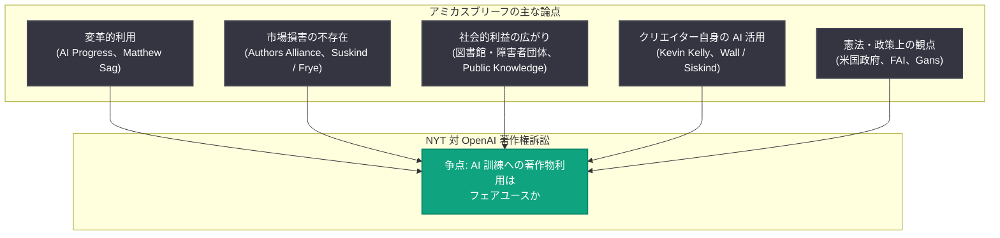

# フェアユースはすべての人に利益をもたらす: 各界からのアミカスブリーフ紹介

## メタデータ

| 項目 | 内容 |
|------|------|
| 発表日 | 2026-10-30 |
| ソース | OpenAI News |
| カテゴリ | Company (法務・ポリシー) |
| 公式リンク | https://openai.com/index/fair-use-benefits-everyone |

## 概要

OpenAI は、ニューヨーク・タイムズ (NYT) が同社を相手に起こした著作権訴訟に関連し、クリエイター、学者、アクセシビリティ擁護団体、法律専門家などがフェアユース (公正利用) を支持して裁判所に提出したアミカスブリーフ (意見書) の抜粋を紹介する記事を公開した。OpenAI は、フェアユースが数十年にわたりイノベーションを支え、医学・科学の進歩や新技術を生み、著者やジャーナリストを含む多くの人々に利益をもたらしてきたと主張している。

一方で NYT の訴訟については、半世紀にわたる法的発展を無視し、フェアユースの原則を捨てさせようとする金銭目当ての狭い追求だと批判している。記事中の引用はいずれも提出書面からの抜粋であり、全文は公開裁判記録で閲覧可能とされている。

## 主な内容

### 記事の背景

本記事は NYT 対 OpenAI の著作権訴訟を背景としている。OpenAI の立場は以下のとおり。

- フェアユースは数十年にわたりイノベーションを支え、医学・科学の進歩や新技術の創出に貢献してきた
- その利益は著者やジャーナリストを含む幅広い人々に及んでいる
- NYT の訴訟はフェアユースに関する半世紀の法的発展を無視するものである

### 意見書提出者と論点の一覧

| 提出者 | 立場・属性 | 主な論点 |
|--------|-----------|---------|
| AI Progress | 団体 | AI 訓練は著作物を根本的に異なる目的で利用し、作品への代替的アクセスを提供せず市場損害も生じない。確立したフェアユース原則により生成 AI の訓練はフェアユース |
| 米国視覚障害者協議会、研究図書館協会、米国図書館協会、消費者技術協会、ビジネスソフトウェア・アライアンス | 団体 (共同提出) | 本訴訟の影響は LLM 開発企業にとどまらず、医療研究者、教育者、障害者、農家、独立クリエイター、幅広い業界に及ぶ。フェアユース訓練の制限は AI を構築する機関と利用する人々の双方に影響する |
| Authors Alliance | 著者団体 | 「市場希釈 (market dilution)」理論は著作権法がこれまで制限したことのない経済現象からの保護を求めるもの。市場希釈は 17 U.S.C. § 107(4) の下で認められる市場損害ではない |
| Engine and Developers Alliance | 開発者団体 | 基盤モデル訓練の目的は学習した作品の複製ではなく、他者が新しい用途に適応できる汎用ツールの構築。スタートアップの用途は訓練データ内の作品の目的とは全く似ていない |
| Foundation for American Innovation | シンクタンク | AI 訓練が新しい知識・表現・ソフトウェア等の創出を可能にする利益は第 4 要素の評価に関わる。新しい分析やソフトウェアを可能にする能力の国家安全保障上の価値も考慮すべき |
| Joshua S. Gans | 戦略経営学教授 | 著作権はコンテンツ創作のインセンティブに加え、そのコンテンツから学習するツールを構築するインセンティブも支える。売上減少すべてを侵害とみなすルールは後者を弱めうる |
| Kevin Kelly | 作家 | 各 AI モデルは著者に新しいテキストやアイデアを生み出す能力を与える「全く新しいメディア」。原告勝訴の判決は議会が意図した限定的独占をはるかに超える権利を与え、創造性・革新・知識の普及を窒息させる |
| Matthew Sag | 法学教授 | 被告による AI 訓練利用は高度に変革的であり、現実的条件下でモデルの出力は訓練過程で作られる不可視の中間コピーといかなる点でも類似していない |
| Michael Wall、Sarah Rose Siskind | ミュージシャン兼作曲家、コメディアン兼ライター | 著作権保護と AI ツールの両方に依拠する独立クリエイター。AI は創造性を置き換えるのではなく、より多くの創作と新しい表現への拡張を助ける |
| Public Knowledge | 公益団体 | フェアユースが保護してきたツール (画像・書籍検索、アクセシブルなデジタル書籍、技術標準の無料公開) の判例を列挙。フェアユースは AI の利益が広く公衆に行き渡ることを保証する |
| Ron Suskind、Brian L. Frye | ピュリッツァー賞受賞ジャーナリスト、法学教授 | AI 訓練利用は報道機関原告の合理的な商業的期待を一切害していない。原告は記事の独占的販売権を今も保持・行使している |
| 米国政府 | 政府 | NYT の主張は基本的な著作権法原則と矛盾し、合衆国憲法第 1 条第 8 節第 8 項が掲げる科学と有用な技芸の進歩を著しく妨げる。LLM の制約は米国の繁栄と経済的流動性を妨げる |

### 注目される個別の主張

**独立クリエイターの実体験**: コメディアン兼ライターの Sarah Rose Siskind は、日常の管理業務からアイデア開発、新規顧客獲得まで AI を活用しており、「I don't think I could run my business without AI at this point.」(現時点で AI なしに事業は運営できないと思う) と述べている。ミュージシャンの Michael Wall も、音楽事業の運営負担管理やコスト削減に AI を使うことで作曲により多くの時間を充てており、AI なしでは現在の形で事業が存続できるか疑わしいとしている。両者の経験は、AI ツールが大手と独立系の間の競争条件を平準化するのに役立つべきという米国政府の見解を裏付けるものとされる。

**Public Knowledge が挙げたフェアユースの判例**:

- 画像検索・書籍全文検索: *Perfect 10, Inc. v. Amazon.com, Inc.* (第 9 巡回区、2007 年)、*Authors Guild v. Google* (Google Books 判決、第 2 巡回区、2015 年)
- 読書に障害がある読者向けのアクセシブルなデジタル書籍提供: *Authors Guild, Inc. v. HathiTrust* (第 2 巡回区、2014 年)
- 法律に組み込まれた技術標準の無料オンライン公開: *Am. Soc'y for Testing & Materials v. Public.Resource.Org* (D.C. 巡回区、2023 年)

### 論点の構造

## 開発者への影響

本件は法的・政策的な発表であり、API やモデルへの直接的な変更はないが、AI を利用・構築する開発者にとって以下の点で重要である。

- **訓練データの法的位置づけ**: 本訴訟の帰結は、著作物を用いた AI モデル訓練がフェアユースと認められるかという、基盤モデル開発全体に関わる法的枠組みに影響しうる
- **オープンソース AI への波及**: 図書館・障害者団体等の共同意見書が指摘するとおり、多くの開発者や機関はオープンソース AI など他者のシステムに依存しており、フェアユース訓練の制限は AI を構築する側と利用する側の双方に影響するとされる
- **スタートアップへの影響**: Engine and Developers Alliance の意見書は、スタートアップが基盤モデルを新しい用途に適応させて活用している実態を示しており、訓練の適法性はこうしたエコシステム全体の前提となっている
- **「市場希釈」理論の行方**: Authors Alliance が批判する市場希釈理論が認められるか否かは、生成 AI の出力が既存作品と市場で競合すること自体を侵害と扱うかどうかという、今後の AI 開発に広く関わる論点である

## 関連リンク

- [Fair use benefits everyone (OpenAI 公式)](https://openai.com/index/fair-use-benefits-everyone)
- [OpenAI の NYT 訴訟関連ページ](https://openai.com/new-york-times/)
- [OpenAI News](https://openai.com/news)

## まとめ

OpenAI は、NYT 著作権訴訟に関連して各界から提出されたフェアユース支持のアミカスブリーフの抜粋を公開した。提出者は AI 関連団体にとどまらず、図書館・視覚障害者・消費者技術の各団体、著者団体、経済学者・法学者、作家、独立クリエイター、公益団体、そして米国政府にまで及ぶ。論点は、AI 訓練の変革的性質、市場損害の不存在、社会的利益の広がり、クリエイター自身による AI 活用、憲法・政策上の観点など多岐にわたる。各意見書の全文は公開裁判記録で閲覧可能である。
